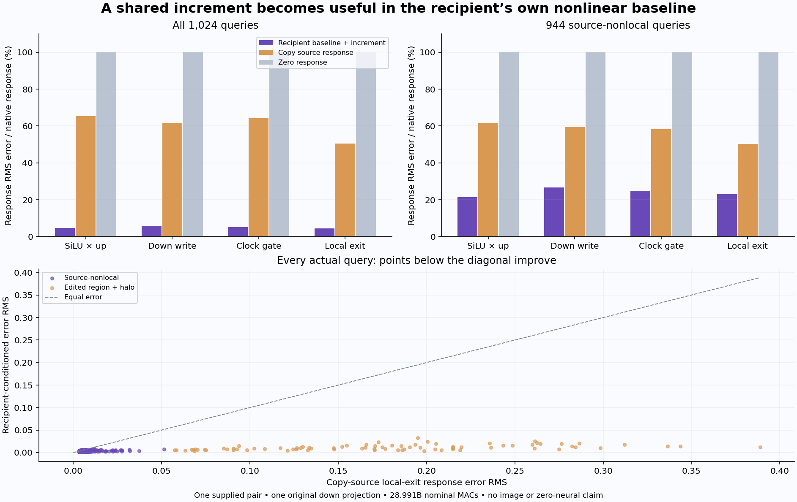

# A shared MLP increment works better in the recipient's own baseline

Moving source gate/up increments into the recipient's baseline reduces local image-exit response error from **50.57% to 4.48%** on this supplied pair. On the 944 source-nonlocal queries, it falls from **50.25% to 22.90%**. The candidate completes its prediction before seeing the recipient's changed endpoint, using one original down projection and the full native SiLU/product law.

This identifies a useful conditional computation, with native baseline/source preparation still paid. It generates no image. The [parent](first-image-consumer.md), [frozen plan](results/product-transport/frozen-plan.md), [raw report](results/product-transport/report.json), [candidate](results/product-transport/primary.json), [seal](results/product-transport/primary-seal.json), [physical census](results/product-transport/execution.json), [mechanics](results/product-transport-evidence/mechanics.json) and lossless [output](results/product-transport/queries.jsonl.gz)/[operand](results/product-transport/operand-queries.jsonl.gz) records retain the scope.

## Predict the operand, then apply its nonlinear consumer

The candidate receives only R0A, R0B and R1A fused operands, R1 embedding, shared B gated carrier, the qualified clock gate and one original down matrix. R1B and old product/write/exit fields are unavailable before sealing.

For gate g and up v, the fixed law is

\[
\delta g_0=g_{0B}-g_{0A},\quad \delta v_0=v_{0B}-v_{0A},\qquad
\widehat g_{1B}=Q(g_{1A}+\delta g_0),\quad
\widehat v_{1B}=Q(v_{1A}+\delta v_0).
\]

CPU arithmetic decodes BF16 to FP64 for subtraction/addition, then Q explicitly converts **FP64→FP32→BF16**. The predicted contiguous BF16 fused operand moves to CUDA. The original native SwiGLU source evaluates SiLU and multiplication once; one original down map, clock gate and residual addition complete the exit:

\[
\widehat p_{1B}=\operatorname{BF16}(\operatorname{SiLU}(\widehat g_{1B})\odot\widehat v_{1B}),\quad
\widehat m_{1B}=W_d\widehat p_{1B},
\]

\[
u_{1B}=\operatorname{BF16}(E_1+a_B),\quad
\widehat y_{1B}=\operatorname{BF16}(u_{1B}+\operatorname{BF16}(g_m\odot\widehat m_{1B})).
\]

The reconstructed B residual matches the retained native payload bits exactly. Complete fields seal, and the primary child exits before a separate scorer admits native endpoints. A trusted-code file audit denies target arrays and the scoring specification, records declared opens and exercises five denied canaries. This is an audited execution boundary, not an adversarial OS sandbox.

## Compare response, endpoint and every query

Both candidate and target responses subtract native R1A. Raw source transfer reuses S0B−S0A at each field; zero predicts no change. These are post-seal fieldwise controls, not newly executed coherent rollouts. All errors below divide by the **recipient native response norm**, unlike the parent's interaction divided by source response norm.

| Field | Conditioned error, all | Copy-source error, all | Conditioned error, nonlocal | Copy-source error, nonlocal |
|---|---:|---:|---:|---:|
| SiLU × up product | 4.67% | 65.33% | 21.48% | 61.37% |
| Down write | 5.74% | 61.61% | 26.58% | 59.42% |
| Gated MLP write | 5.20% | 64.29% | 24.78% | 58.18% |
| Local image exit | 4.48% | 50.57% | 22.90% | 50.25% |

Zero-response error is 100% at every aggregate. Product/exit all-query cosines are .99891/.99900, versus .78827/.87258 for raw transfer. Nonlocal candidate cosines remain .97694/.97380. Endpoint local-exit relative RMS is only .467% overall; the larger 4.48% response error tests the changed computation.

The aggregate is energy weighted, not a typical-query guarantee. Median local-exit response error is 33.12% overall and 34.23% nonlocal. The candidate beats source transfer at 995/1,024 queries, while 29 nonlocal queries worsen. It beats zero at all local-exit queries, but the down write loses to zero at four nonlocal queries and the gated write at six. These are dependent observations from one receiver pair; every signed error remains retained.

After conversion, gate/up response errors are 4.34%/4.12% overall and 24.14%/21.14% nonlocal. Before conversion they are 4.26%/4.06% and 23.32%/20.42%. Conversion RMS is .000696/.000513 overall and .000675/.000502 nonlocal. This slightly worsens operand transfer; preexisting receiver-dependent increment errors remain.

The result does not identify SiLU/product as the sole cause of the later complete-denoiser response rotation. It shows that the recipient baseline plus the full nonlinear law works much better than copying a finished local write here. Later consumers, text/image feedback and own-state iteration remain separate.

## Computation, resources and custody

Job **job-f21da64e0e39** succeeds in **77.34 scheduler seconds**, with **1,663.9 MB peak RSS** and **494 MB peak device usage**. Its reservation is 4,096 MB RAM /1,024 MB VRAM, four CPU threads and 4 GB disk. The selected BF16 down matrix contains **56,623,104 parameter bytes**. Its B1 affine costs **28,991,029,248 nominal MACs**, with 9,437,184 native SiLU and product scalars each.

The candidate omits normalization and fused gate/up projection while receiving their already computed operands. This is one third of one image MLP's affine work at this geometry, excluding baseline/source-increment preparation. It is not an end-to-end speedup. No full Transformer, attention, encoder, clock network, fit, scheduler image update, VAE or image runs.

Primary subprocess wall time, including imports, is 37.85 seconds; saved-only scoring is 33.50 seconds. Post-import setup is 6.74 seconds and the instrumented transport/nonlinear/down/capture path is 7.23 seconds. Post-import primary CPU time is 8.86 seconds. Native allocator peak is 184,555,520 bytes, distinct from scheduler telemetry. Hashing, I/O, transfers and diagnostics are included; no matched serving-speed comparison exists.

All 256 mechanics tests pass in 18.15 seconds, including four new independent quantization, nonlinear-baseline, single-down/commit and target-quarantine checks. Eleven shipped sources are frozen. One Saturn Act binds seven inputs to the predicted exit. Saturn run/verify exits 0 over 6,144 complete records, with no formal scientific claim receipts.

[Full byte verification](results/product-transport/retained-array-verification.json) covers 69 files /9,085,768,740 bytes, including inherited original assets and every new array. An independent 6,144-byte clock-gate slice hash is a reread, not additional storage. Twenty-six new arrays total 1,006,642,432 bytes and remain near compute. Fifteen compact public files total 1,411,062 bytes before summaries/figure. Shared-volume free space is observed at 14.02 GB without cleanup attribution. Last actual cleanup remains 48; next review is due 51 or earlier pressure.

[Astra49](results/product-transport-evidence/advisor.json) confirms the conditional interpretation and selects an [upstream shared-innovation prediction](plans/shared-normalization-innovation.md). It removes both supplied B fused operands, retains native A baselines and explicitly measures finite-policy defects. That plan is unexecuted. Arbitrary-prompt zero-neural image generation remains active and unsolved.
