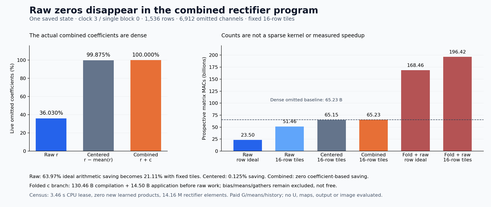

# Raw rectifier zeros disappear in the combined forecast

The combined rectifier forecast has **no exactly zero omitted coefficient in any of its 1,536 rows**. Its raw positive branch looks sparse—only 36.03% of coefficients are nonzero—but centering raises density to 99.87%, and combining the earlier linear term raises it to 100%. This closes the proposed exact-zero skipping route for this expression on this saved state. It does not exclude other factorizations, approximate pruning or compression on other states.

The [previous experiment](combined-rectifier.md) repaired two large text errors while worsening most rows against its quadratic predecessor. Its output gain did not establish an economical way to form that output. The [frozen feasibility plan](plans/rectifier-sign-support.md) is now executed: count exact coefficients and fixed batches before building a sparse producer. No new learned projection, native state update or image runs in this assay. Arbitrary-prompt zero-neural generation remains open.

## The coefficient belongs to the complete expression

Let r=max(G*,0), δU=U*−Ubar_s and c_s=Abar_s−rbar_s. On omitted channels, the earlier linear term and new correction combine in real arithmetic as

\[
L_{\bar S}=\bar A_{s,\bar S}\odot\delta U_{\bar S},\qquad
P^+=1_{\bar S}\odot(r-\bar r_s)\odot\delta U,
\]
\[
(L+P^+)_{\bar S}=(r+c_s)_{\bar S}\odot\delta U_{\bar S}.
\]

If r is zero while rbar_s is positive, centering creates a nonzero coefficient. If c_s is nonzero, the combined expression can require that channel even where r vanishes. An activation's zeros therefore need not be zeros of the program that the output consumes.

The census evaluates three explicitly ordered FP64 expressions: r, r−rbar_s and r+(Abar_s−rbar_s), then applies the frozen omitted-channel mask. It uses stored means from their authenticated producers; it does not recompute them in a new reduction order. Zero means exact stored-expression equality to zero, with no threshold, fit, output-error selector or near-zero pruning. New finite grouping is not certified equivalent to the earlier separate contractions.

Only four saved fields are admitted: G*, rbar, Abar and selected support S. Full U/Up means, original maps, prior products, output errors and forecasts stay unavailable. G*, both means and S remain paid learned/history inputs. This is a coefficient-demand measurement, not actual product support: δU might itself vanish, outputs might cancel, or another algorithm might exploit additional structure that this instrument cannot observe.

## What survives centering and batching

Every row has 6,912 omitted channels. All 96 fixed tiles contain 16 consecutive rows within one stream; there is no sorting, stream mixing or tile-size search.

| Stratum | Raw nonzero coefficients | Centered nonzero coefficients | Combined nonzero coefficients | Raw fixed-tile prospective saving |
|---|---:|---:|---:|---:|
| All |36.030%|99.875%|100%|21.107%|
| Text |31.718%|99.711%|100%|34.049%|
| Image |38.186%|99.957%|100%|14.636%|

Every text row has 6,892 live centered coefficients; every image row has 6,909. Every row and tile has all 6,912 combined coefficients live. The stream term c_s also has all 6,912 omitted channels live in both streams. No row, channel or tile is removed from the record.

For source/output width d=3072 and rowwise live counts m_i, ideal prospective Up-plus-Down work is

\[
W_{\rm row}=2d\sum_i m_i.
\]

For a fixed tile b, a dense kernel over its union of active channels would instead pay

\[
W_{\rm tile}=2d\sum_b |b|\left|\bigcup_{i\in b}\operatorname{supp}(a_i)\right|.
\]

The omitted-only baseline is **65,229,815,808 MACs**. The full-width baseline is 86,973,087,744; the already-selected quarter is not a new sign-derived saving.

| Coefficient expression | Ideal rowwise work | Fixed 16-row tile work | Fixed-tile saving vs omitted baseline |
|---|---:|---:|---:|
| Raw r |23.502 B MACs|51.462 B MACs|21.107%|
| Centered r−rbar |65.148 B MACs|65.148 B MACs|0.125%|
| Combined r+c_s |65.230 B MACs|65.230 B MACs|0%|

Raw's ideal 63.97% arithmetic saving falls to 21.11% with the fixed batching rule. Replacing the combined expression with raw r would change the computation, so that raw saving cannot be assigned to the measured combined forecast. These are arithmetic counts, not a lowered kernel, measured runtime or lower bound on every possible implementation. G formation, live means, support formation, gathers and launch costs remain outside these counts and are not free.

## Folding the dense term moves the cost

One could split rδU+c_sδU and fold the second branch into an input-space map:

\[
C_s=D_o\operatorname{diag}(c_s)W_{U,o},\qquad
b_s=-D_o(c_s\odot\bar U_s),\qquad C_s z+b_s.
\]

No map or bias is constructed here. With both streams' 6,912 omitted c_s entries live, forming the two maps would cost **130.460 billion MACs**, then **14.496 billion** to apply. Adding the raw branch gives 168.458 billion under ideal rowwise execution or 196.417 billion with fixed tiles, against the 65.230 billion omitted baseline. Their signed prospective savings are negative: −103.228 and −131.187 billion MACs. The two FP64 maps alone occupy 150,994,944 bytes. Bias/means, gathering, storage and compilation reuse remain additional questions. The stream-dependent c_s is not established constant across prompts or future states.

This is why a shorter formula is not automatically cheaper computation. A factorization can expose a mechanism while moving expensive input-dependent work into its coefficients.

## Work, custody and limits

One guarded strict-preflight CPU job, `job-c9f87f9687d5`, succeeds in **3.46 seconds**, with sampled **152.9 MB RSS / zero VRAM**. Intent-first admission reserves 4096 MB RAM, four CPU slots and 1 GB disk; numerical thread environments are one. The finite cap is 180 seconds and retries are disabled. Declared/sealed/executed payload SHA matches over 18,825 bytes.

It scans 113,560,064 bytes of four saved source files, rectifies 14,155,776 elements and evaluates exact scalar support expressions, counts and bit packing. It evaluates **zero learned matrix products** and loads no checkpoint tensors. Source G/means/support/history remain paid. Support counting takes 0.0531 seconds; worker wall time after imports is 1.4608 seconds including source checks and retention, with 0.2598 process CPU seconds. These scopes differ from scheduler time and do not measure a generator or serving speedup.

All **348 mechanics tests** pass, including an independent scalar/manual-bitwise reference with exact zeros, tiny nonzeros, stream boundaries, per-row/per-channel counts, fixed unions and prospective MACs. Six complete arrays retain row supports, row/channel counts, tile unions/counts and c_s support. They total **6,124,800 NPY bytes** and stay near compute. [All scalar rows, tiles and evidence](results/rectifier-sign-support-evidence/README.md) remain available.

Full-byte verification covers **28 files / 120,821,263 bytes / 10 NPY payloads**, including all four sources, all six new arrays and parent/result metadata. It verifies identities and complete fields, not an independent numerical replay of the real-array arithmetic. The standard Saturn sweep and verification cover two scalar streams / 1,632 records, with zero fires, formal claims or qualified addresses and two expected missing no-fire ledgers. Initial CLI/scope setup findings are retained separately; the corrected standard sweep ran successfully.

The public scientific core is fifteen files / 58,282 bytes before figure and evidence. The [scheduled storage review](results/storage-audit-cycle81/README.md) validates all 93 recovery pointers within their separate custody scopes and finds no large transport candidate; no new archive or deletion occurs. Nine previously archived current-byte snapshots receive fresh full SHA checks over 3.806 GB, without repairing their historical scientific provenance. Astra's [full newest-post review](results/research-review-cycle81/advisor-survey.json) finds no route-changing economical prompt/state/pixel producer; next full review is due in cycle 84 or earlier material evidence.

The result narrows one implementation route. It does not supply an image producer, prove general compression impossible or solve arbitrary-prompt generation without neural evaluations.

## Move the question upstream

Astra recommends stopping this centered sparse-correction branch. The [next written, unexecuted plan](plans/current-state-gate-up-basis.md) instead forms complete G/Up operands from one fixed rank-128 basis of current normalized Z per stream, then feeds their own predicted values to the unchanged local SwiGLU/output consumer. It admits no Abar, Ubar, L or selected-channel support. Existing cycle73 source and dense local targets allow that contrast without a reference campaign, while preserving their paid moment-attention origin.

The proposed map/compiler/reconstruction/output subtotal is 77.309 billion MACs against a matched 144.955 billion, before QR and scalar/data overhead. Those maps are original learned parameters, and each input-dependent basis must be rebuilt. Rank128 has no established adequacy; discarded input directions may be amplified downstream. This changes the operand-production question rather than repairing another supplied activation field. It remains reduced learned computation, with no new image or zero-neural serving claim.
