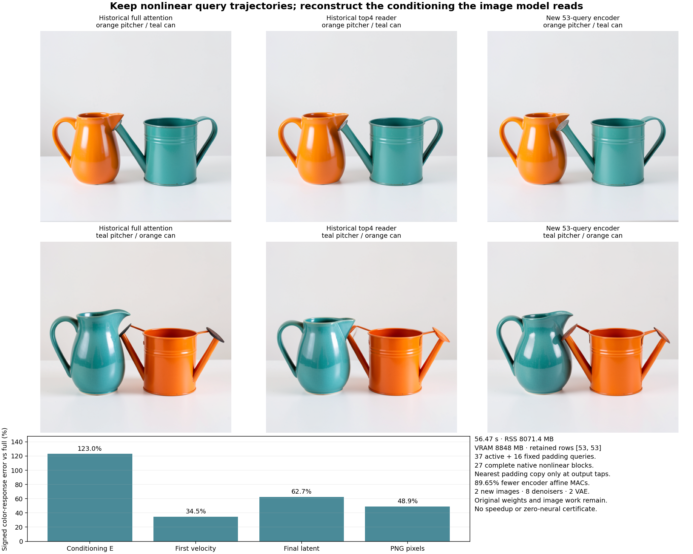

# Fewer encoder queries preserve the scene but lose contextual variation

Keeping 53 of the encoder's 512 query trajectories preserves the coarse colors and vessel layout on the tested prompt pair, while introducing substantial conditioning and image-response error. The two new images cost 89.65% fewer nominal encoder affine MACs than full-row encoding. Original nonlinear computation still runs on the selected rows, and the full learned FLUX/VAE consumer remains. Arbitrary-prompt zero-neural generation is still open.

The selected queries retain every input coordinate and execute all 27 original nonlinear blocks. Approximation moves to reconstructing the conditioning rows that the image model demands. This follows the [source MLP tangent](padding-mlp-tangent.md), whose missing nonlinear remainder made its first-order prediction worse than a constant anchor. The [frozen plan](plans/retained-padding-queries.md) and [request](results/retained-queries/request.json) specify one rule, without fitting or sweeping the number of samples.

## A smaller continuing state has an exact structural premise

Let A be all mask-active rows and Q a subset of padding positions. Keep S=A∪Q. The original Qwen attention mask prevents every padding row from supplying an attended key. Retained padding queries can read active keys and their own incoming row state, while active queries read their causal active predecessors. Normalization and MLPs act independently on each row.

If every key read by a retained query is retained, and positions, masks, parameters and mode agree, then in real arithmetic

\[
\pi_S F_\ell(H)=F_\ell^S(\pi_S H).
\]

Induction carries this closure through all 27 blocks: omitted padding queries cannot influence selected trajectories. This is a condition on the actual computation graph. It does not assert that a reduced output field is sufficient for the later image model.

The implementation builds the original 512-row visibility mask and RoPE coordinates first, then gathers selected queries and both mask axes. Original position IDs remain unchanged. It never renumbers selected positions or admits padding keys. Exact bit-hash witnesses reconstruct the declared source visibility/positions, and all 54 actual attention calls join the saved compact mask. The [mechanics audit](results/retained-queries-evidence/mechanics.json) retains those checks. Compact CUDA BF16 GEMM/SDPA can still differ numerically from the historical 512-row execution.

## One fixed rule reconstructs the demanded interface

Both known square00/10 prompts have 37 active rows and 475 padding rows. Select 16 padding positions including both endpoints. For sorted padding positions P,

\[
Q=\{P_{\lfloor j(|P|-1)/15\rfloor}:j=0,\ldots,15\}.
\]

All padding positions are kept when there are at most 16. Every active row remains. Each omitted padding position copies the nearest retained original padding position, with ties going earlier. One fixed expansion R is used at H9/H18/H27, then the usual packing forms the complete 512-row conditioning E. Intermediate blocks consume compact own states, without expansion or target replacement.

Original native attention runs in block 0 and all later blocks. Historical full attention is the primary comparison; the historical top4 reader is secondary context. This avoids changing a first-layer attention approximation at the same time as query sampling. Both new image trajectories seal before saved target values become available. No new noise, native reference campaign, fitted coefficient, support sweep or target-state refresh runs.

Copying representatives preserves the number of rows and their multiplicities. It does not preserve the original attention partition, mass or payload. The unchanged full image consumer receives all 512 rows and determines the consequence.

## What survives and what changes

| Observable against historical full attention | Case00 | Case10 |
| --- | ---: | ---: |
| Selected H0 error | 0, byte exact | 0, byte exact |
| Retained H1 endpoint error | 0.403% | 0.404% |
| Retained padding E endpoint error | 10.978% | 10.979% |
| All padding E endpoint error after reconstruction | 89.08% | 88.48% |
| Whole E endpoint error | 9.740% | 9.762% |
| PNG endpoint error | 7.229% | 11.541% |

The new images preserve coarse orange/teal body assignment and pitcher-left/can-right layout. Vessel shapes, handles, spouts and overlaps change. Candidate00 has a conspicuous gray watering-nozzle overlap near the orange pitcher's upper right side; candidate10 has another visible nozzle/overlap against the teal body. Historical native geometry remains alongside the candidates. Clean surfaces and correct coarse colors do not establish every requested object or material property. The [visual observations](results/retained-queries-evidence/visual-observations.json) keep these limits.

Signed color-response errors against full are 123.05% at E, 34.45% at the first velocity, 62.66% at the final latent and 48.93% at PNG pixels. PNG response cosine is 0.8785 and error RMS is 29.56 on the 0–255 scale. Against historical top4, pixel response error is 54.19%. The earlier top4 reader's corresponding full-reference color error is 34.51%; this query reduction spends less encoder arithmetic while losing response fidelity on the known pair. It is not a quality improvement over that different algorithm.

Active E endpoint aggregate error is about 0.381% in both cases. The large first-row reference norm makes that denominator unusually favorable. Median active-row errors are 1.284%/1.203%, with 90th percentiles 1.787%/1.785%. Median padding-row errors are 92.14%/92.94%. Active E color-response error is 7.67%, versus 124.34% on padding. Complete row observations and distributions remain available; pooled endpoint similarity does not imply accurate prompt response.

## Numerical execution and reconstruction are separate vectors

Let P_sel select the historical native taps and E_small be the actual compact taps. Then

\[
\widehat E-E
=\underbrace{R(E_{\rm small}-P_{\rm sel}E)}_{F:\ \text{compact execution and propagation}}
 +\underbrace{(RP_{\rm sel}-I)E}_{G:\ \text{fixed reconstruction}}.
\]

Both terms are formed only after the candidate image seal. Reference taps never enter serving. Six complete signed diagnostic arrays retain F, G and their total for both prompts. The floating-point telescope has zero observed residual at every retained coordinate.

| Complete E error energy | Case00 | Case10 |
| --- | ---: | ---: |
| Compact execution and propagation, ||F||² | 130,271.52 | 133,571.70 |
| Reconstruction, ||G||² | 8,343,463.52 | 8,311,541.88 |
| Signed cross term, 2〈F,G〉 | −222,414.58 | −154,224.98 |
| Actual total | 8,251,320.46 | 8,290,888.60 |

On the signed color change, these energies are 215,908.37, 3,828,665.26 and −274,582.93, summing to 3,769,990.70. Reconstruction is the larger vector omission, while compact finite execution remains consequential and partly cancels it. These are not percentages of semantic responsibility. No native hybrid-image control has been run to isolate each term's separate pixel effect.

The selected state starts exactly and diverges under changed matrix/attention geometry: retained padding error grows from about 0.43% at H1 to roughly 11% at packed E. The real-arithmetic closure statement therefore remains distinct from finite native parity. On active rows G is exactly zero; their measured discrepancy belongs to compact execution and its continuation.

## Compute and retained evidence

Job `job-a9e0a0f370fb` succeeds in 56.47 scheduler seconds, with 8,071.4 MB sampled process-tree RSS and 8,848 MB VRAM. Queue time is separate. Fresh-process phases take 1.92 s lexical formation, 25.46 s encoder and 19.95 s image generation; sealing, scoring and runtime overhead account for the remaining time. This is a single assay, without a matched speedup comparison.

The pair pays 54 original encoder blocks/attention calls and 378 affine calls, totaling 288,848,609,280 nominal encoder affine MACs. Full 512-row encoding would cost 2,790,386,565,120 under the same per-row accounting. The reduction is 89.65%, about 6.16% of the inherited full encoder-plus-denoiser affine total. Issued compact attention shapes separately account for 1,242,611,712 nominal QK/AV MACs; this is not a hardware FLOP counter.

Eight original denoisers, 824 transformer linears and two native VAE decodes remain, with 37,791,417,237,504 transformer affine MACs. There are two new images, zero new reference images, zero noise draws and zero post-seal model calls. Original encoder weights still load, the complete learned lexical table remains referenced, and full E/image buffers remain. The denoiser now represents about 99.24% of the remaining counted encoder-plus-denoiser affine work, excluding VAE and other operations.

All 190 mechanics tests pass. Independent complete byte verification covers 410 members/876,318,712 bytes, including inherited comparison/input artifacts; it is not a new-storage total. The 128 new arrays totaling 284,306,578 bytes stay near compute. The 23 compact primary files occupy 3,469,913 bytes and retain 16,386 dependent observations byte-losslessly. Checks cover 54 own encoder handoffs, eight actual denoiser E/latent/clock joins, 58 compact state fields, eight expanded encoder fields, 24 setup witnesses, 32 image fields and six original PNGs. Saturn run/verify return0 within observation-stream scope, with no semantic or physical-address certificate.

The earlier [admission snapshot](results/retained-query-preflight/README.md) is preserved separately from terminal execution evidence. A concurrent [storage review](results/storage-cleanup-cycle36/README.md) archives four qualified transport copies/1.631 GB with full checksum and restoration pointers; extracted scientific evidence remains local.

## Why copied conditioning cannot simply collapse FLUX tokens

A [source inspection](results/retained-queries-evidence/flux-position-source-check.json) checks the exact pipeline and transformer source hashes used by this run. FLUX text IDs are [0,0,0,j], and the fourth axis has 32 rotary dimensions. The transformer applies those position-dependent rotations to text queries and keys. Equal copied E rows alone therefore do not establish identical attention operands.

For one read with a genuinely common unrotated key/value pair (k_g,v_g), the position-aware group factors would be

\[
Z_g(q)=\sum_{j\in g}\exp\{q^\top\Omega_jk_g/\sqrt d\},\qquad N_g(q)=v_gZ_g(q).
\]

A log-multiplicity correction alone requires identical rotated scores. Here the positional partition must still be computed, and later attention can make text states diverge. This is an identified next boundary, not an implemented denoiser reduction. The [living research record](zero-neural-research.md) keeps complete arbitrary-prompt zero-neural serving as the unchanged goal.

## The next experiment removes a complete velocity evaluation

[Astra's review](results/retained-queries-evidence/advisor.json) recommends moving to the dominant remaining denoiser work. The [next frozen plan](plans/last-velocity-forecast.md) replaces only the fourth velocity with a fixed secant along its own preceding trajectory, compared with previous-velocity hold:

\[
\widehat v_3=v_2+\frac{\sigma_3-\sigma_2}{\sigma_2-\sigma_1}(v_2-v_1).
\]

The actual coefficient is 2.24666 and the final Euler interval is −0.71750, so this is a demanding extrapolation. The first assay will replay authenticated own-prefix Z3,v1,v2, deny the actual fourth output until all candidate images seal, preserve finite scheduler casts and pay four VAE decodes. Its three original prefix calls per image remain charged. A later serving integration could avoid 25% of denoiser affine work if the law proves useful; no such result or speedup exists yet.
