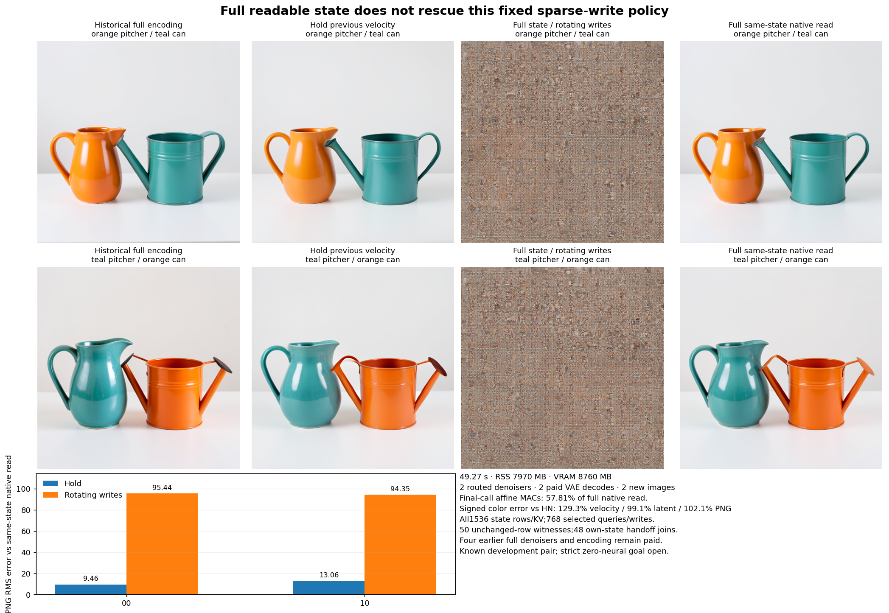

# Full readable state with fewer residual writes

The fixed rotating-write producer completes its own state trajectory, but loses the image. Both original candidate PNGs are fine grid-like textures without recognizable vessels. Their RMS errors against a full native read on the exact same incoming state are95.44/94.35, versus9.46/13.06 when simply reusing the earlier velocity. The candidate performs57.81%of that final read's nominal affine work. This is an informative negative result for one frozen routing policy, with arbitrary-prompt zero-neural generation still open.

The experiment follows the [coarse-global result](coarse-global-innovation.md). Pooling the state had left about65%of endpoint error energy in the retained coarse producer. [Astra39](results/coarse-global-evidence/advisor.json) therefore proposed keeping every fine state row and reducing only which rows receive learned writes. The [frozen protocol](plans/rotating-residual-writes.md) now executes on the same known development pair; it is not a new-prompt or held-out experiment.

## Preserve the read, route the write

At each of25blocks, the candidate retains1024image rows and512text rows at their original positions. Every current row contributes K/V. All text rows and one rotating quarter of image rows form queries, attention outputs and MLP writes:

\[
S_b=\{\text{all text}\}\cup
\{(h,w):2(h\bmod2)+(w\bmod2)=b\bmod4\},
\qquad b=0,\ldots,24.
\]

There are768queries/writes and1536keys/values per attention call. Each image row updates six or seven times. Unselected image rows carry their existing bits unchanged; no native hidden state refreshes them. The first single block uses global index5, preserving the phase sequence across the joint/single boundary.

Joint MLPs consume their own newly attention-updated residuals. Single-block attention and MLP branches share the normalized incoming state. Single fused weights are sliced before evaluation: selected Q, complete K/V, selected gate/up, then selected output. The code never computes full Q/MLP outputs merely to discard them.

Full input/output projections, original clock constants, absolute RoPE, ordinary attention mass and the original final scheduler/VAE remain. There is no pooling, lifted innovation, multiplicity bias, fitted coefficient or phase sweep. Actual operation records identify sliced parameters by storage identity, offset, stride and shape.

## What the candidates produce

The two candidate images seal before the existing HN/HH/NN/NH/full target files become available. HN is the full final native read on each exact incoming Z3H. HH reuses the earlier velocity on that same state. Targets were already seen in development, so file isolation does not create a fresh held-out split.

| Case | Hold velocity RMS error | Routed velocity RMS error | Hold PNG RMS error | Routed PNG RMS error |
| --- | ---: | ---: | ---: | ---: |
| 00 |.414611|1.410100|9.46357|95.44307|
| 10 |.437145|1.411947|13.06402|94.34727|

The signed color-response error against HN is129.30%for velocity,99.10%for final latent and102.13%for PNG. Velocity-response cosine is−.667; PNG-response cosine is.060. The historical NN/full comparisons remain in the raw report and show the same broad loss of response. Neither a low compute count nor valid state advancement establishes useful prediction.

The full and hold references retain recognizable pitchers and watering cans, including their original spout/contact defects. The routed outputs do not preserve those objects. The texture visually resembles a grid; this observation does not by itself identify the responsible phase, layer, operator or numerical mechanism.

## Expand the computation before attributing the error

Write an ideal native block as

\[
F_b(X)=X+W_b(X).
\]

Let M_b select the rows in S_b. Because normalization/MLPs act independently by row, and selected attention queries still read complete current K/V, the ideal routed law is

\[
R_b(X)=X+M_bW_b(X).
\]

For the joint block, W includes both attention and its sequential MLP. For the single block it includes the parallel attention/MLP computation. This expression must preserve those different internal dependencies.

If e_b is the candidate-minus-native incoming state and \(\rho_b\) represents changed finite evaluation, expanding gives

\[
e_{b+1}
=e_b+M_b[W_b(X_b+e_b)-W_b(X_b)]
-(I-M_b)W_b(X_b)+\rho_b.
\]

Where a differentiable real-arithmetic surrogate applies, the bracket factors through a path-averaged Jacobian:

\[
e_{b+1}=(I+M_b\overline J_b)e_b
-(I-M_b)W_b(X_b)+\rho_b.
\]

Keeping all readable rows does not remove either term. Omitted writes create new error; later queries, K/V and MLPs consume the resulting own state. A compact runtime must preserve the future functions of that state, not just its shape or original spatial detail.

This is an algebraic account, not a measured layerwise attribution. We have not separated internal sparse-write error from changed sliced-GEMM finite effects, identified a first failing block, or excluded a better routing law. The mechanics record verifies the declared producer; it does not supply those missing causal measurements.

At the final Euler boundary we do retain the complete measured split:

\[
\Delta Z_4=d\,\Delta v_3+\Delta R_{\rm finite},
\qquad d=-.7174965739250183.
\]

Its telescope closes exactly in the retained calculation. Scaled-velocity energies are134168.19/134519.93, final finite-difference energies1.422/1.431, with signed twice-cross terms471.09/473.92. This separates final scheduler arithmetic; it does not measure internal GEMM error.

## Paid work and evidence

Job job-aa657d5672e5 succeeds in49.27scheduler seconds, with7970MB sampled RSS and8760MB VRAM. It executes2routed denoisers,286physical transformer affines/5,461,587,787,776nominal MACs,50rectangular attention dispatches/362,387,865,600nominal QK/AV MACs, and2VAE decodes/80conv-linear calls/2,481,224,417,280nominal MACs. Four historical full prefix denoisers/18,895,708,618,752nominal affine MACs and original encoding remain charged. No new encoder, reference, noise draw or fit runs.

Per routed call, affine MACs are2,730,793,893,888versus4,723,927,154,688full. The native103-call census becomes143physical calls because sliced input projections split work. First/second routed calls take4.274/.531seconds including full-state hash witnesses; VAE takes2.701/.054seconds. First-use effects and different instrumentation prevent a matched speedup claim.

All224mechanics tests pass in15.978seconds. The six new tests include an independent tiny dense-equation oracle, a distant unselected-row edit, physical slices, exact carry, absolute query-position selection, lazy imports, and release refusal for incomplete fields or broken routing/handoffs. [The audit](results/rotating-writes-evidence/mechanics.json) checks50unchanged-row witnesses,48adjacent own-state joins,120sliced single-input calls, actual complete consumers and5120lossless dependent observations.

Independent full-byte verification covers139members/7,986,081,162bytes, including original assets and inherited inputs. All24new arrays/27,298,816bytes remain near compute. Compact publication contains25files/4,673,184bytes plus the separately derived figure and small receipts. The executed payload is4f9139169beac86feecbec8e207f543206a9820f6b6d823390074362098c9010,74,799bytes. Raw report, release seal and complete manifest are under [results/rotating-writes](results/rotating-writes/report.json). Saturn run/verify returns0 for the5120-row stream, with no fires or formal claim receipts; its scope is instrument mechanics.

Use [rotating_write_study.py](../generator/rotating_write_study.py) stage/submit/collect with a fresh run directory. [publish_rotating_writes.py](../generator/publish_rotating_writes.py) verifies complete near-compute bytes before publication, while the auditor and plotter consume compact records. Frozen executed sources and raw outputs remain unchanged.

The neighboring [small-global-reader result](../../obsidian/blog/2026-11-06-174218-a-small-global-reader-needs-the-right-response-basis.md) supplies a complementary limit: distant information can be available but exposed in poorly aligned response directions. The [consumer-clock study](../../obsidian/blog/2026-11-06-173328-the-consumer-metric-needs-a-clock.md) also shows that an immediate error ranking can change across continuation. Together with this result, they point toward understanding useful future-read/response functions, while the [strict research record](zero-neural-research.md) keeps raw-prompt conditioning, own-state zero-neural denoising and general pixel generation explicitly unresolved.

[Astra40](results/rotating-writes-evidence/advisor.json) selects one [source-native global read and velocity writer](plans/source-native-global-reader.md) next. Compute the first joint block's image attention read from actual full Z/E, then fit one discovery-only shared innovation writer on Z, previous velocity and those head outputs. No native text queries, attention output projection, MLP or later block runs. The source census estimates 51.137 billion original affine MACs plus .436 billion writer MACs, 1.092% of the full final read, with QK/AV separately charged. This is written and unexecuted, still evaluates eight learned maps, and has not established useful prediction or speedup. Its purpose is to test a specific cheaply formed source response function after arbitrary global sketches and geometry-only cuts have proved inadequate.
