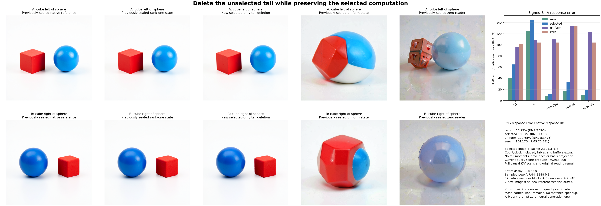

# Delete the attention tail and keep the image computation

Cycle32 follow-up: the [direct-score reader](direct-reader.md) removes anchor routing and score caches, matches all consumed BF16 inputs and lexical controls, and inherits these original images by exact input identity. Its comparable numerical state is1.05MB; no new dense consumer or image runs. The original cycle31 result follows.

The selected-only reader preserves the red cube, blue sphere and requested left/right swap on the tested pair. It deletes the rank-one reader's tail moments, envelopes, centroid updates, basis projection and fallback. Signed image-response error rises from **10.72% to 19.37%**, while the allocated numerical reader state falls from **18,980,992 to 2,101,376 bytes**. The tail improves fidelity, but this much smaller read retains useful image behavior. This is a bounded reduction on one known pair and one noise realization; arbitrary-prompt generation with zero neural evaluations remains open.

The [frozen plan](plans/selected-only-reader.md) follows the [uniform-value experiment](uniform-reader-image.md). Uniform causal means ran their own state law exactly but merged the objects. The new contrast keeps query-specific selection and its finite weight arithmetic while removing the unselected tail. It reuses the original model, complete lexical table, raw strings, template, 512-row mask and positions, source geometry, seed314159 noise, exact clocks and consumer profiles. Only two new candidate images run. Existing full, rank-one, zero and uniform references are observed evidence, not a new held-out test.

## What computation remains

For a scaled query x, source-centered keys u_j, values V_j and the frozen routed anchor ell, the reader keeps the original causal top-four set S and computes

$$
s_j=\ell^T u_j,\qquad \delta=x-\ell,\qquad
a_j=s_j+u_j^T\delta,
$$

$$
H_S=\sum_{j\in S}\exp\!\left(a_j-\operatorname{logsumexp}(a_S)\right)V_j.
$$

It returns H_S immediately, then applies the inherited FP64→FP32→BF16 conversion. Selected positions retain their original order and tie policy. The same-shaped anchor admission GEMV, cached scores, source routing and full current-query K/V scan remain paid. No direct QK reassociation is introduced in this experiment.

The parent combines the selected and tail reads:

$$
A_R=(1-w)H_S+wH_T,\qquad H_S-A_R=w(H_S-H_T).
$$

Deleting that tail removes its numerical state and work. It does not make the whole encoder sparse or eliminate its original learned layers. All32 resulting heads feed the original block0 output/residual/norm/MLP, then their own original full512-row blocks1…26 and H9/H18/H27 conditioning. The original image computation consumes that actual conditioning through all four steps and VAE decode. There is no exact-head replacement or native-state refresh.

## Verify the contrast before interpreting it

The complete head, encoder and image candidates seal before any reference values or parent diagnostic caches are opened. A separate post-seal reconstruction then reads the parent's immutable final causal K/V and anchor-score cache, old supports/routes and lexical operands. It reconstructs H_S using the original selected expression, without evaluating native attention or repairing the candidate.

Both prompts have **zero mismatches** in lexical operands, cached keys/values/scores/positions, ordered supports, routes, selected logits and selected weights. Reconstructed H_S differs by **zero** in raw FP64 values and BF16 words. The first128 head queries per prompt, where the parent already had no complement, also match exactly. These are checks of the declared deletion; they do not certify image quality.

## What the images and states show

Errors below compare the signed B−A response against the native B−A response. Rows are dependent ports from the same pair, not independent prompt replications.

| Port | Rank-one | Selected-only | Uniform | Zero |
|---|---:|---:|---:|---:|
| H1 | 40.59% | 64.90% | 96.76% | 101.53% |
| H2 | 50.05% | 98.41% | 98.27% | 102.13% |
| H9 | 90.77% | 181.75% | 104.49% | 111.95% |
| H18 | 121.46% | 148.58% | 108.30% | 101.49% |
| H27 | 126.93% | 144.02% | 109.87% | 105.00% |
| Conditioning E | 125.43% | 145.41% | 109.46% | 104.23% |
| First velocity | 8.65% | 12.26% | 109.58% | 104.07% |
| Final latent | 17.82% | 32.63% | 133.91% | 133.84% |
| PNG | 10.72% | 19.37% | 122.68% | 104.17% |

The new PNG response has RMS error13.183 on the 0–255 scale and cosine0.98164 against the native response. Endpoint PNG errors are9.952 for A and9.151 for B, compared with6.191/4.058 for rank-one. The objects remain separate and swap positions, with visible size, shape and shading differences. Keeping the tail improves these endpoints; deleting it still beats both zero and uniform at every image scanline.

The hidden-state measurements retain mixed effects. Selected-only E has lower row RMS error than rank-one on108/118 padding rows for A/B, but higher error on31 active rows per prompt; the first4 active rows remain equal. At PNG,36 A scanlines improve over rank-one and476 worsen; all512 B scanlines worsen. Against zero, E improves on490/496 rows, including all35 active rows, while22/16 padding rows worsen. Aggregate paired E error ranks selected-only last, despite its much better images than uniform and zero. There is no single layerwise RMS score that substitutes for the actual image consumer here.

For q=selected−rank and e_S=e_R+q, the measured signed PNG energy account is

$$
\|e_S\|^2=\|e_R\|^2+\|q\|^2+2\langle e_R,q\rangle
=41{,}860{,}242+98{,}631{,}122-3{,}809{,}716
=136{,}681{,}648.
$$

The tail-deletion change weakly opposes the parent's error direction, but its added power is much larger. Preserve that signed cancellation alongside the net degradation.

## Compute, custody and limits

Per prompt, selected-only retains2,101,248 bytes of allocated K/V, positions and anchor scores, plus128 bytes of group counts/clocks. Its occupied entries total1,149,120 bytes plus those counts/clocks. This excludes the3,153,920-byte runtime source geometry, complete learned lexical table, source identities/counter metadata, input/output arrays, diagnostics and serialization. The deleted numerical payload is16,879,616 bytes per prompt, about88.93% of the comparable parent numerical state. This is not a whole-pipeline memory or speedup claim.

Each prompt still performs9,175,040 anchor-admission MACs,70,963,200 current-query score products and16,728,064 selected-coordinate products. Group streaming wall times sum to0.548/0.359 seconds; reader serving including serialization takes1.055 seconds for the pair. The complete reader body, including lexical setup/IO, takes3.605 seconds,1.597 CPU seconds and221,112KiB high-water RSS. The independent post-seal diagnostic takes0.496/0.583 seconds. These scopes are measured separately and are not matched timing comparisons with the parent.

Guarded CUDA job **`job-0021bd0429e3`** succeeds once in **118.43 scheduler seconds**, with sampled peaks7197.7MB RSS and8848MB VRAM. Fresh-process reader/encoder/image phases take3.720/45.547/27.764 seconds. Original learned work remains52 encoder blocks,52 SDPA and372 linears (**2.774T nominal linear MACs**),8 denoisers and824 transformer linears (**37.791T nominal linear MACs**), plus2 VAE decodes. Forty inherited clock gathers run; no new reference image, noise draw or clock compilation occurs.

All148 mechanics tests and isolated staged imports pass. [Independent byte verification](results/selected-reader-image/retained-array-verification.json) covers659 members and1,882,018,218 bytes. The162 new complete arrays/packets total742,770,948 bytes and remain near compute. The27-file primary publication is12,455,445 bytes with122,880 losslessly retained dependent observation rows. [Saturn run](results/selected-reader-image-evidence/saturn-run.json) and [verify](results/selected-reader-image-evidence/saturn-verify.json) return0 with stream-only scope; they add no semantic certification.

**Reporting correction:** the raw report's second `limitations` entry accidentally retained uniform-mean/8192-byte prose from the prior worker. The [additive correction](results/selected-reader-image-evidence/report-correction.json) identifies that exact report hash and gives the actual selected K/V/cache account above. The raw report and executed source remain immutable; outputs, counters and other measured fields are unaffected.

[Astra's review](results/selected-reader-image-evidence/advisor.json) recommends [reusing the existing current-query scores](plans/direct-selected-reader.md) to remove anchor routing and caches. That next cut is written and unexecuted; it must measure finite arithmetic changes and may reuse downstream evidence only when complete demanded input ports match exactly.

The strict arbitrary-prompt zero-neural goal remains active. This experiment identifies a useful reduction in one contextual reader, with most learned computation still paid.
