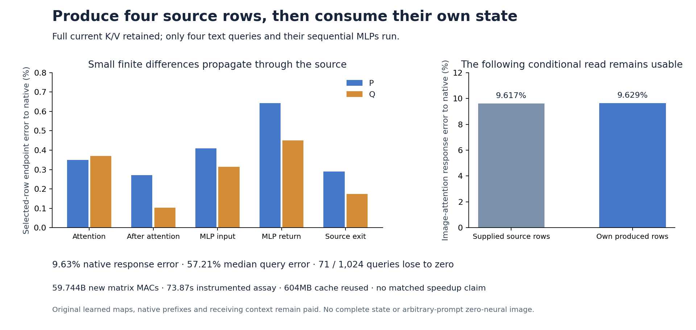

# Produce demanded text rows from their actual source states

Four source text rows now reach the next image-attention read without supplied attention returns, MLP returns or finished rows. A new producer starts from authenticated P/Q states before joint0, computes the rows' own sequential attention and MLP ancestry, and feeds its actual outputs into the unchanged projected reader. Native response error is **9.63%**, versus **9.62%** with supplied rows. This closes a supplied-return dependency on one retrospective family; original learned maps, native prefixes and the receiving query/complement remain required.

The change is not numerically exact. Relative to the previous reader, the new response differs by **3.24%**. Against native, median query error is **57.21%**, **71 of 1,024 queries lose to zero**, and two response cosines are negative. Comparing native error by query, **409 improve and 615 worsen**. No new image is generated or inherited.

The [report](results/selected-source/report.json), [source producer](results/selected-source/producer.json), [producer seal](results/selected-source/producer-seal.json), [reader seal](results/selected-source/primary-seal.json), [complete queries](results/selected-source/queries.jsonl.gz), [byte custody](results/selected-source/retained-array-verification.json) and [mechanics](results/selected-source-evidence/mechanics.json) preserve the executed computation. The [frozen plan](results/selected-source/frozen-plan.md) precedes the result; [Astra's review](results/selected-source-evidence/advisor.json) binds source, result and newest-post interpretation.

## Keep full readable context while pruning demanded outputs

The specimen remains sphere-cube-plain-2027 at logical diffusion step 2. Each source begins before joint0; its four resolved text addresses are S=[4,11,12,13]. The receiving computation remains the fixed image query/complement before joint1. These are supplied intermediate states, rather than new raw-prompt interpretations.

For source X in {P,Q}, normalize and modulate its complete current text and image streams. Form all 1,536 current keys and values, with text before image. Form only the four text queries in S. Preserve original head normalization and absolute RoPE positions. The attention read has four queries and all 1,536 keys:

\[
A_{X,S}=W_{text,out}\operatorname{Attn}(Q_{X,S},K_X,V_X).
\]

Each selected row then advances through its own attention update and original rowwise MLP:

\[
U_{X,S}=B(R_{X,S}+B(g_A A_{X,S})),\qquad
M_{X,S}=\operatorname{MLP}_{\theta}(\operatorname{ModLN}(U_{X,S})).
\]

Here B marks the separate BF16 output boundaries. The executed program also preserves the pinned kernels, normalization order and SwiGLU split. It produces the family rows in their declared order:

\[
T_{QQQ,S}=B(U_{Q,S}+B(g_M M_{Q,S})),
\]
\[
T_{PQP,S}=B(B(R_{P,S}+B(g_A A_{Q,S}))+B(g_M M_{P,S})).
\]

P's MLP consumes P's attention-updated state before the final PQP splice uses Q's direct attention return. It is not an MLP recomputed from the hybrid residual. The actual common source gates match in payload bytes, and the final splice uses recipient Q gates.

Image queries, image output projections and image MLPs are absent. Unneeded text queries, outputs and MLP rows are absent too. This pruning follows the original dependency graph: all K/V are formed from the incoming state, and the later text normalization/MLP is rowwise. It does not assert that four rows contain all relevant source information; the complete current context still supplies their attention operands.

## Separate source endpoint drift from the following response

| Source field | P error to native | Q error to native |
|---|---:|---:|
| Selected incoming residual R | 0% | 0% |
| Attention return A | 0.3492% | 0.3693% |
| After-attention residual U | 0.2720% | 0.1036% |
| MLP input X | 0.4098% | 0.3132% |
| MLP return M | 0.6434% | 0.4500% |
| Source exit T | 0.2898% | 0.1746% |

The emitted QQQ/PQP rows differ from the archived native family endpoints by 0.1746%/0.2387%. Shortened GEMMs and rectangular attention change finite execution. The experiment measures their combined consequence without a precision sweep or output-selected repair.

| Image-attention response reference/panel | Relative error | Median query error | Queries losing to zero |
|---|---:|---:|---:|
| Native/all | 9.6292% | 57.2058% | 71 |
| Native/left physical half | 12.7112% | 72.9238% | 51 |
| Native/right physical half | 8.0289% | 42.6741% | 20 |
| Previous projected reader/all | 3.2355% | 10.0988% | 0 |

The native signed response has RMS .036342; its error is .003499. QQQ/PQP endpoint errors are .1801%/.1843% to native and .0484%/.0648% to the previous reader. All 14 upstream K/V and partition payloads now differ from the previous result. Physical grid halves remain address panels, rather than identified object mechanisms.

Nearly equal aggregate native errors conceal a changed response. Let e_old be the previous error to native, delta the new response minus the previous response, and e_new their sum. Published scalar norms obey:

\[
\operatorname{RMS}(e_{new})^2=\operatorname{RMS}(e_{old})^2+
\operatorname{RMS}(\delta)^2+2\operatorname{mean}(e_{old}\delta).
\]

RMS(delta)=.001175, and the reconstructed error/change cosine is −.1643. The signed cross term partly cancels the added squared change. This is an output-level identity from three published norms, not an attribution to a particular source operation. Paired source-port responses remain distinct from the endpoint table.

## Charge source production and retained preparation

The source producer executes 16 original affines for 58,812,530,688 matrix MACs, plus two rectangular attention reads totaling 75,497,472 QK/AV MACs. The two unchanged readers add 855,638,016 matrix MACs. Total new work is **59,743,666,176 matrix MACs**, plus scalar normalization, softmax, cache scaling, divisions, head sums, casts, commits, checks and I/O.

Fifteen distinct BF16 parameters occupy 339,739,648 bytes across the two separate processes. The reader also forms its 75,497,472-byte FP64 Wo copy and reuses the paid 604,372,992-byte projected cache. No cache compiler runs again. Including the two historical complement/projection compilers gives 117,725,724,672 matrix MACs before the original native source prefixes and other preparation. This is not the total cost of a first image.

Job job-3505d6effb40 succeeds in **73.87 scheduler seconds**, with **3,195.1 MB peak RSS** and **756 MB peak device usage**. Source/reader process phases take 28.74/39.74 seconds including imports. Post-import scopes take 12.75/29.00 wall seconds and 10.48/23.32 process CPU seconds. Source arithmetic samples are 2.562/.00194 seconds; reader samples are 1.911/.201 seconds before capture. These asymmetric single samples do not establish serving latency or a matched speedup.

Two selected-row MLPs and two native rectangular attention calls execute. No full transformer, image MLP, new encoder, native image reference, later diffusion, scheduler transition, VAE or image runs.

## Bind actual source membership and emitted state

Astra identified a missing enforcement check in staged v1: independently valid pages were not yet joined to the slots inside the authenticated cut manifest. All six actual v1 page descriptors did match; the gap did not demonstrate wrong inputs. V1 remains unchanged and unsubmitted. V2 checks cut bytes and manifest identity, slot/page membership, page/blob hashes and descriptors, and the restored CUDA value/layout descriptor. Four tiny fixtures include rejection of a valid foreign page. All **276 generator mechanics tests pass in 18.25 seconds**.

Two typed source Acts, one typed splice Act and two unchanged typed reader Acts bind actual inputs and outputs. The source process seals and exits before its emitted rows are admitted to the reader. The reader then seals and exits before archived source returns and native/parent reader targets open. Full byte verification covers **142 files / 8,700,029,835 bytes**, with **105 independent NPY payload witnesses**. The publication auditor distinguishes raw producer payload hashes from native structured Frame fingerprints; its initial convention mismatch is retained as a diagnostic, without changing scientific sources or rerunning the model.

The standard evidence run/verify returns zero on one stream and 1,024 records, but adapts only the top-level query index. Deep reference-response metrics remain outside its one-level discovery. The [instrument receipt](results/selected-source-evidence/saturn-instrument.json) preserves partial coverage; zero fires does not certify those metrics.

The 54 new complete arrays / 135,887,616 bytes remain near compute. Twenty-one compact scientific files total 1,064,282 bytes, before summaries and the derived figure. [Scheduled cleanup](results/storage-cleanup-cycle54/README.md) archives four redundant transports / 617,842,388 bytes with full remote SHA checks and restoration pointers; extracted research evidence remains local. The [56-pointer audit](results/storage-audit-cycle54/README.md) rechecks custody joins and remote file type/size; older 52 objects are not freshly byte-rehashed. Next storage review is due cycle 57 or earlier pressure.

## The remaining mathematical question concerns context

The [new retained-history result](../../obsidian/blog/2026-11-06-235716-when-a-models-history-overrides-its-current-working-state.md) shows why a current vector alone can be insufficient: replacing upper historical K/V redirects two reciprocal native computations while the current residual stays fixed. The initial two-coordinate role map changes no emitted answers across 32 prompts. Neither result establishes independent operand/operation registers. They support tracing what the next reader actually consumes, rather than assuming a small visible interface contains its context.

Here four output addresses suffice to state the demanded result, while complete P/Q context still produces it. Astra's next question is whether those addresses also suffice as the changing source-information interface. The [next context-transfer plan](plans/source-complement-transfer.md) holds freshly computed selected operands fixed while comparing P and Q context outside S. It is written and unexecuted. Full source production, receiving context, arbitrary raw-prompt interpretation, own-state diffusion and general pixels remain unresolved. The full zero-neural goal remains active.
