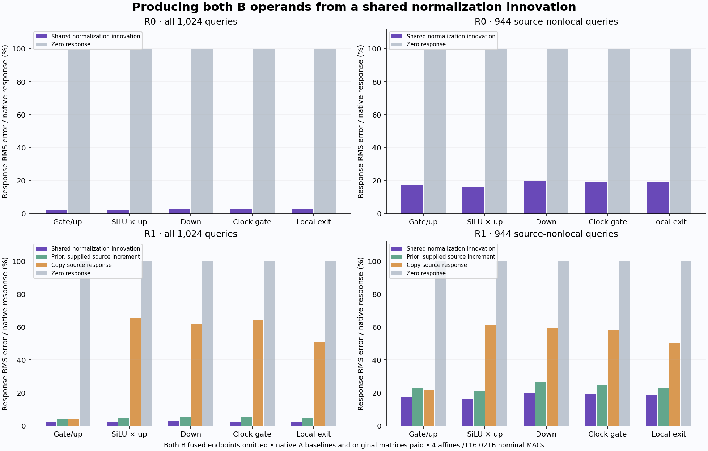

# One shared normalization innovation predicts both changed MLP operands

The predictor now forms both receivers' B gate/up operands without receiving either native B operand. Local-exit response error is **2.69% at R0 and 2.60% at R1**; source-nonlocal error is **19.08% and 18.90%**. R1 improves over the prior conditioned prediction's 4.48% /22.90%, despite removing its supplied source B fused increment.

This is a conditional local producer on a supplied shared-carrier pair, including hybrid states. It retains native A baselines, embeddings, carriers, clock constants and original learned matrices. It creates no complete velocity or image. The [frozen plan](results/normalization-innovation/frozen-plan.md), [report](results/normalization-innovation/report.json), [complete candidates](results/normalization-innovation/primary.json), [seal](results/normalization-innovation/primary-seal.json), [execution](results/normalization-innovation/execution.json), [mechanics](results/normalization-innovation-evidence/mechanics.json) and lossless [response](results/normalization-innovation/queries.jsonl.gz)/[operand](results/normalization-innovation/operand-queries.jsonl.gz) records retain the measured scope.

## Factor the normalized affine map

The [previous experiment](recipient-conditioned-product.md) reused R0's native fused increment inside R1's baseline. This experiment removes that increment. Reconstruct the actual BF16 residuals uA/uB from each receiver's embedding and the shared gated carriers:

\[
u_{rA}=\operatorname{BF16}(E_r+a_A),\qquad
u_{rB}=\operatorname{BF16}(E_r+a_B).
\]

Let C center each row. Calculate sA/sB from those committed residuals in CPU FP64, including epsilon 10⁻⁶. Use the actual retained BF16 clock constant d=BF16(1+scaleMLP) and shift b, widened to FP64. With original fused matrix W widened to FP64, form one shared grid projection and one clock row:

\[
J=W[d\odot C(a_B-a_A)],\qquad \beta=Wb.
\]

Then predict both receivers' B fused operands:

\[
\alpha_r=s_{rA}/s_{rB},\qquad
\widehat F_{rB}=\alpha_r(F_{rA}-\beta)+\beta+J/s_{rB}.
\]

This rearranges the receiving normalization's finite-change structure. Shared carrier innovation supplies J; each receiver's own scale and native A baseline supply its operating point. FP64→FP32→BF16 converts the complete prediction before native CUDA SiLU/product, down, clock gate and residual commit.

Both B fused operands, products, writes and exits seal before the primary child exits. A separate scorer then admits native B targets, native A/B output controls and the older R1 prediction. A trusted-code audit denies six canaries and records declared opens. This does not claim an adversarial OS sandbox.

## Preserve the finite defects

For the smooth reference T(u)=W[d⊙Cu/s(u)+b], define

\[
\rho_r=(u_{rB}-u_{rA})-(a_B-a_A),\qquad
\eta_{rh}=F_{rh}-T(u_{rh}).
\]

The real-arithmetic prequantization defect is

\[
\widehat F_{rB}-F_{rB}
=\alpha_r\eta_{rA}-\eta_{rB}
-\frac{W[d\odot C\rho_r]}{s_{rB}}.
\]

The shared-innovation identity is not a native-exact rewrite. FP64 evaluation also has finite precision. The candidate retains rho and combined operand errors; it runs no additional projections merely to assign causal shares to these symbolic terms.

Measured rho RMS is .000901/.000921 overall at R0/R1 and .000855/.000881 nonlocal. After conversion, gate/up response errors are 2.46%/2.07% at R0 and 2.45%/2.07% at R1. Nonlocal errors remain 18.49%/15.58% and 18.40%/15.56%. Before conversion, the corresponding nonlocal errors are about 16.0%/13.84%. Native finite policy and weak-response denominators remain material.

All four reconstructed native A/B residual payloads match their retained source bits exactly. This qualifies that input prefix; cycle48's local targets still lack an independently archived complete native-block-exit parity witness.

## Follow the prediction through its nonlinear consumer

Each relative error divides by the native B−A response norm for that receiver and stage.

| Stage | R0 all | R0 nonlocal | R1 all | R1 nonlocal | Prior R1 all | Prior R1 nonlocal |
|---|---:|---:|---:|---:|---:|---:|
| Fused gate/up | 2.31% | 17.33% | 2.29% | 17.27% | 4.25% | 22.93% |
| SiLU × up product | 2.32% | 16.08% | 2.27% | 16.11% | 4.67% | 21.48% |
| Down write | 2.79% | 19.86% | 2.76% | 20.24% | 5.74% | 26.58% |
| Gated MLP write | 2.64% | 19.02% | 2.54% | 19.16% | 5.20% | 24.78% |
| Local image exit | 2.69% | 19.08% | 2.60% | 18.90% | 4.48% | 22.90% |

Zero-response error is 100% at each aggregate. R1's raw-source transfer exit error remains 50.57% overall /50.25% nonlocal. The older controls are reused after sealing, with their historical work charged; no new reference model or control projection runs.

Better operands do not guarantee every subsequent row improves. Every R1 fused row has lower error than the older conditioned prediction, yet 96 nonlocal exit rows worsen. Exit error improves at 928/1,024 rows against that prediction and 1,012 rows against raw transfer. Median exit response error remains 27.84% at R0 and 27.63% at R1; nonlocal medians are 28.91% and 28.43%. Every exit row beats zero. These are dependent query observations from two related receivers, not independent experiments.

Endpoint exit errors are only about .27–.28%; the larger response errors are the relevant changed-computation measurement. No quality threshold erases small, adverse or heterogeneous effects.

## Physical work and retained evidence

Job **job-524c9a8e838e** succeeds in **176.10 scheduler seconds**, with **2,719.9 MB peak RSS** and **534 MB peak device usage**. One shared J and one clock beta run on CPU FP64; two native down maps run on CUDA BF16:

| Operation | Calls | Nominal MACs |
|---|---:|---:|
| Shared J | 1 | 57,982,058,496 |
| Clock beta | 1 | 56,623,104 |
| Two down maps | 2 | 57,982,058,496 |
| Total | 4 | **116,020,740,096** |

Original BF16 parameter payload is **169,869,312 bytes**; W's FP64 working copy adds 452,984,832 bytes. Two complete native B MLPs would contain 173,946,175,488 nominal affine MACs, so this selected window omits 33.30% of that count. Native A preparation is outside that denominator. FP64 CPU contractions and BF16 CUDA contractions have different hardware costs; this is not a runtime speedup.

Primary subprocess wall time, including imports, is 49.81 seconds; saved scoring is 118.03 seconds. After imports, setup is 10.59 seconds, the shared projection/capture interval 1.89 seconds, and the R0/R1 exit intervals 5.51/4.98 seconds. Primary CPU time is 22.28 seconds; allocator peak 216,012,800 bytes is separate from scheduler device telemetry. Captures, hashes, transfers, file I/O and diagnostics remain included.

No native B fused projection, extra rho projection, native LayerNorm module, attention, full Transformer, encoder, learned clock network, fit, scheduler image update, VAE or image runs. Explicit FP64 normalization statistics still process 12,582,912 input scalars. All original learned matrices and historical operand preparation remain paid.

All 260 mechanics tests pass in 17.15 seconds, including four independent smooth-identity, finite-defect, two-contraction/parameter and invalid-input checks. Twelve shipped sources are frozen. Two Saturn Acts bind original allowed inputs and the same emitted J/beta payloads to the two exits. Saturn run/verify exits 0 over 14,336 records, with no formal scientific claim receipts.

[Complete byte verification](results/normalization-innovation/retained-array-verification.json) covers 126 files / 11,090,772,578 bytes, including inherited assets and every new array. Independent shift/gate view checks reread 12,288 bytes already covered by parent-file custody. Sixty-seven new arrays total 2,894,293,376 bytes and stay near compute; fifteen compact files total 3,375,684 bytes before separate summaries and figure. The 12.17 GB shared-volume free-space observation is not cleanup attribution. Last actual archive remains 48; next storage review is 51 or earlier pressure.

The existing component-aware mrun planning request is [upvoted](results/normalization-innovation-evidence/planning-request.json) with this measured mixed CPU/CUDA geometry. The generic full-model alias preview still cannot express the selected workload without a documented measured exception. That operational limitation does not invalidate the executed numerical result.

[Astra's review](results/normalization-innovation-evidence/advisor.json) found no material source-order, arithmetic or quarantine defect. The next [addressed value-innovation plan](plans/addressed-value-innovation.md) removes the supplied B carrier as well: a frozen two-address V swap with Q/K held fixed gives one direction per head by construction. Fresh Q/K/V acquisition, all-key normalization, original linear maps and a post-seal local native reference remain paid. That plan is written and unexecuted.

This advances a conditional operand producer. It does not establish a natural shared-innovation family, inexpensive first-prompt formation, later own-state continuation, a general velocity/pixel decoder or arbitrary-prompt zero-neural image generation. The full goal remains active.
