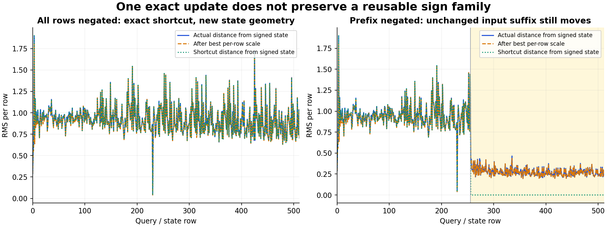

# Exact one-block reuse does not close across blocks

The output of the qualified sign shortcut leaves both the signed and the more general row-scaling family. On the saved globally negated Qwen block 18 input, the shortcut predicts H19 exactly, but H19′ is not −H19. Even the best independently fitted scale for each row leaves 98.34% of the signed-state discrepancy energy. A subsequent block must consume the actual emitted H19 unless another relation is established.

This is a measured representation limit on one authenticated context. It does not measure the next learned projection, later conditioning or image quality. Arbitrary-prompt images with zero neural evaluation remain open.



## The admitted source

The [support-aware reuse plan](plans/support-aware-computation-reuse.md) now has an authenticated result. Neighboring native job `job-74efe5506ecf` and corrected saved audit `job-ded9cc529d99` completed. The independent intake collected 41 metadata files, 1,676,498 expanded bytes, with no activation or weight payload. Twelve actual installed catalog/atlas calls verify four exact-context matches and eight source/profile abstentions. These are qualified occurrence lookups, not a general dispatcher.

The globally negated input is numerically exact at head/R/M/H19, with head/M/H19 bit-exact. R retains 903 signed-zero differences. Negating only rows 0–255 leaves those 256 support-closed rows exact numerically, with 415 residual zero-sign differences. On rows 256–511, unchanged input rows read changed keys and values: the shortcut predicts zero response and misses 100% of the actual response at all four ports. H19 response RMS there is 0.2817309802. Full-functional execution matches the native targets at all retained primary fields. No row was removed because it missed.

The failed first audit remains preserved: atlas ingestion lacked backend metadata. The corrected audit fixed publication metadata and did not rerun the model. The [public intake](results/row-sign-intake/provenance.json) retains complete compact evidence, installed-CLI results, byte identities and custody pointers. The raw 125-member / 376.59 MB source remains near compute.

## What was expanded

Let s be the incoming row sign. At the output of the block define

$$
D=H'_{19}-sH_{19},\qquad \epsilon=H_{19}-R-M.
$$

The exact retained-value account is

$$
D=\underbrace{R'-sR}_{\text{attention/residual contribution}}+
\underbrace{M'-sM}_{\text{MLP contribution}}+
\underbrace{\epsilon'-s\epsilon}_{\text{finite addition remainder}}.
$$

On support-closed negative rows the first term is numerically zero. The MLP does not inherit oddness: in real arithmetic, for the same positive G/U,

$$
\operatorname{SiLU}(-G)\odot(-U)+\operatorname{SiLU}(G)\odot U=G\odot U,
$$

$$
M(-x)+M(x)=W_d(G\odot U).
$$

That identity explains an even write. This assay reads the already evaluated writes; it does not execute the additional RHS projection. The epsilon term is required for the actual finite computation. The zero vector-closure defect is bookkeeping, not independent predictive evidence.

## A stronger test than sign mismatch

For each row, allow any real scale and fit

$$
a_i=\frac{\langle H'_{19,i},H_{19,i}\rangle}{\|H_{19,i}\|^2},\quad
E_{\perp,i}=H'_{19,i}-a_iH_{19,i},\quad c_i=s_i a_i.
$$

The perpendicular vector is computed directly in FP64. These fitted scales use the output and are retrospective diagnostics. c>0 preserves the proposed signed direction; c<0 reverses it. Positive radial scale would disappear only for ideal zero-epsilon RMS. Noncollinearity does not rule out cancellation under a particular next learned projection.

| Full-functional region | Rows | Sign-family defect RMS | Best-scale perpendicular RMS | Defect energy remaining after best scale |
|---|---:|---:|---:|---:|
| Global negative, all |512|0.9344032502|0.9266153856|98.3400%|
| Prefix negative, closed prefix |256|0.9557633364|0.9453626572|97.8354%|
| Prefix negative, mixed suffix |256|0.2817309802|0.2797309615|98.5852%|

All 512 global rows have a measured perpendicular RMS between 0.03963 and 1.81475. Global c ranges 0.49767–1.28833; no direction reversals or undefined scales occur. The globally negated endpoint RMS is 15.7835, making the signed-state defect 5.9201% of endpoint RMS. That small endpoint percentage coexists with a predominantly nonradial discrepancy. All regions and lanes share operands and are not independent replications.

For the global edit, the component energies are 0 residual, 0.8731608206 MLP, 0.0000391744 addition remainder, with a signed MLP/remainder cross term −0.0000905610. On the mixed suffix they are 0.0798091940 residual, 0.0509198905 MLP and 0.0000054587 remainder; the residual/MLP cross term is −0.0513628579. The contributions partially cancel. Raw signed terms and every per-row outcome are retained.

## Execution and reproduction

The [frozen plan](plans/sign-composition-boundary.md) ran once as guarded CPU job `job-07dd2ad27814`: 4.34 scheduler seconds, 2.8213 worker seconds, 0.6653 process CPU seconds, 278.4 MB peak RSS and 0 VRAM. One NumPy math thread was configured inside a default 4 CPU / 4 GB reservation. It evaluated no model, original weight projection, next block or image.

The request is `f34059b9d5307640521b005e2765f71bc7c613c109b8a663becac4bb3e39b5e5`; declared/sealed/executed payload is `0bae4633f0426d59269a70cc03986b8c3f6b65309f585053c2b34fc4ff7f822c`. [Complete report](results/sign-composition/report.json), [2,048 lossless row accounts](results/sign-composition/observations.jsonl.gz), [source/derived-array byte verification](results/sign-composition/retained-array-verification.json) and [provenance](results/sign-composition/provenance.json) are public. Four complete derived NPZ bundles total 251,702,160 bytes near compute; 32 source/result/derived members totaling 293,636,490 bytes were independently hashed. This total includes inherited evidence. The compact composition publication is 307,933 bytes; the metadata intake is 2,014,525 bytes.

The first evidence-plane sweep targeted the gzip publication and found no readable streams: `evidence-incomplete-empty-target`. That instrument outcome is [preserved](results/sign-composition-evidence/saturn-gzip-instrument.json). Running on the byte-identical raw JSONL then [succeeded](results/sign-composition-evidence/saturn-raw-run.json), and [verification succeeded](results/sign-composition-evidence/saturn-raw-verify.json): 1 stream / 2,048 records, no watch fires. This stream-only sweep establishes no terminal scientific claim or physical model/input address join.

```sh
../common/bin/common exec python generator/sign_composition_study.py stage artifacts/sign-composition-new \
  --compact artifacts/qwen-row-sign-intake-cycle21/extracted/binding-minimal-result \
  --verification artifacts/qwen-row-sign-intake-cycle21-verification-v1/verification.json
../common/bin/common exec python generator/sign_composition_study.py submit artifacts/sign-composition-new
../common/bin/common exec python generator/sign_composition_study.py collect artifacts/sign-composition-new
```

The 102 generator mechanics tests pass, including sign support, an even-write counterexample, finite addition remainder and undefined-scale cases. A synthetic fixture and a scheduler field-name assumption were corrected before staging; the scientific job completed on its first attempt. Full arrays stay near compute, and no storage deletion was needed this cycle; the next periodic cleanup review remains cycle 22.

## Consequence for the next computation

Astra reviewed the newest 08:42 post and this design. The next predictive cut remains the neighboring transformed-QKV campaign: emit Q′=sQ,K′=sK,V′=sV with the original strides, then run the paid original-profile attention and MLP on those emitted operands. Its two frozen edits are row 511 negative and alternating 64-row signs. It was still qualifying at this cycle's intake; this assay does not duplicate its native calls.

That candidate would avoid three edited-branch input projections, nominally 8,053,063,680 MACs at 512 rows, while charging source construction and all remaining learned operations. This is a conditional reduction. First-image arbitrary-prompt generation still needs a complete contextual encoder, denoising transitions, decoder and an own-state continuation rule at each boundary. The objective is unchanged.
