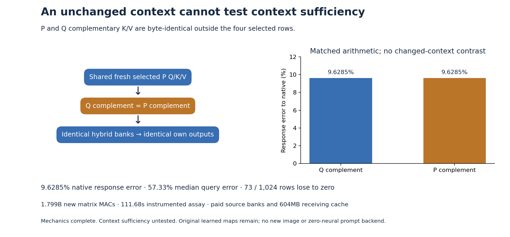

# Identical context cannot establish context sufficiency

The four-row source producer now reuses the retained source K/V complement and executes only fresh selected projections, attention, output maps and sequential MLPs. Its two arms produce byte-identical hybrid banks, source outputs and following image-attention reads. Independent byte witnesses explain the equality: **P and Q already have identical K/V outside the selected rows**. This closes a bounded reuse computation, but the proposed changed-context test is inapplicable. It supplies no evidence that genuinely different context can be ignored.

The [frozen plan](results/source-complement/frozen-plan.md), [immutable raw report](results/source-complement/report.json), [additive instrument diagnosis](results/source-complement-evidence/scalar-summary.json), [byte witnesses](results/source-complement/retained-array-verification.json) and [complete query streams](results/source-complement/queries.jsonl.gz) retain that distinction. The original report's execution status remains unchanged; the separate diagnosis explains what its zero contrast can establish.

## Factor the actual information change before testing its consumer

The specimen remains sphere-cube-plain-2027, logical diffusion step 2, source before joint0, with S=[4,11,12,13]. The previous [selected source producer](selected-source-text-producer.md) formed every current key and value while asking only four queries. This follow-up keeps its already-paid full banks and recomputes the four selected P operands once:

\[
(q_S,k_S,v_S)=\operatorname{SelectedOriginalMaps}(R_{P,S},c_P).
\]

For complementary source C in {Q,P}, assemble the actual attention operands:

\[
\widetilde K^{(C)}_j=
\begin{cases}k_{S,j}&j\in S\\K_{C,j}&j\notin S,\end{cases}
\quad
\widetilde V^{(C)}_j=
\begin{cases}v_{S,j}&j\in S\\V_{C,j}&j\notin S.\end{cases}
\]

Both arms reload the same sealed selected bytes, preserve absolute RoPE positions and use identical contiguous text-first bank geometry. Each runs its own rectangular attention, residual and sequential MLP:

\[
A_C=W_o\operatorname{Attn}(q_S,\widetilde K^{(C)},\widetilde V^{(C)}),
\quad U_C=B(R_{P,S}+B(g_A A_C)),
\]
\[
M_C=\operatorname{MLP}_{\theta}(\operatorname{ModLN}(U_C)),
\quad T_{PQP,C}=B(B(R_{P,S}+B(g_A A_Q^{paid}))+B(g_M M_C)).
\]

P's MLP consumes its own attention-updated state before the final splice uses retained Q direct attention. The emitted PQP rows feed the unchanged projected recipient reader. The paid historical QQQ baseline opens only after both arms seal and exit; it is not recomputed.

Full byte comparisons establish

\[
K_{P,\bar S}=K_{Q,\bar S},\qquad V_{P,\bar S}=V_{Q,\bar S}.
\]

The assembled operands are therefore identical before attention. Every following source field and reader output is also identical. This is an exact observation about admitted bytes and executed deterministic arithmetic. It cannot distinguish a model that needs complementary context from one that does not. The support of the intervention should have been checked before scheduling this contrast; that inexpensive byte inventory is now an explicit prerequisite for the next assay.

## Preserve finite drift and query heterogeneity

The identical arms still differ from their previous finite execution. Their native response error is **9.6285%**, with **57.3339% median query error**, **73/1,024 queries losing to zero** and two negative response cosines. Compared with cycle54, 580 native-query errors improve and 444 worsen. A small aggregate change does not make every query better.

| Reference or panel | Response error | Median query error | Queries losing to zero |
|---|---:|---:|---:|
| Native, all |9.6285%|57.3339%|73|
| Native, left physical grid half |12.7092%|72.2360%|52|
| Native, right physical grid half |8.0291%|42.7570%|21|
| Cycle54, all |2.0431%|6.4491%|0|

The new PQP source rows differ from cycle54 by .1614% and from native by .2583%. Source attention/MLP endpoint errors to native are .3908%/.6647%. These are endpoint denominators. Following reader-response errors use the intervention response, a much smaller denominator. Primary-minus-control is exactly zero on both types of observable, with undefined cosine for the zero vector. Its zero effect is not a zero prediction error against an independently changed context.

## Charge the work that remains

| New matrix work | Nominal MACs |
|---|---:|
| Shared selected Q/K/V |113,246,208|
| Two source attention QK/AV reads |75,497,472|
| Two source output maps and MLPs |754,974,720|
| Two unchanged recipient readers |855,638,016|
| **Total** |**1,799,356,416**|

Nine source affines, two source attention calls, two sequential MLPs and 52 recipient affines execute. Per recipient, the cache law additionally performs 75,497,472 multiply/add pairs, the same number of divisions and 72,351,744 inter-head additions, plus normalization, exponentiation, conversions and I/O. No full-bank projection runs, although both full hybrid bank tensors are assembled. Full P text/context pages are hydrated before gathering four input rows.

Twelve distinct original BF16 parameters total **301,990,656 bytes**. Across three processes, parameter reads total 547,357,696 bytes; each recipient also forms a 75,497,472-byte FP64 output matrix. The paid projected receiving cache is **604,372,992 bytes**. Full source banks, Q direct attention, QQQ baseline, original prefixes and historical compilation remain supplied. This is conditional reuse with original learned computation, rather than a first-prompt cost or zero-neural program.

Job job-9f27e8bc9efd succeeds in **111.68 scheduler seconds**, with **3,318.7 MB peak RSS** and **624 MB peak device usage**. Fresh shared/primary/control processes take 25.77/41.34/36.05 wall seconds including imports. This assay does less new matrix work than cycle54 but does not establish a matched runtime speedup. It runs no new full transformer, raw-prompt conditioner, diffusion suffix, VAE or image.

## Keep mechanics separate from the scientific question

All **280 generator mechanics tests pass in 18.12 seconds**. Two independent byte fixtures include rejection of a freshly rehashed hybrid whose outside-support bytes were changed. The actual release verifies 116 files / **8,596,093,933 bytes**, 84 independent NPY payload witnesses and four selected/complement splice witnesses. The splice checks reread 75,595,776 bytes; payload checks reread 838,060,032 bytes. Rereading evidence does not create that much new storage.

Thirteen executed source pins, two authenticated source page joins and five typed Acts bind the shared producer, two source outputs and two recipients. Primary cannot read P's retained complement. Control starts after primary seals and exits, and cannot read primary arrays. Targets open only after both arms finish. The [mechanics audit](results/source-complement-evidence/mechanics.json) passes; the context-substitution instrument remains inapplicable because its intended information change is absent.

Standard MDB evidence run/verify returns zero on two streams / 3,072 records, adapting seven context-effect and nineteen query predicates. The shallower schema now exposes response metrics that the previous deep nesting hid. There are no formal accepted claims or bound xref addresses, and zero fires does not establish context sufficiency.

All 51 new complete arrays / 135,899,520 bytes stay near compute. The compact scientific publication is 22 files / 758,588 bytes before the figure and additional receipts. No new archive or deletion occurs; the last actual cleanup remains cycle54, with storage review due57 or earlier pressure.

The [new historical-payload trace](../../obsidian/blog/2026-11-07-003606-how-a-historical-payload-becomes-the-next-computation.md) illustrates the missing contrast: later same-token rows can carry changed values, a fixed first attention allocation reads them, and the receiving MLP changes the next query. Our next source-information test must similarly begin with an authenticated, nonzero outside-support change. [Astra's review](results/source-complement-evidence/advisor.json) and the [next plan](plans/propagated-context-support.md) keep this separate from arbitrary-prompt conditioning, autonomous state advancement and zero-neural pixels, which remain open.
