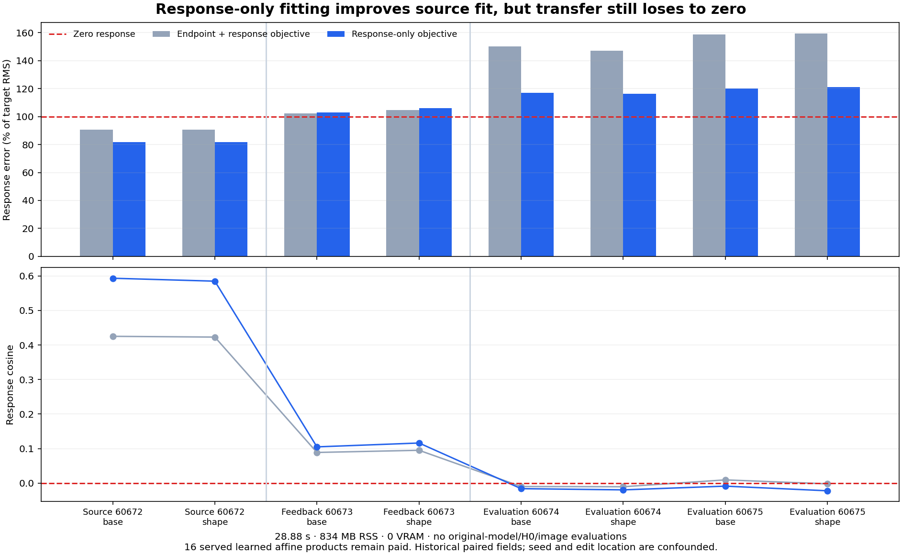

# Separating endpoint fit from response transfer

Removing endpoint loss improves the fitted nonlocal response on discovery fields, but does not make it useful on the six feedback/evaluation pairs. Same-location feedback gets slightly worse. Top-left evaluation error falls substantially, mostly because predicted response amplitude falls; its direction still has negative cosine on every field. Predicting zero response remains better throughout feedback and evaluation.

This is a response diagnostic using retained arrays, not a complete velocity or image generator. No original model, attention reader or VAE runs. It still fits and evaluates learned affine maps. Arbitrary-prompt images with zero learned computation remain open.

The [frozen protocol](results/source-response/frozen-plan.md), [raw report](results/source-response/report.json), [fit](results/source-response/fit.json), [candidate seal](results/source-response/candidate-seal.json), [mechanics](results/source-response-evidence/mechanics.json) and [scope clarification](results/source-response-evidence/report-correction.json) preserve the executed account. This follows the [source-native reader result](source-native-global-reader.md).

## Change the objective, preserve the operands

For each paired distant edit, retain only the 944 queries outside its 8×8 edited region and four-neighbor halo. Local latent and previous-velocity coordinates match exactly there. The old shared writer therefore predicts, before output quantization,

\[
\Delta\widehat v=X_\Delta B_H,
\qquad X_\Delta=(H_B-H_A)/s_H.
\]

The inherited scale s_H is the original discovery feature standard deviation. It is not refitted to response differences. The new objective removes endpoint loss and intercept:

\[
B_\Delta=\arg\min_B
\frac1N\|X_\Delta B-Y_\Delta\|_F^2+.01\|B\|_F^2,
\qquad Y_\Delta=v_B-v_A.
\]

Two seed60672 discovery pairs give N=1,888 rows, 3,072 features and 128 outputs. A single FP64 dual solve computes

\[
B_\Delta=X_\Delta^\top
(X_\Delta X_\Delta^\top+N(.01)I)^{-1}Y_\Delta.
\]

This is the equivalent ridge solution with a smaller solve dimension. There is no epoch, gain/ridge search, new normalization or feedback selection. Both the new writer and inherited B_H control produce raw FP64 responses, with no BF16 output conversion. Comparing raw with raw isolates the objective contrast from the prior generator's output quantization.

The zero baseline exists before the proposal. Saturn Frames/Acts bind its source contract and fitted coefficient write, retaining both immutable branches. Selecting the baseline again verifies its identity; it does not claim restoration of a mutable optimizer. Coefficients seal before a fresh serving actor produces all 24 logical responses. Every candidate seals before the scoring process opens old evaluation labels. Numerical actors deny neural frameworks, network access and undeclared files, including two canaries. The canonical typed control process imports Torch, but constructs/evaluates no model.

## Discovery improves; transfer remains inadequate

| Cohort | Old writer response error | Response-only error | Response-only cosine |
|---|---:|---:|---:|
|Discovery60672 base|90.77%|81.79%|.5934|
|Discovery60672 shape|90.66%|81.61%|.5850|
|Same-location feedback60673 base|102.37%|103.06%|.1049|
|Same-location feedback60673 shape|104.75%|106.03%|.1161|
|Top-left evaluation60674 base|150.31%|116.92%|−.0161|
|Top-left evaluation60674 shape|147.06%|116.29%|−.0196|
|Top-left evaluation60675 base|158.80%|120.18%|−.0088|
|Top-left evaluation60675 shape|159.32%|121.22%|−.0223|

Error is RMS discrepancy divided by target response RMS. Zero response gives 100%. Each role pair shares a seed; these are eight dependent contrasts, not thousands of independent query tests. Same-location feedback and top-left evaluation differ in seed and location, so their discrepancy cannot isolate location causally. Every label already existed historically; delayed access does not create prospective evidence.

The source fit remains far from interpolation: its mean squared error is .00448464 and relative errors remain about 82%. The fixed regularization, inherited feature scaling, linear family and source coverage can all matter. This run neither proves insufficient information in H0 nor demonstrates that removing endpoint competition is enough.

## Factor amplitude and direction

For a fixed measured raw prediction P and target T, define a=||P||/||T|| and c=cos(P,T). Then

\[
\frac{\|P-T\|^2}{\|T\|^2}
=1+a^2-2ac.
\]

The response-only evaluation amplitude ratios are .574–.663, versus 1.068–1.243 for the original writer. Their smaller a² terms account for most of the error reduction. Direction does not improve into positive alignment. On feedback, both amplitude and cosine increase slightly, but the larger amplitude penalty outweighs the alignment gain.

For a nonnegative scalar gain g applied to each fixed prediction,

\[
E(g)=1+g^2a^2-2gac.
\]

All four response-only evaluation fields have c<0, so every strictly positive gain gives E(g)>1. Positive amplitude adjustment alone cannot beat zero on those fixed aggregate fields. This is a post-hoc identity, not a fitted gain, serving policy, per-query statement or general exclusion result. Another decoder or nonlinear representation could change the direction.

## Measured work and integrity

Job job-2d99ab01e1ac succeeds in 28.88 scheduler seconds, peaking at 833.9 MB RSS and zero VRAM. Intent-first admission chooses its default 4,096 MB RAM, zero VRAM and four reserved CPU threads; arithmetic is configured to one thread. No faster-backend or serving-speed claim is made.

The fit takes 1.6037 seconds/.7614 CPU seconds including source access and retention. Its Gram product costs 10,950,279,168 nominal MACs; coefficient formation and post-fit prediction cost 742,391,808 each. The dense-LU solve estimate is 5,399,095,979 FLOPs. The coefficient array occupies 3,145,728 bytes. These are shape-derived operation accounts, not hardware counters.

Serving takes 4.4660 seconds/.8400 CPU seconds including retained fields. Sixteen learned affine products cost 5,939,134,464 nominal MACs; eight logical zero responses reuse one physical zero array. NumPy2.5.4 and the actual Python version are recorded. All old H0 production, native labels and prefixes remain paid preparation.

The raw report's newModelEvaluations=0 means no original pretrained-model/runtime evaluation. Its newH0Reads=0 means no new attention-read computation; cached H0 files are loaded. Neither field means zero learned arithmetic. The additive [clarification](results/source-response-evidence/report-correction.json) preserves the raw report and explicitly charges the response products.

All 231 mechanics tests pass. New checks compare dual ridge with independent augmented least squares, validate the exact unchanged-query mask/local-operand admission, and verify fresh-process framework/target denial. The publication audit checks the fixed source scale, typed coefficient lineage, 24 outputs, shared zero allocation and 22,656 lossless observations. Full-byte verification covers 133 files/395,602,450 bytes. Large arrays stay near compute; the compact bundle has 16 files/3,018,110 bytes before separate evidence and figure.

The guarded executed payload is 03b2073a21e00bbe6f4ec3a4d3ba9fed0d9270978bf6ecd5911b1853aec8457d, 1,119,895 bytes. Initial staging refused a missing explicit analysis task-family declaration before submission. Updating publication prose later changed its verifier-source hash and correctly refused publication; a second byte verification covers the identical file inventory, preserving both receipts. Neither refusal is a scientific result. Saturn run/verify returns0 over the original 22,656-row stream, with no fires or formal claim receipts.

The neighboring [all-layer transition comparison](../../obsidian/blog/2026-11-06-184700-compiling-cheaper-transitions-on-the-states-they-create.md) has now completed. A receiver-coverage refresh improves local write error while both substantially cheaper all-layer programs lose useful chat. Together these results distinguish geometric coverage, local approximation and the direction that later computation needs. The [MLP–reader composition](../../obsidian/blog/2026-11-06-180411-a-cheap-mlp-feeds-a-cheap-attention-program.md) and [own-history comparison](../../obsidian/blog/2026-11-06-184252-the-same-query-program-visits-a-different-future.md) supply complementary producer/future constraints. A smaller computation needs those functions to survive its actual state transitions.

[Astra42](results/source-response-evidence/advisor.json) selects one [source-spectrum diagnostic](plans/source-response-spectrum.md) next. Reconstruct the existing ridge prediction from one thin SVD and separate its continuous attenuation from numerically unresolved source directions. The weak source fit makes a deeper producer experiment premature. This plan is written and unexecuted; no alternate predictor or historical-target selection is proposed.
