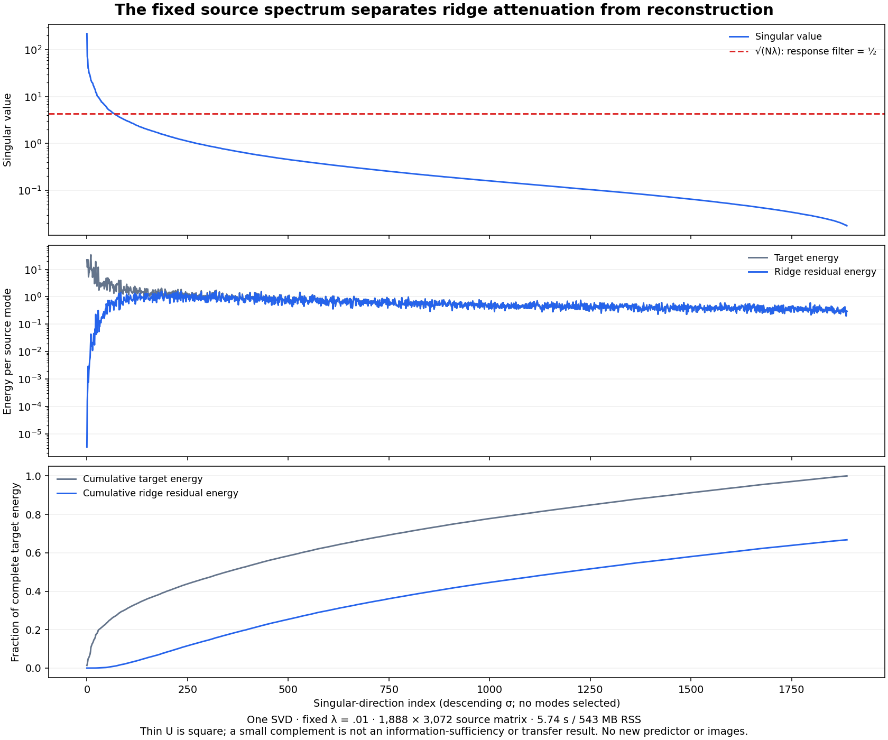

# The source fit is being attenuated

One fixed-source spectral analysis explains the response writer's approximately 82% discovery error: its declared ridge penalty strongly attenuates directions that the finite source matrix can resolve. This removes one ambiguity in the [response-only result](source-native-response-writer.md). It does not show that those directions contain transferable information, or that interpolating them will help a new state.

Job job-7a556e85153a completes in **5.74 scheduler seconds**, peaking at **542.8 MB RSS and zero VRAM**. There is no new predictor, learned fit, model evaluation, attention computation, decoder or image. The result remains a target-assisted analysis of old learned operands and labels. Arbitrary-prompt zero-neural image generation remains open.

The [executed frozen protocol](results/source-spectrum/frozen-plan.md), [report](results/source-spectrum/report.json), [analysis seal](results/source-spectrum/analysis-seal.json), [mechanics audit](results/source-spectrum-evidence/mechanics.json), [scalar derivations](results/source-spectrum-evidence/scalar-summary.json) and [Astra review](results/source-spectrum-evidence/advisor.json) preserve the evidence. Full arrays stay near compute; all 1,888 mode records are retained losslessly.

## Factor the computation we already ran

Keep the actual discovery difference matrix X, response targets Y, inherited normalization and lambda=.01. Two related discovery pairs contribute 944 unchanged-query rows each: X has shape 1,888×3,072 and Y has shape 1,888×128. At these queries, local latent and previous-velocity coordinates match exactly across the edit. X therefore represents the changed global attention output, divided by its previously frozen scale.

The previous writer minimizes

\[
B_\lambda=\arg\min_B\frac1N\|XB-Y\|_F^2+\lambda\|B\|_F^2.
\]

Take one thin FP64 decomposition X=UΣVᵀ, let C=UᵀY and tau=N lambda=18.88. Factoring the ridge solution gives

\[
B_\lambda=V\operatorname{diag}
\left(\frac{\sigma_i}{\sigma_i^2+\tau}\right)C,
\qquad
\widehat Y=U\operatorname{diag}
\left(\frac{\sigma_i^2}{\sigma_i^2+\tau}\right)C.
\]

Each source direction has a response filter f_i=sigma_i²/(sigma_i²+tau). Its residual filter is 1−f_i. Orthogonality separates the energy:

\[
\|Y-\widehat Y\|_F^2
=\|Y-UU^\top Y\|_F^2
+\sum_i\left(\frac{\tau}{\sigma_i^2+\tau}\right)^2\|C_i\|^2.
\]

This reconstructs the already-sealed prediction; it does not fit a replacement. The maximum discrepancy from the original dual solve is 1.1782×10⁻¹⁴. Reconstructed residual energy is 1,083.775 against target energy 1,623.421, giving aggregate relative RMS **81.706%**. Spectral and direct residual energies agree to the recorded floating-point discrepancy; no arbitrary cross-solver tolerance selects a scientific outcome.

## Where the source error comes from

The singular values range from .0175199 to 220.7809, a condition number of 12,601.7. The descriptive FP64 reference max(N,d) epsilon sigma_max is 1.506×10⁻¹⁰. Every retained singular value is far above that scale. This comparison describes numerical resolution; it is neither a scientific rank gate nor evidence that BF16-derived inputs encode reliable unseen responses.

The fixed penalty passes more than half of a direction when sigma_i>sqrt(18.88). Only 68 of the 1,888 modes exceed that half-response point. **73.375% of source target energy and 98.576% of residual energy lie in directions attenuated by at least half.** The full filters and energies remain available, without mode selection.

The energy outside thin U is about 1.74×10⁻²⁶. Here U is square because N<d; that complement would be nearly empty even if singular values were zero. The complement alone therefore says little. The combination of the complete resolved spectrum and measured continuous filters explains this particular finite fit. It establishes no informative causal span, semantic sufficiency or general decoder.

There are more input features than discovery rows. Exact interpolation can consequently memorize these dependent source contrasts. Numerical rank answers whether this finite linear system resolves directions; transfer asks whether its map predicts what another receiver needs. Those are different questions.

## The cost of removing attenuation is visible before serving

The retained scalar modes permit a diagnostic of coefficient magnitude:

\[
\|B_\lambda\|_F^2
=\sum_i\frac{\sigma_i^2}{(\sigma_i^2+\tau)^2}\|C_i\|^2
=4.8015,
\]

\[
\|B_0\|_F^2
=\sum_i\frac{\|C_i\|^2}{\sigma_i^2}
=144842.47.
\]

The corresponding norm ratio is **173.68×**. No B_0 coefficient array or predictions are constructed in this run. Exact-zero denominators would remain undefined in the mode records; none occurs here. The large ratio warns about potential sensitivity and source-specific fitting. It does not demonstrate instability, nor prove that removing attenuation cannot help.

The [next written protocol](plans/minimum-norm-source-response.md) follows Astra's recommendation: one all-mode minimum-norm endpoint, using the saved decomposition, before scoring the same archived held roles. This deliberately changes regularization to the untuned interpolation endpoint. It is not equivalent to multiplying the old response by a positive gain: it reweights directions and may rotate predictions. Its usefulness has to be measured. No rank, gain or regularization grid is proposed.

## Measured work and evidence boundaries

The one SVD takes 2.5343 seconds. Source access, contractions and array retention together take 3.5987 worker wall seconds and 3.0723 process CPU seconds. Intent-first admission reserves 4,096 MB RAM, zero VRAM and four CPU threads; BLAS is configured to one. NumPy 2.5.4 and Python 3.14.6 are recorded. No comparative backend speedup is claimed.

Target projection, target reconstruction and ridge-prediction reconstruction each cost 456,261,632 nominal MACs. Reconstructing X costs 10,950,279,168. Their total is **12,319,064,064 nominal contraction MACs, excluding the SVD itself**. These are shape-derived accounts, not hardware counters. Original H0 production, native labels and the previous learned response fit remain paid preparation.

The execution imports no neural frameworks. A declared-file audit hook excludes held predictions and native targets, with two denied canaries; it is trusted-code quarantine, not an adversarial sandbox. Six source pins, two source pairs, fourteen retained arrays and the complete ordered spectrum pass publication mechanics. Full-byte custody covers 35 input/output files totaling 137,795,521 bytes. The compact primary bundle is ten files/204,477 bytes before separate evidence and figure. All 234 generator mechanics tests pass, including independent augmented-least-squares and known-spectrum/zero-direction checks. Saturn run/verify succeeds on the original uncompressed 1,888-record stream; this certifies stream applicability only, with no watch fires or formal claim receipts.

The guarded executed payload is 294aa56962d5406010ae9dff78a638236b8abc6f517284eb5a733f481c43b9b9, 21,650 bytes. The analysis seal is 598201a4bfa3add9dac44ba29ffe9d05563e6ccc90305ff5bab5ada6fcfeaed6. The frozen worker sources are unchanged after execution.

The newest [all-layer transition study](../../obsidian/blog/2026-11-06-184700-compiling-cheaper-transitions-on-the-states-they-create.md) strengthens the same distinction: receiver coverage and local writes improve, but write error remains about 49% and useful all-layer behavior fails. Composition is not isolated as the sole remaining problem. This spectrum improves our account of one local approximation; a reusable computation must still earn its usefulness on the future state it actually receives.
