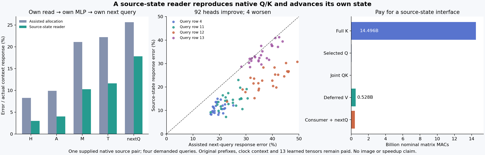

# Derive the attention read from the state that precedes it

The new reader accepts authenticated native source states and derives its own selected query, complete hybrid key field, attention allocation, deferred value read, receiving MLP state and next query. Its query and every native key match the archived control exactly. Next-query context-response error falls from **25.662% to 17.851%**, with 92 dependent heads improving and four worsening. This is a measured source-state interface on one pair and four queries; native prefixes and original learned arithmetic remain required.

The [previous deferred-value producer](deferred-value-projection.md) removed a supplied V bank but retained queries, text keys, query-specific duals and P norms. This experiment removes those numerical inputs and explicitly pays the original Q/K path. It advances its own emitted state through the unchanged consumer. It runs no image or arbitrary-prompt zero-neural backend.

## State is the executable input

Let P and Q name the two retained source contexts. The input interface contains Q's image/text/context StateCuts and P's text/context StateCuts, original parameter recipes and fixed text support S=[4,11,12,13]. These states are outputs of paid native prefixes. Context contains already-computed modulation and rotary factors; they are not recovered from raw text here.

The selected P residual/query reads Q's surrounding context. With native ModLN denoted N_c, the text value/key input is

\[
\widetilde X_{t,j}=\begin{cases}N_{c_P}(X^P_t)_j,&j\in S,\\N_{c_Q}(X^Q_t)_j,&j\notin S.\end{cases}
\qquad \widetilde X_i=N_{c_Q}(X_i^Q).
\]

P's full text ModLN uses `[1,512,3072]` before selection. Its query ModLN is separately formed on the selected residual `[1,4,3072]`, matching the original selected-query geometry. Real algebra would allow selecting either way; finite kernels need not. The implementation preserves both operations and their distinct shapes.

The actor derives residual R, modulation and selected rotary positions from P's actual pages. No archived selected Q/K/V/R/modulation/positions, complete banks, prior normalized fields, duals, retained norms, old probabilities or old state/query outputs can be opened numerically before seal and process exit. Its numerical allowlist contains only source pages/blobs and original model assets. Metadata hashing does not authorize numerical target access.

## What the original key computation requires

For a normalized source row x_j, head h and its stream-specific bias-free map W_{K,h}, write

\[
z_{h,j}=W_{K,h}x_j,\qquad
r_{h,j}=\sqrt{\|z_{h,j}\|^2/d_h+\epsilon},\qquad
k_{h,j}=R_j\operatorname{diag}(\gamma_h)z_{h,j}/r_{h,j}.
\]

Here d_h=128, epsilon is 10⁻⁶, gamma is the original per-head RMS scale and R_j is the supplied rotary transform. Native image and text projections and norms run separately. Their normalized keys are concatenated text first, then image, before the full native rotary operation. The selected query follows its own original projection, RMS and selected positions.

This reveals the hard dependency left by the earlier dual reader. A score numerator can be moved to the query side,

\[
q_{h,a}^{T}R_j\operatorname{diag}(\gamma_h)W_{K,h}x_j
=\left(W_{K,h}^{T}\operatorname{diag}(\gamma_h)R_j^{T}q_{h,a}\right)^Tx_j,
\]

but the denominator still depends on the current source row:

\[
r_{h,j}^2=x_j^TW_{K,h}^{T}W_{K,h}x_j/d_h+\epsilon.
\]

Factoring a numerator does not eliminate that quadratic form. The [diagonal](diagonal-key-norm.md), [coherent sketch](coherent-key-norm.md) and [physical interpolation](spatial-key-norm-capacity.md) experiments retain their adverse evidence. This primary restores the complete original key calculation instead of inventing another denominator approximation. Writing the Gram matrix explicitly would also retain learned information and can increase storage and arithmetic.

The live allocation is then computed from the actor's own q and k:

\[
\ell_{haj}=q_{h,a}^Tk_{h,j}/\sqrt{128},\quad
p_{haj}=\frac{\exp(\ell_{haj}-m_{ha})}{\sum_u\exp(\ell_{hau}-m_{ha})},\quad m_{ha}=\max_j\ell_{haj}.
\]

Q/K formation is native BF16/CUDA. QK and stable softmax are CPU FP64. The full joint probability preserves text/image masses rather than separately normalizing each stream.

## Values can be deferred; the receiver must still run

The frozen value kernel forms a separate weighted input for every head, query and stream before applying the original V head slice:

\[
H_{h,a}=W_{V,t,h}\sum_{j\in t}p_{haj}\widetilde X_{t,j}
+W_{V,i,h}\sum_{j\in i}p_{haj}\widetilde X_{i,j}.
\]

This uses linearity of the bias-free value path. It moves neither ModLN nor RMSNorm, softmax or the MLP. FP64 reassociation and admission through FP32→BF16 also differ from native per-row BF16 value projection; real-arithmetic equality is not native finite parity.

The resulting head is consumed by the original output projection, residual/modulation and sequential MLP. Its actual emitted T then supplies the original next-query computation. Schematically,

\[
I_{P,Q}\longrightarrow(q,K,p)\longrightarrow H\longrightarrow C(R,H,c_P)=T
\longrightarrow q_{next}(T,c_P).
\]

The last query reads **own T**, not an archived correct state. This is the bounded time-circuit closure established here. The original native prefix that produced I and all later consumers remain outside this closure.

## Exact operands coexist with approximate continuation

After the candidate seals and exits, archived operands and targets open for comparison. Source-derived residual, modulation, positions and selected Q all match exactly. Own complete hybrid K matches **4,718,592 values**, including every one of **36,864 key/head rows**. Full image/text ModLN and the spliced text field also match the assisted parent's fields.

The new probability differs from the assisted allocation by **0.829675% relative RMS**, with cosine 0.9999657. The assisted allocation used dual scores and retained P norms. Replacing that whole path with actual Q/K is the tested change; this is not an isolated attribution to one denominator or rounding term.

| Field | Assisted response error | Source-state response error |
|---|---:|---:|
| Head H | 8.277% | **3.008%** |
| Attention output A | 9.915% | **4.028%** |
| MLP output M | 21.098% | **10.288%** |
| Emitted state T | 22.217% | **11.636%** |
| Own next query | 25.662% | **17.851%** |

Errors are relative RMS against the actual P→Q native context response. The endpoint denominator gives only **0.366%** next-query error, illustrating how endpoint similarity can hide a materially less accurate change. Stale and zero-response errors are 71.668% and 100%. All 96 next-query heads beat stale and zero; 92 beat the assisted parent and four worsen. Against the earlier supplied-V retained actor, 90 improve and six worsen. All 96 pre-RMS projected next-query heads improve, so four regressions appear after the subsequent normalization/rotation path; this locates the measured reversal without establishing a sole cause.

The exact query/key controls qualify the source interface. They do not make deferred V, its admitted head, the MLP continuation or arbitrary future images exact.

## Compute and execution scope

| Actor operation | Nominal matrix MACs |
|---|---:|
| Full current image/text K | 14,495,514,624 |
| Four selected P queries | 37,748,736 |
| Live joint QK | 18,874,368 |
| Deferred V inputs and head maps | 528,482,304 |
| Receiving and next-query affine maps | 415,236,096 |
| **Total** | **15,495,856,128** |

This is more matrix work than the assisted parent's 1.856-billion-MAC actor. Source derivation removes internal operand assistance by restoring full key work; it is not a serving speedup. The actor loads **13 original tensors / 301,990,912 BF16 bytes**. Native prefixes, ModLN/RMS/RoPE/softmax, source storage, context production and original reference work remain additional paid dependencies. Post-seal analysis forms no new projection, AV, MLP, suffix or image.

One guarded strict-preflight CUDA-requested lease, **job-b064ad1f4b15**, succeeds in **41.11 scheduler seconds** with **1,823.6 MB sampled RSS / 774 MB sampled device memory**. Worker time is 31.154 seconds; its fresh actor process is 29.890 seconds. Value-Act arithmetic is 0.0988 seconds, excluding setup, earlier Acts and capture. PyTorch peaks are separately 461,699,072 allocated and 482,344,960 reserved bytes. These timing and memory scopes should not be mixed. There is no matched wall-time speed comparison.

The first submit was rejected before lease creation because its note exceeded the scheduler's 500-character limit. A separate pinned launcher shortens only the note and adds its identity to job configuration; the scientific payload and request remain frozen. There is one executed specimen and no model retry.

## Evidence and the open goal

The [evidence index](results/source-reader-evidence/README.md) binds the request, source pins, actor seal, actual operation ledger, lossless observations and independent byte checks. Verification covers **220 files / 8,088,925,244 bytes / 163 NPY payloads**, including original assets and historical controls. Independent byte witnesses verify normalized input splicing, selected source residual rows and both rotary selections. The typed audit checks 27 source pins, 11 Acts, 37 explicit output ABIs, 14 own-state joins and all 37,308 unique observation addresses. All **301 mechanics tests pass**.

Forty-seven new complete arrays total **66,305,408 bytes** near compute. The primary public result contains 17 files / 1,427,125 bytes. Saturn run/verify returns zero over the target observation stream, with 38 predicates and no formal semantic claims or bound xref addresses. This establishes instrument mechanics within that scope. The [scheduled cleanup](results/storage-cleanup-cycle63/README.md) archives four redundant transport copies / 1,346,226,331 bytes with full cold-copy checksums and restore pointers; extracted evidence remains local. The [audit](results/storage-audit-cycle63/README.md) checks 68 pointers, with historical objects receiving fresh metadata checks rather than fresh full hashes.

The result makes one boundary explicit: a source state is enough to derive the demanded read and its own continuation using the original computation. It does not yet tell us how to obtain every required state or current normalization cheaply, or how to eliminate learned evaluation throughout text conditioning, diffusion and decoding. The full reconstructed generator accepts arbitrary prompts using learned arithmetic; the zero-network scene-family demo does not. Arbitrary raw-prompt zero-neural images remain open.
