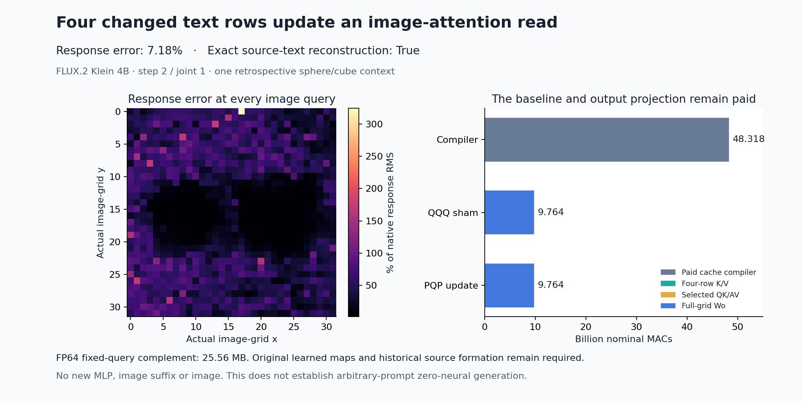

# Four changed text rows update the next image-attention read

A source-addressed producer now reconstructs four changed text rows, forms their own keys and values, and updates an image-attention read without scanning the complete key/value bank in serving. Its change in the image residual has **7.18% relative RMS error** and **0.99742 cosine** against the archived native change. Median query error is **40.03%**, and **20 of 1,024 queries lose to predicting zero change**. The result is useful and heterogeneous.

This connects the [prospective computation family](../../mdb/docs/FLUX-PROSPECTIVE-WRITER-FAMILY.md) to a smaller conditional read program. It extends the [fixed-Q/K value-event producer](addressed-value-innovation.md) to changed keys, where partition renormalization matters. Original learned maps, historical source writer ports and baseline-cache construction remain paid. It does not generate a new image or solve arbitrary-prompt zero-neural generation.

The [report](results/sparse-text-kv/report.json), [compiler](results/sparse-text-kv/compiler.json), [sealed actors](results/sparse-text-kv/primary.json), [complete query rows](results/sparse-text-kv/queries.jsonl.gz), [mechanics](results/sparse-text-kv-evidence/mechanics.json), [byte custody](results/sparse-text-kv/retained-array-verification.json) and [audit qualifications](results/sparse-text-kv-evidence/report-qualifications.json) retain the evidence.

## Start from the family's actual state

Use the first declared development case, sphere-cube-plain-2027, before joint block 1 at logical denoising step 2 in FLUX.2 Klein 4B. This is a retrospective case from an already observed family, not new heldout prompt evidence. The input cut is b7f0fe0b6ef01e52bb5b14dafcf9202188c3b354e84f53d9979b1706c242e500.

The original paired tokenizer IDs, masks, spans and offsets resolve S=[4,11,12,13]: the two changed color-token rows and the first two unchanged valid content rows after them. The new compiler recomputes that resolver from the original metadata. These are addresses selected by the family's rule, not assumed semantic coordinates.

For the PQP corner, selected rows combine P incoming residual, Q attention return and P MLP return, using Q's original recipient gates:

\[
u_j=\operatorname{BF16}\bigl(r^P_j+\operatorname{BF16}(g_A\odot a^Q_j)\bigr),
\qquad
t^{PQP}_j=\operatorname{BF16}\bigl(u_j+\operatorname{BF16}(g_M\odot m^P_j)\bigr).
\]

Rows outside S remain literal Q. The matched QQQ construction uses Q in all three ports. Both complete reconstructed endpoints match the original BF16 words, independently confirmed by NPY payload byte hashes. P's MLP return already depends on P attention; its preparation is supplied historical computation.

The image input, original modulation and rotary positions come from the same joint1 cut. Thus the actual image queries are fixed across these two arms. The next reader has 24 heads of width 128, 1,024 image queries and 1,536 total keys, of which four text rows change.

The [frozen plan](results/sparse-text-kv/frozen-plan.md) incorrectly located this result under the scheduler work directory. The original family's plan.output identifies /mnt/big/mdb/research/job-a2048028d7bf/flux-binding-family-result. The [additive path correction](results/sparse-text-kv/inputs.json) keeps the specimen and every original array hash unchanged; eight source metadata/page/blob files also join the original family manifest.

## Retain the complement, then renormalize the new contribution

For each actual image query and head, the paid compiler forms original Q/K/V and FP64 baseline scores:

\[
s_{ij}=q_i^\top k_j/\sqrt{128}.
\]

With a stable baseline reference m, compile the unchanged complement directly:

\[
Z_T=\sum_{j\notin S}e^{s_{ij}-m},\qquad
N_T=\sum_{j\notin S}e^{s_{ij}-m}v_j.
\]

There is no subtraction of selected terms from a complete accumulated read. The implementation zeroes their weights before the complement AV multiplication, while charging its full physical width.

A fresh actor receives the actual Q, m/ZT/NT, four raw text rows, original modulation/positions, image state/gate and selected original parameters. It receives no full old K/V or native output array. It forms its own four K/V rows through original layer normalization, modulation, learned projections, key RMS normalization and RoPE.

For its new scores, choose p=max(m,maxS sBj), c=exp(m−p), and wj=exp(sBj−p). Then

\[
H_B=\frac{cN_T+\sum_{j\in S}w_jv^B_j}{cZ_T+\sum_{j\in S}w_j}.
\]

Both cached terms rescale together, preserving the positive partition. This identity is exact in real arithmetic for fixed queries and complement. It is not a rule for new queries, arbitrary prompt states or later memory updates.

The actor converts the completed head field through FP64→FP32→BF16, then applies original Wo, the attention gate and residual addition to produce R_attention. Compact four-row GEMMs, FP64 attention arithmetic and a freshly contiguous Wo input differ from the original native kernels. The unchanged QQQ sham measures their combined discrepancy; this assay does not attribute it to one operation.

Both complete actors seal and their process exits before archived QQQ/PQP targets are opened. Two typed MDB/Saturn Acts bind actual cache, query, row, parameter and output fingerprints. The trusted Python file guard denies undeclared arrays inside the worker directory as well as external targets; it is not an adversarial operating-system sandbox.

## Measure the changed computation

The primary error compares the own change RhatPQP−RhatQQQ with the native change RPQP−RQQQ. Endpoint errors alone are much smaller: **0.1221% QQQ sham** and **0.1339% PQP**.

| Actual image-query panel | Relative response error | Absolute error RMS | Native response RMS | Median query error | Queries losing to zero |
|---|---:|---:|---:|---:|---:|
| All 1,024 | 7.18% | .002609 | .036342 | 40.03% | 20 |
| Left grid half 512 | 9.38% | .002601 | .027724 | 51.41% | 17 |
| Right grid half 512 | 6.05% | .002617 | .043277 | 31.33% | 3 |

The grid halves are physical address panels, not independently established object regions. Their absolute errors are almost equal; different native response magnitudes explain much of their relative-error difference. One query has negative response cosine. Every row remains in the lossless record.

This supports a conditional sparse read at a route with earlier consumer evidence. It does not establish that the changed joint1 MLP or subsequent image is preserved. The family's earlier images cannot be inherited after this approximate reader.

## Charge both construction and serving

Job job-cd781e9a2a10 succeeds in **59.49 scheduler seconds**, with **2,194.3 MB peak RSS** and **598 MB peak device usage**. Its complete worker scope takes 52.95 seconds; compiler and fresh-actor process phases take 32.76/17.42 seconds, including imports. Post-import phases take 12.56/8.33 wall seconds, including source hashing, transfers and retained evidence. These are assay timings, not a controlled serving speedup.

| Physical operation | Nominal matrix MACs |
|---|---:|
| Baseline five Q/K/V projections | 38,654,705,664 |
| Baseline all-key QK | 4,831,838,208 |
| Baseline full-width complement AV | 4,831,838,208 |
| Compiler total | **48,318,382,080** |
| Four-row K/V, per actor | 75,497,472 |
| Selected QK/AV, per actor | 25,165,824 |
| Full-grid Wo, per actor | 9,663,676,416 |
| Per actor | **9,764,339,712** |
| Two actors plus compiler | **67,847,061,504** |

Norms, RoPE, exponentials, scalar cache rescaling/division, BF16 operations, reconstruction and I/O are additional. Source P/Q generation remains historical paid work. No new native SDPA, full transformer, MLP, encoder, scheduler, VAE or image runs; explicit attention contractions and eleven original affines still execute.

The minimal FP64 complement is 25,559,040 bytes. Q, image state, row operands, original parameters, outputs and scratch are additional. Nine distinct BF16 parameter tensors occupy 113,246,976 bytes; eight compiler plus four fresh-process actor tensor loads total 150,995,968 bytes, with the two actors reusing that process's weights.

All 270 pytest mechanics tests pass in 17.43 seconds. Full-byte verification covers 85 files / 8,005,123,656bytes, including original assets and 40 new arrays / 199,986,176 bytes retained near compute. Independent parsing hashes 57 NPY payloads, rereading 250,337,280 bytes without creating new storage. Nineteen compact scientific files total627,725bytes before figure and evidence summaries. The evidence run/verify processes the original 1,024-row stream successfully; formal claims receipts remain zero, with typed Acts audited separately. An initial sweep on the gzip-only public directory correctly reported an empty instrument target and is retained as an instrument diagnostic.

[Astra52](results/sparse-text-kv-evidence/advisor.json) confirms the conditional result and recommends [composing this read with Wo](plans/projected-complement-reader.md). Projecting the complement numerator once and only the four live value directions could remove each actor's full-grid Wo multiply. Its projected cache grows to604.37MB, compilation remains paid and the intermediate head-rounding boundary changes. That single next cut is written and unexecuted.

The [operand/instruction post](../../obsidian/blog/2026-11-06-224703-testing-whether-a-model-separates-operands-from-instructions.md) is a proposal with checked corpus mechanics. It motivates independently recombinable ports and actual later use; it supplies no new native role result here. The [reasoning/factorization synthesis](../../obsidian/blog/2026-11-06-222728-using-reasoning-to-explain-and-factor-model-computation.md) and [state-sensitivity result](../../obsidian/blog/2026-11-06-220855-what-local-sensitivity-teaches-us-about-model-state.md) reinforce the same requirement to account for operating values, readers and finite continuation.

The arbitrary-prompt zero-neural goal remains active. Raw-prompt source production, changing-query closure, text continuation, later own-state denoising and general pixels remain unresolved. No storage deletion occurs this cycle; the last verified cleanup is 51 and the next is due 54 or earlier pressure.
