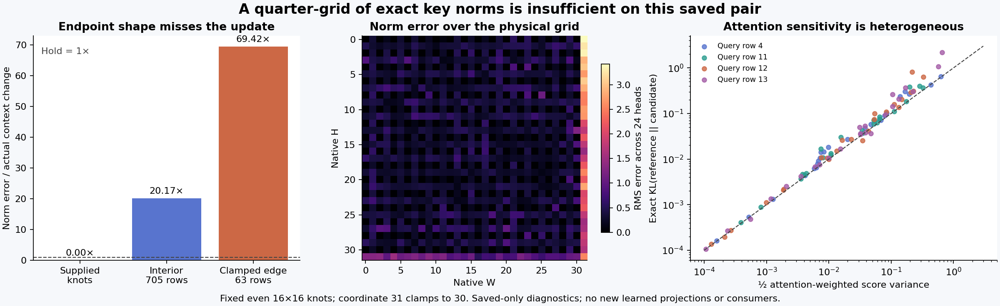

# A smooth-looking field can miss the state update

The fixed quarter-grid norm reconstruction is inaccurate on this saved FLUX pair. Its pooled norm endpoint error is 13.41%, but its error relative to the actual contextual norm change is **27.34×**. All 24 heads lose to holding the previous norm. Even with exact original model outputs at one quarter of the physical image positions, this fixed interpolation does not recover the changing state.

That is a result about this representation and specimen. It is not an impossibility result for spatial compression, and it does not measure a downstream image. The [prior coherent sketch](coherent-key-norm.md) and this experiment both show why overall state similarity is an inadequate target for predicting a much smaller state change.

## Physical coordinates and supplied information

The [frozen plan](plans/spatial-key-norm-capacity.md) selects the physical coordinates {0,2,…,30}² before execution. The original Q StateCut resolves its `img_ids` slot through a content-addressed page and safetensors blob to the original int64 THWL payload. The page/slot ID is `1e8d2a66…`; the tensor payload SHA is `87b4f95c…`. These identify different objects. Both P and Q record the same IDs, with a one-to-one map of all 1,024 image rows to a 32×32 H/W grid.

A separate intake hashes the complete saved Q norm file as bytes, then copies exactly 256 selected 192-byte rows. Unsampled norm words are not numerically decoded in this intake. A fresh candidate reads only authenticated IDs, knot rows, spatial strata and 6,144 supplied norm values from the saved FP64 smooth original-weight law. The full Q/P norms, image numerator and text scores are denied until the candidate seals its complete reconstruction and exits. Original raw keys, value banks and model weights are not operands of this assay.

For nonnegative bilinear weights summing to one, the fixed law is

\[
\widehat s_{jh}=\sqrt{\sum_k\lambda_{jk}s_{kh}^{2}}.
\]

The smooth knot norm already contains epsilon. It is not added a second time. This is the smooth FP64 reference norm, distinct from the native BF16 normalization policy. Coordinate 31 clamps to 30 in each axis. The three predetermined strata contain 256 sampled, 705 unsampled-interior and 63 outer-edge rows per head.

## Endpoint accuracy and response accuracy answer different questions

Let P and Q be the original context pair, with actual norm response Δs=s_Q−s_P. The candidate's response is s_hat_Q−s_P. Its response error is therefore the same absolute error as its endpoint error, divided by a much smaller reference:

\[
\frac{\|\widehat s_Q-s_Q\|}{\|s_Q\|}=0.13408,
\qquad
\frac{\|\widehat s_Q-s_Q\|}{\|s_Q-s_P\|}=27.3434.
\]

The true norm change has RMS 0.020956; interpolation error has RMS 0.572999. This comparison uses actual saved P/Q outputs, not a learned closed loop.

| Fixed stratum | Norm cells | Endpoint relative RMS | Error / actual norm-change RMS |
|---|---:|---:|---:|
| Supplied samples | 6,144 | 0 | 0 |
| Unsampled interior | 16,920 | 9.817% | 20.170× |
| Unsampled edge | 1,512 | 33.104% | 69.420× |
| Complete field | 24,576 | 13.408% | 27.343× |

Sample equality confirms that supplied values were preserved; it is not evidence of 6,144 independent successful predictions. Removing the clamped edge from interpretation does not rescue the interior. Every head loses to hold on both unsampled strata. Pooled head response errors range from 12.98× to 83.10×.

## A norm error matters through the score it changes

For the same already-paid numerator n_j and key width d=128,

\[
\ell_j=\frac{n_j}{\sqrt d\,s_j},\qquad
\delta\ell_j=\widehat\ell_j-\ell_j
=-\ell_j\frac{r_j}{1+r_j},\qquad
r_j=\frac{\widehat s_j-s_j}{s_j}.
\]

This factors a scalar normalization defect into the actual score that the receiving query uses. Equal norm errors need not have equal attention effects. Moreover, a common additive score shift cancels under softmax, so an unweighted score RMS does not directly measure probability distortion. Text score errors here are zero, and normalization includes both text and image keys.

For reference probabilities p over all 1,536 keys, the exact finite relation is

\[
KL(p\|\widehat p)=\log\mathbb E_p[e^{\delta\ell}]-\mathbb E_p[\delta\ell],
\qquad
KL(p\|\widehat p)\approx\tfrac12\operatorname{Var}_p(\delta\ell)
\]

for sufficiently small score errors. The full signed score errors, reference/candidate probabilities and logits remain near compute; complete per-query/head scalar observations are published. Across 96 dependent query-head addresses, exact KL ranges from 0.000105 to 2.1683, with median 0.035757. Weighted centered variance ranges from 0.000214 to 1.3117, with median 0.064084. The independent finite KL identity residual is at most 2.22×10⁻¹⁵.

The edge carries only 0.826% of mean reference attention mass, but contributes 0.02366 of the mean centered variance 0.15879. Interior contribution is 0.12527. Thus the edge is disproportionate but is not the only source of score distortion. Exact sampled positions and unchanged text positions can contribute to centered variance because centering subtracts the joint weighted mean; this is not a claim that their uncentered score errors are nonzero.

These are smooth score-distribution diagnostics. No attention-value product, MLP, next query, image or semantic quality is evaluated. A small KL at some addresses cannot establish native-consumer fidelity, and a large pooled norm error does not prove equal harm to every query.

## Execution, compute and evidence

Guarded strict-preflight job **job-a8cbc7c17161** succeeds in **1.44 scheduler seconds**, with **0.48248 worker seconds** including all three fresh processes. Candidate process time is 0.06713 seconds including import/startup. Actual numerical execution uses NumPy FP64 and one configured CPU thread; admission reserves four CPU threads, 4,096 MB RAM, zero VRAM and 1 GB disk through intent-first default planning. No original learned projection or consumer runs. The scheduler's 2 MB sampled RSS observation is too sparse to establish this short process tree's peak memory; it is not advertised as the workload's memory requirement.

Candidate arithmetic pays 6,144 knot squares, 98,304 interpolation multiplications and accumulator additions, and 24,576 square roots, plus coordinate/index work. Post-seal full-joint score/exponential/reduction diagnostics and byte hashing remain paid. Eleven new complete arrays total **6,385,024 bytes** and remain near compute. Primary compact publication is **2,352,837 bytes**, before the separate figure and evidence receipts.

The prospective cost of producing these knots from an actual current state is still **2,415,919,104 original-projection MACs**, plus ModLN/state formation and receiving computations. That unexecuted quarter-projection account is not a measured saving. This experiment supplies paid native knot values and tests their representational capacity only.

The [evidence index](results/spatial-norm-evidence/README.md) links source-pinned requests, original byte custody, isolated candidate receipt/seal, complete lossless rows and all scalar trends. Independent byte verification covers **28 files / 16,693,141 bytes / 15 NPY payloads**, including the native ID payload and exactly 256 selected source segments. All **297 mechanics tests** pass. The evidence-plane run and verify return zero over 24,672 observations with 10 numerical predicates; there are no formal semantic claims or bound xref addresses.

The strict goal remains arbitrary raw prompt → image with zero neural evaluations. This result narrows the usefulness of a particular scalar-field approximation; prompt interpretation, economical source formation, autonomous state advancement and a general pixel decoder remain unresolved. Storage cleanup last ran in cycle60; review remains due63 or earlier pressure, with newest-post Astra review due62.
