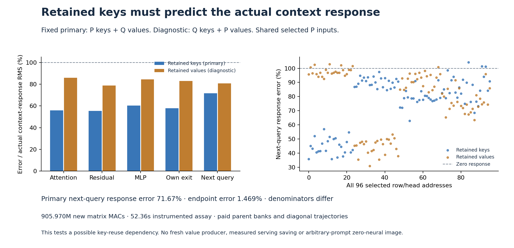

# Retained keys predict part of the context response

Retaining P's complementary keys while supplying Q's complementary values predicts the actual next-query context response with **71.67% relative error** and **.705 cosine**, compared with 100% error for predicting no change. It beats that zero-response baseline on **93 of 96 query heads**, while three heads are worse. The candidate has a useful measured direction, with a substantial remaining gap.

Its next-query **endpoint** error is only **1.469%**. Both numbers are correct: they divide the same .0182845 RMS error by different quantities. Endpoint closeness alone would conceal how much of the small contextual change remains unresolved. No fidelity threshold or scientific promotion is assigned here.

The [immutable report](results/stale-key-context/report.json), [complete row/head observations](results/stale-key-context/observations.jsonl.gz), [full interaction-array identities](results/stale-key-context/report.json), [byte custody](results/stale-key-context/retained-array-verification.json) and [mechanics](results/stale-key-context-evidence/mechanics.json) preserve the result. The [frozen plan](results/stale-key-context/frozen-plan.md) prespecifies retained keys as the primary candidate.

## Test an expensive dependency after establishing its effect

The [preceding experiment](propagated-context-query.md) found that genuinely propagated context changes a selected write, its own MLP state and its own next query. Full K/V production cost 98.398% of that assay's new matrix work. Here we ask whether retaining one old factor can predict the actual response before attempting a new source producer.

The case remains sphere-cube-plain-2027, logical step 2, source joint1 and next query joint2. All four selected P residual/Q/K/V operands, global modulation, absolute positions and numerical geometry remain fixed. S=[4,11,12,13]. Both complementary banks already exist and remain paid.

Define F_ab as the complete selected attention→own sequential MLP→own exit→own next-query trajectory using complementary keys from a and values from b. Selected S is restored to P in every bank. Existing immutable trajectories are F_PP and F_QQ. The new primary is F_PQ, retaining P keys and supplying Q values. The diagnostic is F_QP, changing keys while retaining P values; it is not an outcome-selected replacement candidate.

For each field, the target response and primary forecast are

\[
D=F_{QQ}-F_{PP},\qquad \widehat D=F_{PQ}-F_{PP}.
\]

We score

\[
E_{response}=\frac{\operatorname{RMS}(\widehat D-D)}{\operatorname{RMS}(D)}.
\]

The endpoint numerator is identical, because subtracting the common F_PP cancels. Its denominator is the full F_QQ endpoint instead of the smaller D. For the final query, those denominators are 1.24438 and .0255126, respectively. The zero-response baseline has error one whenever D is nonzero.

| Field | Retained-key primary response error | Retained-value diagnostic error | Primary response cosine |
|---|---:|---:|---:|
| Attention head context H |54.29%|86.11%|.841|
| Attention return A |55.88%|85.91%|.831|
| After-attention residual U |55.31%|78.77%|.833|
| MLP input X |57.51%|85.28%|.820|
| Fused gate/up projection |60.59%|82.88%|.797|
| Nonlinear product |59.84%|84.14%|.804|
| MLP return M |60.31%|84.45%|.801|
| Own exit T |57.84%|82.97%|.816|
| Next projected query |70.97%|82.30%|.712|
| Next query after RoPE |71.67%|80.74%|.705|

Every new MLP consumes its own changed attention-updated state. Its actual emitted T feeds the next query directly. The original learned maps, finite boundaries and rectangular attention dispatcher remain unchanged. No oracle state refresh or earlier Q-attention splice occurs.

At the final query, primary head error ranges from **35.82% to 104.28%**, with **80.58% median**, 93 heads better than zero and three worse. The diagnostic has **84.86% median**, 90 better and six worse. Neither has a negative head response cosine. These are dependent observations within one source pair, not 96 held-out examples. [All addresses and scalars](results/stale-key-context-evidence/scalar-summary.json) remain available, including the countertrends.

| Selected row | Retained-key primary response error | Retained-value diagnostic error |
|---|---:|---:|
|4|44.63%|97.50%|
|11|90.94%|43.36%|
|12|78.30%|91.29%|
|13|85.65%|75.68%|

The key-update diagnostic is better on rows 11 and 13 despite its worse pooled score. These addresses are not independent semantic roles. The heterogeneous result argues for preserving both source dependencies rather than declaring either factor generally dispensable.

## Factor the finite interaction explicitly

Define the value-only and key-only responses from the common baseline:

\[
D_V=F_{PQ}-F_{PP},\qquad D_K=F_{QP}-F_{PP}.
\]

The measured four-corner interaction is

\[
J=F_{QQ}-F_{QP}-F_{PQ}+F_{PP},\qquad D=D_V+D_K+J.
\]

At the ideal attention-head boundary with fixed query,

\[
H_{ab}=\Pi_aV_b,\qquad
J_H=(\Pi_Q-\Pi_P)(V_Q-V_P).
\]

Attention is linear in values at a fixed allocation, but changing keys changes that allocation and its normalization. Updating both factors need not equal the sum of their separate effects. The native finite four-corner account retains actual reductions and BF16 boundaries.

| Field | RMS(J) | RMS(J) / RMS(actual response) |
|---|---:|---:|
| Head context H |.0170096|14.42%|
| Attention return A |.0342676|15.87%|
| MLP return M |.0333326|26.74%|
| Own exit T |.0725036|29.38%|
| Next query |.00897461|35.18%|

Each field has its own response scale. Later interactions include receiving nonlinearities and finite execution; these ratios do not attribute the change to one primitive. The final interaction has cosine .0241 with the actual response and is almost orthogonal to it; it should not be treated as a scalar gain on that response. All fifteen complete FP64 interaction arrays remain near compute, formed by widening the original captured fields before subtraction.

## Charge the assay separately from a possible saving

The two new actors execute **830,472,192 affine MACs** and **75,497,472 attention MACs**, totaling **905,969,664 matrix MACs** across eight affines and two rectangular attention calls. Five distinct original tensors occupy **207,618,304 BF16 bytes**; two processes hydrate **415,236,608 parameter bytes**.

Job job-03c1bd316b2b succeeds in **52.36 scheduler seconds**, with **1,776.5 MB peak RSS** and **586 MB peak device usage**. Primary/diagnostic processes take 28.16/20.01 seconds including imports. This is one instrumented run, not a latency distribution or matched speedup.

The dependency being tested is one Q-side full key formation, nominally **14,495,514,624 MACs**. This assay does not actually produce fresh Q values while omitting those keys; it reuses both already-paid banks. The useful response trend motivates further work, while its remaining error prevents an unsupported equivalence claim. No first-prompt cost, avoided-key serving measurement, complete state closure or zero-neural generator is established.

## Preserve execution and custody independently of the trend

All **286 generator mechanics tests pass in 18.19 seconds**. The new tiny fixtures independently verify the fixed-allocation value identity, four-corner attention interaction and the prescribed candidate's own-state query. Seventeen executed source pins, four typed Acts, ten explicit output ABIs and two actual T→query joins verify. Both actors are denied the archived diagonal outputs. Primary also cannot read Q's key bank or P's value bank. Diagnostic starts only after primary seals and exits, and cannot read primary arrays. Scoring begins after both processes finish.

Complete verification covers **115 files / 7,831,899,034 bytes**, **90 independent NPY payload witnesses** and four raw selected/complement splice comparisons. Standard MDB evidence run/verify returns zero on **348 observations / 26 numeric predicates**, without accepted formal claims or bound xref addresses. These mechanics do not certify semantic fidelity or an image outcome.

All **49 new arrays / 40,999,040 bytes** stay near compute. The primary compact publication contains 18 files / 336,624 bytes before the figure and additional receipts. [Scheduled cleanup57](results/storage-cleanup-cycle57/README.md) archives four redundant transports / 626,249,557 bytes with full SHA checks and restoration pointers; extracted science remains local. The [post-audit](results/storage-audit-cycle57/README.md) checks sixty pointers and fresh remote file sizes, without freshly rehashing the previous fifty-six cold objects. Next storage review is cycle60 or earlier pressure.

The [third-family route/value result](../../obsidian/blog/2026-11-07-005623-a-third-family-separates-attention-routing-from-values.md) and [Qwen receiver-assisted composition](../../obsidian/blog/2026-11-07-000659-the-read-was-observed-before-the-future-was-tested.md) remain useful comparisons with different clocks, receivers and source definitions. Neither supplies a general rule about which factor to retain here. [Astra's review](results/stale-key-context-evidence/advisor.json) chooses an [image-only dual-score producer](plans/image-dual-score-producer.md): exploit repeated image positions to move the key map onto query-side coefficients, while explicitly retaining and paying for P normalization denominators. It is written and unexecuted; finite BF16 discrepancies, dynamic denominator error and compilation cost remain explicit. Arbitrary raw-prompt zero-neural generation remains open.
