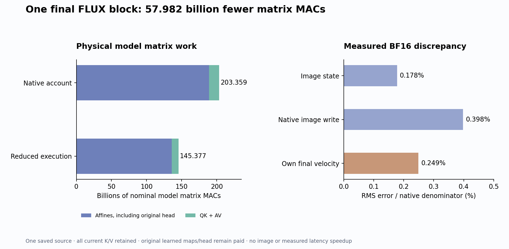

# Compute the state the next consumer actually needs

The final FLUX block now executes less learned work while producing its own complete image state and consuming that state with the original velocity head. On one authenticated source, the measured model matrix account falls from **203,358,732,288 to 145,376,673,792 MACs**: **57,982,058,496 fewer**, or 28.512% of this block-plus-head account. BF16 velocity RMS error is **0.2492%** against its native target. The result is not bit-exact, and there is no measured image quality or runtime speedup.

This is a context-independent source-graph reduction, numerically tested on one supplied state. It retains original learned projections, attention, MLP, normalization and head computations. Arbitrary raw-prompt image generation with zero neural evaluations remains unsolved.

## The consumer changes the computation we must preserve

Let F be the ordinary final single block, Π_I select its image rows, and H be the final normalization/modulation and velocity projection. The actual demanded program is

\[
G(X,c)=H\!\left(\Pi_I F(X,c),c\right),\qquad X=[X_T;X_I].
\]

The next consumer never receives the final text output. Within this parallel block, current text keys and values affect image attention, while text queries and MLP outputs affect only the discarded text output. Therefore the demanded real-arithmetic program can be written

\[
Z=N_c(X),\quad Q_I=W_QZ_I,\quad
K=W_KZ,\quad V=W_VZ,
\]

\[
Y_I=X_I+g_c\odot W_o
\left[
\operatorname{Attn}(\widehat Q_I,\widehat K,V),
\operatorname{SwiGLU}(W_{GU}Z_I)
\right],\qquad v=H(Y_I,c).
\]

Hats include the original head normalization and absolute RoPE. W_GU produces 2M coordinates before SwiGLU reduces them to M. Attention uses every current text and image key/value. No text output is needed to form K/V within this same parallel block.

This elimination depends on the consumer and execution point. Earlier text writes remain live because later blocks can read their changed K/V. Reference-image/cache modes have different dependencies and do not inherit this first result. The [frozen plan](plans/terminal-output-liveness.md) and [authenticated intake](plans/terminal-liveness-execution-intake.md) name the exact ordinary graph.

## The weight slicing is physical

The original fused input weight has shape 27,648×3,072, ordered Q, K, V, gate/up. The producer materializes two smaller maps:

| Map | Original output-row intervals | Evaluated input rows |
|---|---|---|
| K/V, 6,144×3,072 | [3,072, 9,216) | All 1,536 |
| Q + gate/up, 21,504×3,072 | [0, 3,072) and [9,216, 27,648) | 1,024 image rows |

It computes rectangular 1,024-query attention against all 1,536 K/V rows, then image SwiGLU, the original output map, gate and residual. It does not project the full fused output and discard columns afterward. The final head receives this producer's own image state with the declared native shape/stride ABI.

All **six original tensors, 283,902,464 BF16 bytes**, remain loaded. Physical maps add 169,869,312 bytes during this implementation. No parameter is removed globally; executed row work is removed at this boundary. Independent raw-byte witnesses tie both sliced maps back to the original checkpoint intervals.

## The executed arithmetic account

For N=N_T+N_I, width D and MLP width M,

\[
C_{aff,n}=ND(3D+2M)+N(D+M)D,
\]
\[
C_{aff,r}=ND(2D)+N_ID(D+2M)+N_I(D+M)D,
\]
\[
C_{att,n}=2N^2D,\qquad C_{att,r}=2N_IND.
\]

The original final head adds 421,527,552 MACs in both accounts. Here N_T=512, N_I=1024, D=3072 and M=9216.

| Model matrix work | Native account | Reduced execution |
|---|---:|---:|
| Block affines | 188,441,690,112 | 135,291,469,824 |
| QK plus AV | 14,495,514,624 | 9,663,676,416 |
| Final head affines | 421,527,552 | 421,527,552 |
| Total | 203,358,732,288 | 145,376,673,792 |

Actual interception records **five affine calls and one attention call**, with the declared smaller input/weight shapes. Normalization, modulation, RoPE, activation, softmax, copying, hashing and storage are outside this matrix account. The separate tiny mechanics fixture adds 7,600 nominal synthetic matrix MACs; it uses supplied toy maps, not model parameters. Source/prompt/clock production, the [native capture](terminal-native-capture.md) and its failed predecessor remain paid historical work.

## Exact graph liveness does not imply BF16 equality

The algebra removes outputs without a consumer. Its implementation also changes GEMM output width, row count and attention geometry. The finite program can therefore differ:

\[
\delta Y=R_{\rho'}(X,c)-\Pi_I F_{\rho}(X,c),
\]

where ρ and ρ′ denote the actual finite execution policies and geometries. The original head consumes the candidate Y_I; it is not refreshed with native image rows. Comparing with the separately retained native velocity measures the downstream consequence of that actual own state under the head execution.

| Complete field / denominator | RMS error | Changed values |
|---|---:|---:|
| Image state / native image state | 0.1779% | 443,488 / 3,145,728 |
| Image write / native image write | 0.3980% | 443,488 / 3,145,728 |
| Own velocity / native velocity | 0.2492% | 48,852 / 131,072 |

The write comparison subtracts the same actual incoming image state from both outputs, so it does not hide discrepancy behind the carried residual. Every one of the 1,024 image rows improves over holding the incoming state, a diagnostic comparison rather than a quality certification. Maximum absolute image error is 8, velocity error 0.03125. Full signed row/channel results and countervailing signs remain in the lossless observations; there is no effect-size gate. We have not isolated which changed GEMM or attention primitive accounts for each discrepancy.

## Timing, custody and the original goal

Guarded job `job-07e24bebce9b` succeeds in **38.07 scheduler seconds**, sampled peak **1,682.7 MB RSS / 1,058 MB device**. The producer takes 14.467 seconds after imports, and saved-only analysis 1.004 seconds. Synchronized image/head stage wall times are 1.746/0.0924 seconds before fingerprint capture, with first-use overhead. These scopes are not a matched comparison against the native block/head. Comparing 38.07 seconds with the previous 79.94-second multi-block capture would not measure speedup.

The complete thirteen-slot source is authenticated, with exact source pages allowed individually. Target-only arrays/blobs are quarantined; shared unchanged context remains a legitimate source input. The producer seals and exits before a fresh child opens saved targets. Two typed Acts bind the own image→head join. There is no new native reference, prefix, encoder, learned clock network, scheduler, VAE or image run. All **308 mechanics tests pass**, including a nontrivial absolute-position toy. The initial tiny reference incorrectly omitted native RoPE's internal finite cast; it was corrected before staging, with the same tolerance, and no model job was created by that test failure.

The [evidence index](results/terminal-liveness-evidence/README.md) links exact source, custody, complete byte/parameter-slice witnesses, lossless scalar observations, instrument scope and Astra review. Full byte verification covers 46 files/7,821,793,251 bytes, including the inherited checkpoint, with seven NPY payload witnesses, six original-map witnesses and two physical-slice witnesses. The standard evidence run/verify sees 5,248 records and 28 applicable predicates, with no fires, formal semantic claims or qualified addresses. It is a stream instrument; the dedicated audit qualifies source/byte/work mechanics.

The broader question is now source ownership: can this fixed producer participate in an advancing sampler trajectory without intermediate native-state refresh? The [next four-clock plan](plans/terminal-liveness-trajectory.md) uses one existing sealed native comparator, with no new reference campaign. The original arbitrary-prompt zero-neural requirements—economical prompt interpretation, autonomous dynamic computation and general pixel production—remain open.
