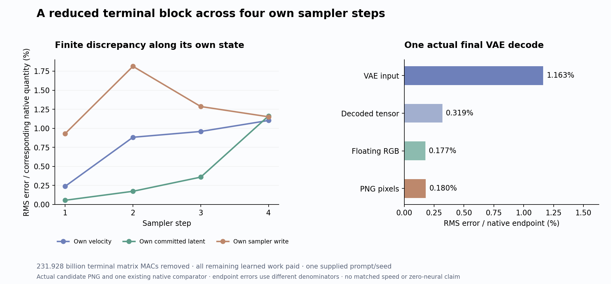

# Let a reduced computation advance its own image state

The physically reduced final FLUX block now runs at **all four sampler steps**, each time consuming its own preceding latent. Its actual final latent goes through one original VAE decode and produces the image below. On this one known prompt/seed, final latent RMS error is **1.162%** and PNG RMS error **0.180%**, against one existing sealed native trajectory. The image retains the red cube to the left of the blue sphere.

This removes **231,928,233,984 nominal terminal matrix MACs** across four steps. It still pays **21,371,806,547,968 matrix/convolution MACs** for the remaining model. Original conditioning and noise are supplied historical inputs. This is a bounded reduction with autonomous sampler continuation, not arbitrary-prompt generation or zero neural evaluation.

## The state really advances

The [previous local test](terminal-output-liveness.md) removes final text queries, MLP and output work while retaining every current text/image key and value. The original final head receives only image rows. In real arithmetic, the discarded text outputs have no downstream consumer. The physical rewrite changes matrix and attention geometry, however, and the local BF16 output is not exact.

Let the complete sampler step be

\[
F_k(x,E)=S_k\bigl(x,D_k(x,E)\bigr),\qquad x_{k+1}=F_k(x_k,E).
\]

The candidate executes

\[
\widehat x_{k+1}=\widehat F_k(\widehat x_k,E)
=S_k\bigl(\widehat x_k,\widehat D_k(\widehat x_k,E)\bigr).
\]

Here S is the original finite scheduler, including its BF16 boundaries. Each candidate denoiser runs the original clock, projections, five joint blocks and first nineteen single blocks, followed by the frozen reduced terminal block and original head. It receives the candidate's actual current latent. The original scheduler then consumes that velocity and commits the next candidate latent. No native intermediate refresh is used.

Exact equality of the demanded programs for every admissible current state would compose by induction from the same initial state. A small error at one supplied source does not establish that equality. This run measures the actual finite trajectory instead of assuming compositional accuracy.

## Local discrepancy and propagated discrepancy differ

Set e_k=\widehat x_k-x_k. An exact telescoping identity is

\[
e_{k+1}=
\underbrace{\widehat F_k(\widehat x_k,E)-F_k(\widehat x_k,E)}_{\text{rewrite defect at the candidate state}}
+\underbrace{F_k(\widehat x_k,E)-F_k(x_k,E)}_{\text{native sensitivity to incoming state}}.
\]

The experiment observes their sum against the original trajectory. It does **not** run a native shadow at each candidate state, so it does not numerically separate these two terms. In a smooth real-arithmetic approximation one might expand the second term with a Jacobian. Actual BF16 execution also has rounding changes and discontinuities; a Jacobian expression is not an exact error law for this program.

The signed scheduler-write comparison uses each lane's own preceding latent:

\[
\Delta\widehat x_k=\widehat x_{k+1}-\widehat x_k,
\quad \Delta x_k=x_{k+1}-x_k,
\quad E_{write,k}=\frac{\|\Delta\widehat x_k-\Delta x_k\|_{RMS}}{\|\Delta x_k\|_{RMS}}.
\]

| Sampler step | Velocity error | Committed latent error | Sampler-write error |
|---|---:|---:|---:|
| 1 | 0.238% | 0.055% | 0.931% |
| 2 | 0.882% | 0.173% | 1.813% |
| 3 | 0.958% | 0.359% | 1.286% |
| 4 | 1.103% | 1.162% | 1.151% |

Each column divides by its corresponding native quantity. The small first latent endpoint error partly reflects the large carried noise state. The write denominator makes the changed computation visible. Latent endpoint error grows at every step here; write error peaks at the second step. Neither observation is a general stability theorem.

The actual VAE input error is 1.163%, decoded tensor error 0.319%, floating RGB error 0.177% and PNG error 0.180%. These percentages use different native denominators. They do not by themselves measure contraction of the same norm through the decoder. PNG MAE is **0.1057 channel levels** on the 0–255 scale; 68,883 of 786,432 values differ, with maximum absolute difference 11. Broad visual agreement on a simple supplied scene does not establish fine-detail fidelity or prompt generalization.

## What was actually computed and measured

Guarded job `job-8b0c4f4bcc44` succeeds in **58.75 scheduler seconds**, sampled peak **8,416.4 MB RSS / 9,314 MB device**. The worker takes 31.285 seconds after imports, including 24.212 seconds of setup; saved-only comparison takes 0.687 seconds. These timings include instrumentation and are not a matched native speed comparison.

The executed ledger records 440 denoiser affine calls, 100 denoiser attention calls, four scheduler commits, four decoder affine calls, one decoder attention call and 36 decoder convolutions. Splitting the terminal fused map increases affine call count while reducing its row work. Actual nominal totals are:

| Paid component account | MACs |
|---|---:|
| Affines | 18,688,085,327,872 |
| QK plus AV | 1,447,403,978,752 |
| Decoder convolutions | 1,236,317,241,344 |
| Sum | 21,371,806,547,968 |
| Terminal matrix work avoided | 231,928,233,984 |

The native dispatch observer is a diagnostic cross-check of the denoiser SDPA account; it is not billed a second time. These are shape-based nominal MACs. They exclude normalization, softmax, activation, elementwise updates, packing, hashing and I/O; convolution counts include nominal padded products. Historical encoding/noise and native reference production remain separately paid. Removing 28.512% from one terminal block/head account does not remove that percentage from the full model.

The [first attempt](results/terminal-trajectory-failed-v1/README.md) stopped after 61.76 seconds at its first attention: my measurement wrapper accepted positional names that did not match native keyword invocation. No candidate model arrays or image were produced. That failure, full log and source remain immutable. A [separate v2 amendment](plans/terminal-trajectory-v2.md) corrects only the observer and adds positional/keyword/mixed tests. All **313 mechanics tests pass**; no scientific quality threshold blocks this exploratory result.

## What the evidence establishes

Nine typed Acts bind four denoisers, four commits and one decode, with 37 output payloads and eleven own-state consumption joins. The candidate seals and its process exits before the comparison child opens the old target trace. The actual VAE input and raw output are directly bound. Final latent unpack/BN/unpatchify follows the pinned native source; the declared final-commit ID is not an independent numerical witness of that transformation.

Full-byte verification checks **101 files / 8,071,718,333 bytes**, including inherited model files, **72 NPY payloads**, **169 original transformer parameter witnesses** and **two physical terminal weight-slice witnesses**. The raw candidate/difference arrays remain near compute. All 11,840 signed observation rows are retained losslessly. The standard evidence sweep checks two streams/11,845 records, including five progress rows, with no fires or formal semantic claims. Dedicated audits qualify custody, work shapes and own-state joins; a clean watcher is not image-quality certification. See the [evidence index](results/terminal-trajectory-evidence/README.md).

The useful structural assumption is still a consumer-sufficient state closed under future execution: a map q with a transition and renderer that operate on q(x) without fetching omitted native state. Terminal image selection supplies one exact graph-level example, with finite discrepancy measured here. Earlier text outputs remain live because the next block reads their keys and values. This result therefore supports consumer-aware elimination at an actual last-use boundary. It does not justify deleting earlier context or replacing remaining learned computation by a lookup for unseen prompts.

Arbitrary raw prompt → autonomous image with zero neural evaluations remains open. Astra selects a [fixed-text-memory trajectory](plans/fixed-text-memory-trajectory.md) next: keep actual projected conditioning fixed at every block, physically remove text-state writes, and retain all live K/V and image computation. Away from the terminal block this is an approximate architectural intervention, with prospective 5.798 trillion matrix MACs removed, not exact liveness. One own trajectory against the same comparator would test this fixed-memory alternative. Its physical slicing changes finite geometry too; an adverse result would constrain the combined candidate, without isolating text evolution as the sole cause. The plan is written and unexecuted. The [living research log](../../obsidian/blog/2026-11-06-004204-toward-arbitrary-prompt-images-without-neural-evaluations.md) connects the evidence to the broader prompt, state, context and decoder work.
