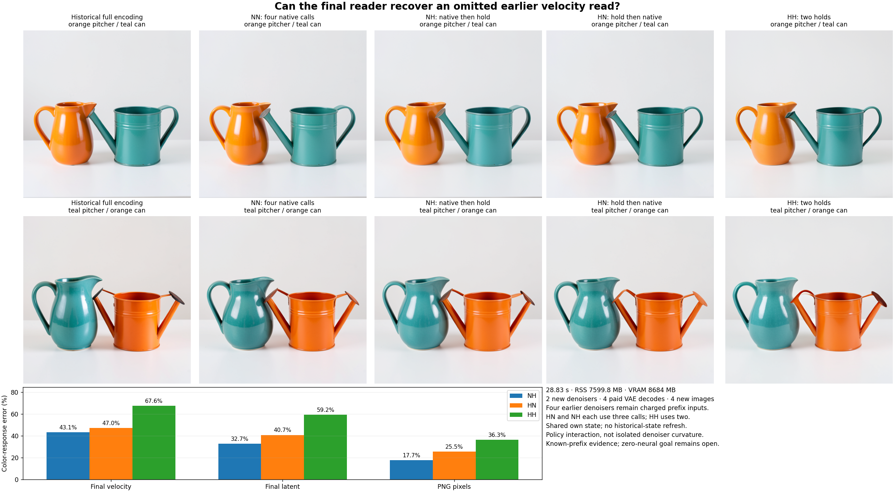
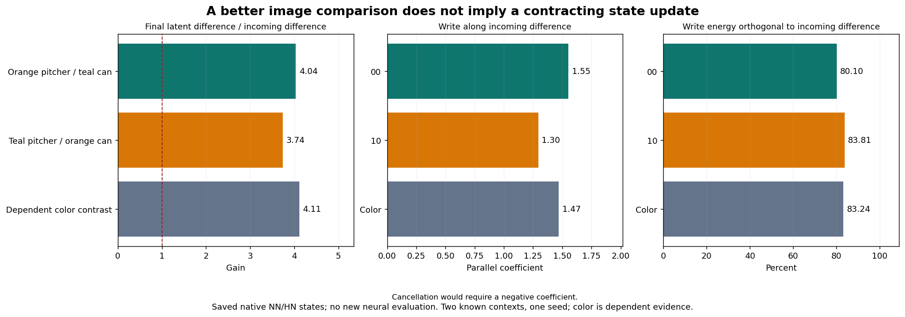

# A later read helps the image while amplifying its incoming state difference

On the known orange/teal vessel pair, omitting both later denoiser reads gives36.31% signed image-response error against the four-call parent. Restoring only the final native read lowers that to25.53%. Keeping the earlier read and holding the last velocity gives17.66% at the same three-call budget. The final reader supplies useful computation, but does not recover everything supplied earlier.

A separate saved-only test establishes a more consequential distinction: the final native update amplifies the incoming latent displacement by4.04× and3.74× on the two contexts. About80–84% of its changed write energy is orthogonal to that displacement. Improved image fidelity against the two-hold policy therefore does not establish state contraction or radial error cancellation.

These are component observations on two known contexts and one inherited seed. Original encoding, weights, earlier denoisers and VAE remain paid. Arbitrary raw-prompt generation with zero neural evaluations remains open.

## The actual continuing state

The [previous final-velocity experiment](last-velocity-forecast.md) showed that holding the previous velocity outperformed a fixed secant forecast. The [frozen factorial plan](plans/two-clock-velocity-factorial.md) then moved the omission one clock earlier and tested downstream recovery. Use the actual retained-query encoder's own Z2, previous velocity v1, complete E, IDs, compiled clocks and finite scheduler. Neither new branch receives a historical corrected latent.

Both new policies share exactly

\[
Z_3^H=U_2(Z_2,v_1).
\]

HH holds v1 again; HN evaluates the final native reader on that emitted state:

\[
Z_4^{HH}=U_3(Z_3^H,v_1),\qquad
v_3^H=F_\theta(Z_3^H,\sigma_3,E),\qquad
Z_4^{HN}=U_3(Z_3^H,v_3^H).
\]

NN and NH are inherited only through authenticated complete source/profile/clock/input identity. NN reads natively at clocks2/3; NH reads at2 and holds v2 at3. The new HH branch never receives v2. All four new candidate images seal before historical targets are released. Four post-seal scheduler-only replays match the original stored words exactly.

| Policy | Prospective denoisers/image | Final velocity-response error | Final latent-response error | PNG-response error |
| --- | ---: | ---: | ---: | ---: |
| NN | 4 | 0% | 0% | 0% |
| NH: native then hold | 3 | 43.14% | 32.71% | 17.66% |
| HN: hold then native | 3 | 47.05% | 40.74% | 25.53% |
| HH: two holds | 2 | 67.61% | 59.24% | 36.31% |

The observable is the signed10−00 color response, normalized by that response in NN. Endpoints are separately retained: HN PNG error is5.04%/5.35%; HH is6.79%/8.26%. Against historical full encoding, signed PNG errors are48.93% NN,49.62% NH,50.11% HN and51.79% HH. The inherited encoder error and its signed interaction with replacement error remain visible.

All originals preserve coarse body colors and order. Vessel proportions, highlights and nozzle contacts differ; HN10 retains a teal contact/spot, while HH00 loses one contact and changes proportions. Image-reference distance does not certify semantic quality.

## Why the factorial is not a curvature measurement

For any complete observable Y, retain the signed policy interaction

\[
J_Y=Y_{NN}-Y_{NH}-Y_{HN}+Y_{HH}.
\]

The held velocity depends on history. Even with an affine final reader F3(z)=Az+b and real scheduler gaps g2,g3,

\[
J_{Z_4}=g_3(A g_2-I)(v_2-v_1).
\]

It can be nonzero without nonlinear curvature. In the actual finite scheduler define epsilon_i=U_i(Z_i,v_i)−Z_i−g_i v_i. The measured factorization is

\[
J_{Z_4}=g_3J_{v_3}+J_{\epsilon_3}.
\]

Its retained vector closure is exactly zero. The smooth/finite/cross energies are7938.56/2.154/+29.42 for00 and9205.61/2.219/+30.95 for10. Small finite terms remain explicit. Neither telescope closure nor a nonzero interaction measures the final reader's contractivity.

## Test the radial hypothesis directly

The [separately frozen saved-only assay](plans/two-clock-carry.md) consumes actual NN/HN Z3, v3, Z4 and independently retained finite remainders. The final sigma is0.7174965739250183, with next sigma zero. Let

\[
D=Z_3^H-Z_3^N,\quad \Delta v=v_3^H-v_3^N,\quad
W=-\sigma_3\Delta v,\quad R=\epsilon_3^{HN}-\epsilon_3^{NN}.
\]

Then the outgoing difference O factors as

\[
O=Z_4^{HN}-Z_4^{NN}=D+W+R.
\]

The source-fixed hypothesis deltaVHat=D/sigma3 predicts clean-estimate invariance for G3(Z)=Z−sigma3 F3(Z,E). It has no fitted coefficient. The assay measures the hypothesis; it does not assume that the algebraic telescope proves it.

For retrospective diagnosis only, split the actual write:

\[
\lambda=\frac{\langle D,W\rangle}{\|D\|^2},\quad
W_\parallel=\lambda D,\quad W_\perp=W-W_\parallel,
\qquad O=(1+\lambda)D+W_\perp+R.
\]

| Domain | Incoming RMS | Outgoing RMS | Outgoing/incoming gain | Parallel lambda | Orthogonal write energy | Radial prediction error |
| --- | ---: | ---: | ---: | ---: | ---: | ---: |
| 00 | .05909 | .23844 | 4.035× | +1.553 | 80.10% | 115.70% |
| 10 | .06275 | .23494 | 3.744× | +1.296 | 83.81% | 116.02% |
| Signed color contrast | .07479 | .30745 | 4.111× | +1.470 | 83.24% | 114.26% |

The radial prediction is compared with actual deltaV; its cosine is−.446/−.402/−.409. Positive lambda means the parallel write reinforces D. The clean-estimate gains before finite terms are4.029/3.738/4.104, so finite rounding does not explain the amplification. Every one of the1024 token rows in each domain has gain above one;84/117 endpoint rows still have a cancelling parallel component, showing why the full orthogonal write matters. These rows are dependent observations.

D+W+R closes exactly. The diagnostic projection factorization closes within2.22e−16. Finite energies1.212/1.213 are small beside actual-write energies5548.80/5358.21; the full vectors and all signed cross terms remain retained. The measured result contradicts radial cancellation on these displacements, not the existence of every possible compact state law or a global contraction theorem in another norm.

## Physical computation and reproducibility

Primary job `job-766f3552f96d` succeeds in28.83scheduler seconds, with7599.8MB sampled RSS and8684MB VRAM. It performs2new native denoisers,206transformer linears/9.448trillion nominal affine MACs and4VAE decodes/160conv-linear calls/4.962trillion nominal MACs. Four earlier denoisers/18.896trillion affine MACs and original encoding remain charged. No fresh noise, references or clock compiler runs. Startup and per-branch first-use timings are retained; they are not a matched serving-speedup measurement. The measured compatible reservation exception and intent preview are in [resource-basis.json](results/two-clock/resource-basis.json).

Addon job `job-c25e485747f0` succeeds in2.23scheduler seconds,130.7MB RSS and0VRAM. Its three global assay calculations take39.96ms in total; complete post-import work including input authentication,3072row accounts and output retention takes626.93ms. NumPy has one configured arithmetic thread; automatic mrun admission reserves4096MB RAM and4CPU threads. It reads no weights and performs zero new encoder/denoiser/VAE/learned-map evaluations, fits or images. Supplied native NN/HN values remain paid diagnostic inputs.

All210mechanics tests pass in15.181seconds, including fixed radial cancellation, orthogonal amplification, independent finite terms, undefined zero-denominator cases, lazy imports and access guards. The earlier205-test fixture failure is preserved in [tests.json](results/two-clock-evidence/tests.json); it was corrected before primary execution without changing scientific workers.

Full byte verification covers181primary members/8,067,296,654bytes, including original image assets, and57addon members/45,191,687bytes. All58primary arrays/92,839,168bytes and30addon arrays/31,461,120bytes remain near compute. The compact publications contain25files/3,403,119bytes and9files/1,106,584bytes, with10240and3072losslessly retained dependent observations. [Primary](results/two-clock-evidence/mechanics.json) and [addon](results/two-clock-evidence/carry-mechanics.json) audits bind actual consumers, release seals, original PNGs, work and custody. Saturn run/verify returns0 for both observation streams, with no fires and no terminal claim receipts; its scope is stream mechanics.

Run `two_clock_study.py stage|submit|collect` for a new primary directory and `two_clock_carry.py stage|submit|collect` for the fixed additive diagnostic. The latter currently names the authenticated completed primary. Publishers verify full near-compute bytes before compact publication; auditors and plotters consume published metadata. Historical execution sources and results are immutable.

The practical route forward must explain how a prompt-conditioned continuing state produces this substantial clean-estimate change. Another scalar hold/secant correction would leave its orthogonal computation unexplained. Neighboring [nonlocal-reader evidence](../../obsidian/blog/2026-11-06-170012-a-compact-diffusion-update-needs-a-nonlocal-reader.md) independently finds incoming-error amplification and an exact local-support collision under a distant patch edit. Its cheap global-reader proposal is unexecuted; native Q/K/V cannot be supplied without charging their production. [Astra38](results/two-clock-evidence/advisor.json) selects a [fixed coarse global innovation producer](plans/coarse-global-innovation.md): keep high-frequency carried velocity, calculate256coarse image tokens with all512text rows, physical centers and fixed represented-key multiplicity, then lift the new coarse innovation. The [subsequent executed result](coarse-global-innovation.md) confirms50.12%of full final-call affine work but is worse than holding the old velocity on both cases. Its error split attributes about65%of endpoint energy to the retained coarse producer and35%to omitted fine innovation. Original learned computation remains paid. The [research record](zero-neural-research.md) keeps the strict zero-neural boundary explicit.
