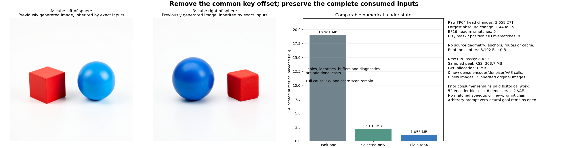

# The first reader no longer needs source geometry

The plain causal top-four reader removes the final source-center dependency. It reads no sampled geometry, basis, landmarks, metrics or centers and performs no source compilation. On the known raw prompt pair, every consumed BF16 head, H0 and lexical control matches the actual original encoder invocation. Its previously generated images therefore remain available by exact input identity. This is a bounded dependency reduction; arbitrary-prompt zero-neural image generation remains unsolved.

## Remove a query-common offset

The [direct-score reader](direct-reader.md) retains scaled queries x, source-centered scaled keys U_j=K_j−c and values V_j. The center contributes the same scalar to every key score for a fixed query:

$$
a_j=x^T(K_j-c)=x^TK_j-x^Tc.
$$

For a common offset b, ordered top-four selection and softmax obey, in real arithmetic,

$$
S=\operatorname{top4}_j(a_j)=\operatorname{top4}_j(a_j+b),\qquad
\frac{e^{a_j+b}}{\sum_{k\in S}e^{a_k+b}}=\frac{e^{a_j}}{\sum_{k\in S}e^{a_k}}.
$$

The new program stores uncentered scaled keys, selects against the same current-query GEMV, and reads the selected values. BF16 positioned operands, quarter-power scaling, causal admission, key layout, ordered ties and FP64→FP32→BF16 RNE conversion stay fixed. Full causal K/V storage and score scans remain.

Finite arithmetic still needs measurement. The experiment changes1,829,473 raw head values in A and1,828,798 in B, with maximum absolute change1.4432899320127035e−15. Selected logits shift by as much as10.63048796819077; this is mainly the common gauge. Among matching supports, the largest within-query spread of that shift is1.2434497875801753e−14. Weight changes reach2.44249e−15. Ordered supports and all lexical operands match, as do all4,194,304 rounded BF16 head words. A mechanics counterexample deliberately uses a huge center that destroys finite score distinctions; real-arithmetic symmetry is not assumed to guarantee finite equality on new prompts.

## Bind the state and the actual consumer

Astra found that removing centers could otherwise make all eight group identities equal. Before freezing the worker, we bound reusable state to the lexical manifest, KV group and query-head IDs. Split NPZ continuation reproduces uninterrupted toy execution, leaves its parent immutable, and rejects wrong-source, wrong-group and wrong-head resumes.

Fresh serving denies the original geometry, basis and centers, with three blocked-open canaries. It seals complete raw/BF16 head banks and own H0 before opening either comparison or original-consumer values. The [input proof](results/uncentered-reader/input-identity.json) compares4,194,304 head words,2,621,440 H0 words and3,072 token-ID/mask/position entries against the actual cycle31 encoder inputs. All match. Checkpoint, source implementation, numerical profiles, conditioning, clock, schedule and noise remain bound.

Cycle32 supplies arithmetic comparisons. Cycle31 supplies the actual encoder/image execution. These roles are explicit: a new lexical ZIP receipt does not replace the original actual-consumer receipt. A negative test gives the comparator different head values and proves that matching the comparator cannot authorize inherited results.

The [inherited-output receipt](results/uncentered-reader/inherited-outputs.json) names the original complete encoder/image fields and PNGs. No new original encoder, denoiser, VAE or image runs. Their19.37% signed PNG response error is inherited evidence on the known pair/noise. The historical52 original encoder blocks,8 denoisers and2 VAE decodes remain paid; a new prompt still requires its own downstream computation. Exact input identity authorizes reuse, whereas an approximate mismatch requires an actual continuation.

## Work and measurements

| Account per prompt | Centered direct reader | Uncentered reader |
|---|---:|---:|
| Allocated numerical K/V/positions plus counts/clocks |1,052,800B|1,052,800B|
| Occupied numerical entries plus counts/clocks |575,808B|575,808B|
| Runtime centers |8,192B|0B|
| Packet-wide key-centering subtractions |524,288|0|
| Current-query score products |70,963,200|70,963,200|
| Selected-value products |8,364,032|8,364,032|

The [frozen plan](results/uncentered-reader/frozen-plan.md) originally quoted35,840 centering subtractions, counting only admitted-key coordinates. Inspection of the executed parent shows that it centers all512 rows before masking:512×8×128=524,288. The [additive correction](results/uncentered-reader-evidence/cost-correction.json) preserves both meanings and the historical plan. It changes no raw output or current zero-centering counter. Full lexical compilation/storage, identities, buffers, diagnostic arrays and serialization are additional costs.

Guarded CPU job **`job-2ed557dbb033`** succeeds once in **8.42 scheduler seconds**, with368.7MB sampled peak RSS and0MB VRAM. Automatic sizing reserves4096MB RAM/4CPU; actual OMP/OpenBLAS/MKL threads are1. Worker time after imports is6.143 seconds. The fresh reader phase takes3.619 seconds including process startup; reader-body time is3.474 seconds/0.769CPU seconds, with284,516KiB high-water RSS. Group streaming sums to0.278/0.162 seconds. Pair reader streaming/serialization takes1.212 seconds. These distinct scopes and cache-sensitive measurements do not establish a matched speedup.

All164 mechanics tests pass in14.468 seconds, including8 new checks; the exact six-file staged payload imports without old readers or neural frameworks. [Independent full-byte verification](results/uncentered-reader/retained-array-verification.json) covers213 members/611,070,497B, including complete current arrays, actual-consumer inputs and inherited downstream outputs. The26 new complete arrays/packets total122,773,956B and stay near compute. Primary publication is16 files/3,934,664B, retaining32,768 dependent head-query records losslessly. Saturn [run](results/uncentered-reader-evidence/saturn-run.json) and [verify](results/uncentered-reader-evidence/saturn-verify.json) return0 with stream-only instrument scope; these checks add no semantic quality certificate.

[Astra's source/result and newest-post review](results/uncentered-reader-evidence/advisor.json) recommends freezing this reader and testing [one fresh compositional prompt square](plans/fresh-prompt-square.md). Further first-reader algebra would leave the present coverage gap intact. Later contextual operand formation, learned-map replacement, general denoising and pixel decoding remain open.
