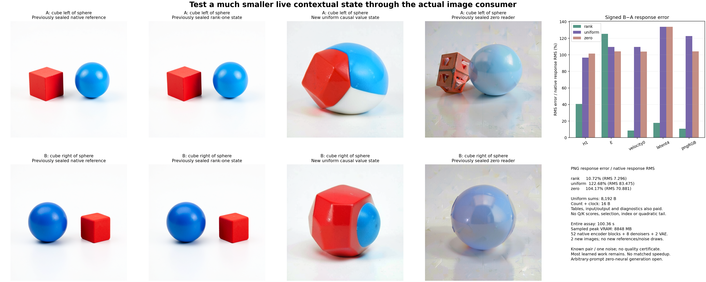

# A small causal mean state does not preserve the tested image computation

Cycle31 follow-up: [matched selected-only tail deletion](selected-reader-image.md) preserves the objects and spatial swap at19.37% signed PNG error with2.10MB of comparable numerical state. The original uniform-reader account follows.

The uniform reader advances an **8,208-byte numerical state** and matches its independent calculation exactly. Its images merge the red cube and blue sphere into one object. Signed PNG response error is **122.68%**, compared with **104.17% for deletion** and **10.72% for rank-one**. This constrains the particular query-independent averaging law; it does not exclude compact contextual readers generally.

## A real state reduction, with an unchanged consumer

The [frozen plan](plans/uniform-causal-reader.md) uses the same raw left/right strings, complete151936-ID lexical table, template/tokenizer/positions/512-row masks, checkpoints, profiles, inherited clocks and seed314159 noise. Each prompt admits35keys and emits all512query rows. Only two new candidates execute; existing native, rank-one and zero references remain unchanged. Targets were already observed, so this is retrospective mechanism research, not prospective quality certification.

For each of eight128-dimensional K/V groups, the reader carries a sum and a shared count:

$$
S_{g,t}=S_{g,t-1}+m_tV_g(\mathrm{token}_t),\qquad
n_t=n_{t-1}+m_t,\qquad O_{h,t}=S_{g(h),t}/n_t.
$$

It repeats each group mean across its four query heads. Empty prefixes emit positive zero. Admission is chronological and causal; masked values never enter. FP64 accumulation/division is followed by the inherited **FP64→FP32→BF16 RNE** conversion. This can differ from direct FP64→BF16 near a midpoint; that distinction is declared and tested rather than tuned.

Numerical sums take8192bytes, with8bytes each for count and clock. No Q/K scoring, source routing geometry, top4, retrieval index, quadratic moments, envelopes or fallback executes. The same bundled lexical E/QKV/position path remains paid. Per prompt, decoded V input is4.194MB, raw head output16.777MB and BF16 output4.194MB; independent diagnostic banks and serialization also consume memory. The8KBcore is not the whole working set.

The emitted BF16 `[1,512,4096]` bank enters the original block0 output/residual/norm/MLP. Own full512-row blocks1…26 form actual H9/H18/H27→E, then original four-step FLUX/scheduler/VAE consumes that E and its own latent. No native state refresh, exact replacement head, compact-GEMM change, new reference image or noise draw intervenes.

## What the mean omits mathematically

For a nonempty causal prefix, let the uniform measure over admitted keys be μ, $w_j(q)=\exp(q^Tk_j)$ and $\bar V=\mathbb E_\mu V$. Exact mathematical attention satisfies

$$
A(q)-\bar V
=\frac{\mathbb E_\mu[w(q)V]-\mathbb E_\mu[w(q)]\mathbb E_\mu[V]}{\mathbb E_\mu[w(q)]}
=\frac{\operatorname{Cov}_\mu(w(q),V)}{\mathbb E_\mu[w(q)]}.
$$

The uniform state retains the unconditional value mean and discards this query-dependent, value-weighted term. This identity names missing information. The images alone do not identify which keys, heads or compact representation must retain it. The complete original consumer remains nonlinear and sees the full receiving state.

## Mechanical closure and consumer fidelity separate

An independent ordered-prefix reconstruction matches every raw and BF16 head scalar for both candidates: zero raw difference and zero BF16 word mismatches over4.19million head scalars. Tests also verify empty prefixes, causal/masked independence, grouped-head expansion, source identity, split continuation and actual NPZ save/load continuation. Initial source review caught an array-metadata comparison issue and the rounding-contract ambiguity; both were fixed before staging.

| Signed B−A response error | Rank-one | Uniform | Zero |
|---|---:|---:|---:|
| H1 |40.59%|96.76%|101.53%|
| H9 |90.77%|104.49%|111.95%|
| H18 |121.46%|108.30%|101.49%|
| E |125.43%|109.46%|104.23%|
| First velocity |8.65%|109.58%|104.07%|
| Final latent |17.82%|133.91%|133.84%|
| PNG RGB |10.72%|122.68%|104.17%|

The uniform PNG response RMS is53.504 versus native68.045, with error83.475 and cosine0.0721. Endpoint PNG RMS is62.648for A, improving deletion's71.686, and90.447for B, worsening deletion's71.711. Both images visibly fuse the objects. No endpoint scanline improves over rank-one;378/512A scanlines and203/512B scanlines improve over zero.

Endpoint E errors improve over zero's107.8% to12.28%/12.50%. That pooled advantage is uneven: only17/35active rows in A and16/35in B improve, alongside269/477and246/477padding rows. At H1 all477padding rows improve over deletion for both prompts. Relative error in pooled active E is2.44%/2.50%, against a large common-state denominator; padding error remains105.47%/106.59%. Lower paired E error than rank-one still yields much worse pixels. All92,160dependent row/scanline records remain in the [lossless stream](results/uniform-reader-image/observations.jsonl.gz).

The signed contribution convention is $q=\Delta_U-\Delta_Z$, $e_U=e_Z+q$. At PNG,

$$
\|e_U\|^2=3{,}951{,}127{,}805+2{,}498{,}824{,}885-969{,}998{,}542
=5{,}479{,}954{,}148.
$$

The cross term opposes error, but its cancellation is smaller than the added power. It does not make the replacement useful at this consumer.

## Compute and evidence

Guarded CUDA job **`job-b2412411d329`** succeeds once in **100.36scheduler seconds**, with sampled peaks **7879.4MBRSS/8848MBVRAM**. The uniform loop takes5.54/5.50ms; the independent prefix diagnostic takes157ms per prompt and is charged separately. Each prompt performs35,840value-sum additions,524,288mean divisions and2,097,152expanded head-scalar writes. Full reader process phases take2.668s, including lexical setup/IO and diagnostics; encoder and image fresh-process phases take49.612and24.156s. Reader CPU after imports is0.711s, with251,988KiBhigh-water RSS. These are measured scopes, not a matched speedup or whole-pipeline8KB claim.

Original learned work remains52encoder blocks/52SDPA/372linears (**2.774Tnominal linear MACs**),8denoisers/824transformer linears (**37.791Tnominal linear MACs**) and2VAEdecodes. Forty inherited clock gathers execute; no new clock compilation, reference image or noise draw occurs.

All141mechanics tests and isolated staged imports pass. Declared/sealed/executed payload SHA is `8664577777c4b40897851a8c9322f7439066848197271a145221a6ff5def6e7d` (96,722B). [Independent verification](results/uniform-reader-image/retained-array-verification.json) covers515members/1,498,390,511B. The140new complete arrays/packets total691,088,660B and remain near compute. Primary publication is24files/9,671,830B plus figure/evidence receipts. [Saturn run](results/uniform-reader-image-evidence/saturn-run.json) and [verify](results/uniform-reader-image-evidence/saturn-verify.json) return0 for one92,160-record stream; stream-only mechanics do not certify semantics.

[Astra's review](results/uniform-reader-image-evidence/advisor.json) checks original images, state-law parity and actual consumer joins. New B3 code-collision evidence excludes its particular compact interface, while the C gate approximation still pays dense matvecs and newer attention traces expose consumer reversals. None supplies general zero-neural closure.

The [next single cut](plans/selected-only-reader.md) returns the successful rank-one reader's matched selected read while deleting its unselected tail. Routes, supports, anchor-score arithmetic and full causal K/V search remain paid. This tests whether the expensive tail state contributed to image fidelity. It is written and unexecuted. Full arbitrary-prompt zero-neural generation remains active and unsolved.
