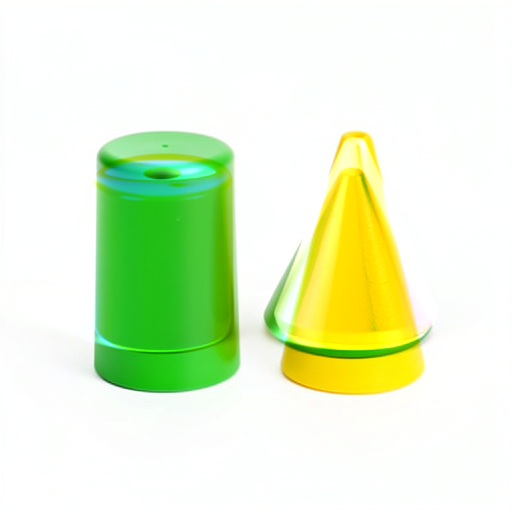

# Toward arbitrary prompt-to-image computation without neural evaluation

Status: **active research; arbitrary prompt-to-image remains unsolved.** The objective includes prompt interpretation, formation of novel operands, state advancement and pixel production. It is not satisfied by known-scene RGB interpolation, cached native conditioning, native decoding, a smaller neural student, or the original dense forward expressed in another library.

The [frozen research plan](plans/arbitrary-prompt-zero-neural.md) preserves that objective and the experimental boundaries. The [previous response-chart result](zero-network-image-response.md) remains useful restricted serving evidence. It does not generalize its four supplied contexts into an arbitrary generator.

Current cycle27 result: [complete clock-only compilation](compiled-flux-clock.md) excludes six learned tensors from fresh image serving, replacing341.31MB of parameters with442.37KB of constants. All32 retained image fields and original PNG pairs match existing full targets. This removes4.40% of transformer parameter bytes but only0.003612% of nominal linear MACs;824 original transformer linears/8denoisers/2VAE remain. The54.53-second assay establishes no speedup. Independent191-member byte verification covers206.65MB, with93 new complete arrays near compute. Astra selects [raw-prompt rank-one reader→image integration](plans/raw-rank-one-image.md) next, retaining full original suffix rows to isolate the dynamic approximation. It is unexecuted; no rank/precision retuning or new reference campaign is planned. Last actual cleanup25,next storage28; advisor review27,next30 or material evidence. Full arbitrary-prompt zero-neural images remain open.

## Why the next cut starts before another image demo

Astra reviewed the newest consumer-response and operational-variable-closure work, the scene compiler, current source and complete prompt-factorial evidence. The useful synthesis is that local computation must retain its products, context and ordered consumers before it can be reduced. OVC10's composed local polynomial reader gives roughly .861/.767-logit axial/joint reader error where the global quadratic H24 prediction gives 4.982/4.982, through a shared native tail. Original dense weights, full states, contextual baselines and that native tail still remain. This strengthens a factorization strategy; it is not zero-neural generation.

The first goal experiment therefore asks whether a compact composition hypothesis already describes a **new combination of two prompt changes**, and where its residual appears. The specimen is the existing full native seed127 prompt square: green/yellow assignment to a cone and cylinder crossed with cone-left/cone-right ordering. The original campaign used four prompt encodings, one common initial noise and four complete native histories. The new work performs no additional neural evaluation.

At the initial review, OVC11 was a prospective writer→memory→reader plan. Its later result now retains61/64 finite memory forecasts and three nonfinite branches; that development strengthens the case for bounded scalar normalization in the state-reader experiment below. The distinction remains: K/V written from a layer's incoming state is not its later hidden-state output, and a good endpoint does not establish that the intervening write and receiving computation have been recovered. The conditioning span result below likewise concerns a representation, not a causal encoder mechanism.

Three native histories calibrate the diagnostic. The fourth corner, yellow cone right of green cylinder, is excluded from the prediction child's file capabilities. All outcomes already exist and previous findings informed the design; the target PNG was viewed before execution. This is retrospective development evidence, not prospective generalization. Each of 34 boundaries is independently supplied its three native calibration states. It is not an own-state rollout or raw-prompt compiler.

## A supplied transport explains some interactions

Let B=X00, C=X10, O=X01 and T=X11. The two fixed laws are

\[
P_A=O+(C-B),\qquad P_H=O+H(C-B).
\]

H is a horizontal image-token-grid permutation derived from the recorded position IDs, or a horizontal pixel permutation at RGB. It is the identity on conditioning and text. It leaves feature channels unchanged and is not a qualified physical latent reflection. The shared noise is unreflected, so this does not test global spatial equivariance of the model.

The finite interaction M, transport correction C_H and residual R_H obey

\[
M=T-O-C+B,\quad C_H=(H-I)(C-B),\quad R_H=M-C_H.
\]

The report retains their raw RMS, signed dot, cosine and the ratio ||R_H||/||M||. It separately measures stored endpoint error against the held color response ||T−O||. Zero reference effects retain undefined ratios. BF16 rounding and RGB clipping remain separate from raw interaction arithmetic.

| Saved boundary | Additive error / held color effect | Transport error / held color effect | Raw transport residual / interaction |
|---|---:|---:|---:|
| Prompt conditioning | 76.6% | 76.6% | 100% |
| Pass0 initial text | 77.2% | 77.2% | 100% |
| Pass0 after joint4, image | 139.5% | 111.3% | 79.8% |
| Pass0 after single19, image | 153.6% | 86.9% | 56.6% |
| Pass0 readout noise | 160.1% | 66.6% | 41.6% |
| Pass2 after joint4, image | 116.9% | 118.8% | 101.7% |
| Final latent | 142.8% | 111.7% | 78.2% |
| Rendered RGB | 111.3% | 39.6% | 28.6% |

“Pass0” is the first denoising pass; local5 is after the fifth joint block and local25 after the twentieth single block. Conditioning's value is not a spatial-transform result: H is the identity there. The initial image projection is invariant in this panel and has zero native color effect, so its relative errors are undefined. The raw horizontal-law decomposition is shared across method rows; `rawMixedErrorRelative` is the actual per-method comparison.

These observations do not support a single transferable color direction in raw coordinates. Transport helps several image boundaries, hurts one measured comparison, and does nothing for the contextual text/conditioning interaction. The same conditioning and initial-text values recur across passes; those repeats do not supply new independent contexts. Localization along saved histories is observational, not causal mediation.

## The stronger image control prevents an overclaim

At RGB, the transported rule's MAE is 8.829 levels out of255; its error RMS is about26.66. Merely mirroring the color-calibration image gives MAE8.822 and RMS25.91, slightly better. The transported output has visible duplicate edges and ghosting. This is a useful failure of a supplied composition rule, not a generator achievement.

Clipping also matters. The transported raw residual RMS is about32.08, while clipping/rounding moves the candidate by16.80 RMS levels and reduces stored endpoint error to26.66. Those vectors are not additive scalar budgets. Mirror-only has no clipping displacement. The raw and rendered comparisons remain distinct; the rendered improvement cannot be attributed solely to transport.

## What three calibration corners cannot determine

For any interaction array M, the program

\[
X(c,o)=B+c(C-B)+o(O-B)+coM
\]

matches the three supplied corners. Their values alone cannot identify M at the fourth corner. A successful predictor needs additional structure: a reusable operator, context-dependent interaction law, or qualified computation that determines this term. A lookup of the target would not supply that structure.

This example also shows why an out-of-plane residual does not prove another independent semantic variable. There are two symbolic inputs c,o while four finite outputs may span three linear directions. Nonlinear composition can create that geometry. The question is which factored law predicts the interaction on new inputs, rather than how many labels we can attach after observing it.

## Even target-assisted coefficients leave a contextual residual

The follow-up tests the most permissive two-coefficient affine reconstruction in the supplied calibration plane. With flattened arrays and D=[C−B,O−B], compute

\[
G=D^\top D/N,\quad b=D^\top M/N,\quad
\gamma=G^\dagger b,\quad r_\perp=M-D\gamma.
\]

The best endpoint in that plane is B+D((1,1)+γ). It is explicitly target-assisted: fitting γ reads T, and those coefficients are unavailable to serving. This is a representation-capacity diagnostic, separate from the sealed prediction assay. Its [raw report](results/prompt-composition/span-report.json) retains every boundary, eigenvalue, rank, coefficient and residual dot product.

| Saved boundary | Residual RMS / interaction RMS | Residual RMS / held color effect RMS |
|---|---:|---:|
| Prompt conditioning | 78.4% | 60.0% |
| Pass0 initial text | 78.5% | 60.6% |
| Pass0 after joint4, image | 69.4% | 96.8% |
| Pass0 after joint4, text | 16.7% | 83.7% |
| Pass1 after joint4, text | 15.1% | 24.2% |
| Pass2 after joint4, text | 12.5% | 15.5% |
| Final latent | 63.0% | 89.9% |
| Rendered RGB, before clipping | 42.8% | 71.2% |

These are RMS ratios, not fractions of variance. At conditioning, the two Gram eigenvalues are .6912 and1.6079, condition number2.326. The best endpoint coefficients are approximately(.8212,.4003), yet residual RMS remains .7752. This measured mismatch cannot be removed just by choosing better scalar coefficients for these two complete calibration differences. It appears before the denoiser. That is an observed boundary discrepancy, not localization of the causal operation inside the encoder.

The counter-trend matters: some later text states lie much closer to the plane, with only15.5% of the held color effect left unexplained at pass2 after joint4. Meanwhile final-latent error remains89.9% even with target-assisted coefficients. There is no single “linear versus nonlinear” verdict for the whole computation.

The RGB span residual also exceeds the supplied horizontal-transport residual. This is consistent: mirroring can create directions outside the original two-delta plane, so it is a different hypothesis class. Neither result establishes a new independent semantic variable, excludes a curved two-variable representation, or provides a reusable raw-prompt law. Every boundary still receives native calibration states independently.

## Evidence and continuation

The completed first diagnostic is guarded CPU job `job-3ff4ee580893`, request `1243c7b75de89651798eff248dfa8cc54d7378b8d97230b23092ee025b127164`. It sealed204 concrete candidate-array hashes across34 boundaries/six methods, with zero target-exclusive source files opened by the prediction child. The scorer recomputed those same candidates and verified every hash before reporting comparisons. Source arrays are bound to the original authenticated native campaign; no learned weight math, encoder, denoiser, VAE or neural student ran. Runtime was19.81 scheduler seconds,19.113 worker seconds, with495.4MB peak RSS and0VRAM. These are analysis costs, not image-serving latency or speedup figures.

The second diagnostic is guarded CPU job `job-7667bd48bb25`, request `c01ee02eb75a1a627ce1eb59977abff1e38d1d3c8aa752b02b3c11e673e99e12`. It took21.74 scheduler seconds,16.419 worker seconds and390.7MB peak RSS, with0VRAM and no neural evaluation. Its earlier default-reservation lease `job-a0456ce5fe32` was cancelled while queued, before execution, and remains unexecuted evidence. The replacement used a documented2GiB profile based on the first assay's measured495.4MB peak.

The [published custody subset](results/prompt-composition/provenance.json) retains exact report/request bytes, payload digests, result inventories and all ten original/candidate PNGs. The standard Saturn evidence sweep and verification completed with two observation streams/238 records and `target-streams-only` status. There are no auto-harvested terminal-claim receipts or physical address joins in this bundle; a clean sweep is an instrument check, not scientific certification.

The original native source is `job-95453050cf73`, checkpoint `dd976d67036c4a0a55642f702dcb3740ba7a4f367557596572baac168330904f`. Its complete prompt encodings, states, parameter work, denoising and VAE costs remain historical assistance. The [source plan and limitations](plans/arbitrary-prompt-zero-neural.md), [diagnostic implementation](../generator/prompt_closure.py), [launcher](../generator/prompt_closure_study.py), and [target-assisted span implementation](../generator/prompt_span_study.py) make those boundaries explicit.

The remaining route is a reduced **state algebra with its own continuation**: a raw-prompt compiler must form meaningful operands; a small factored transition must advance its own predicted state; and a validated non-neural decoder must produce pixels on held prompt combinations. Per-clock native anchors must disappear from serving. A proposed eight-prompt shape×color×relation dataset can test whether a color–order interaction transfers to another shape, but even seven-corner reconstruction would remain a diagnostic until that own-state requirement is met.

After reviewing both results and the newest posts, Astra recommended a [compiled MLP write and its residual consumer](plans/compiled-mlp-write.md). That experiment is now [implemented and measured](compiled-mlp-write.md). A supplied32-row input line is compiled offline into five output-coefficient arrays; serving evaluates a degree-four polynomial and lets the residual update consume its prediction, with no original matrices or native output endpoints online. Arithmetic takes .378–.387ms with51.36MiB primary RSS. Offline original-weight arithmetic and4.136s compilation remain explicit.

At the midpoint, pooled rounded-write paired-response error is9.43% versus11.96% for native endpoint interpolation; receiving-state values are12.59% versus15.42%. That advantage is heterogeneous: only7/32 rounded-write rows improve, and median per-row error remains65.1%. Smooth-polynomial versus staged-BF16 differences remain mixed with approximation error. This eliminates original dense projections for one bounded serving computation; supplied operands, context and arbitrary prompt formation remain unresolved.

The [compiled state reader](compiled-state-reader.md) now advances that producer's actual BF16 output into the next joint layer's row-local Q/K/V affines, with no dose input or native refresh. Source-bound job `job-2f0a52357bf1` sealed predictions before six native CPU reference evaluations. A producer-derived five-direction basis and actual state variance/sqrt feed three learned reduced maps, taking .911–.936ms for32rows. Midpoint composite paired errors are18.73% Q,18.61% K,13.90% V. Median row errors remain83–91%; four rows carry about90% of the effect energy. Attention and changing context are outside this edge.

The follow-up saved-array job `job-15dea027e760` separates output rounding, basis omission, combined numerical policy and inherited writer defects, retaining their signed cross terms. Removing basis omission through the same final quantizer still leaves midpoint reader discrepancies of14.92% Q,15.18% K,10.28% V relative to native change. The corresponding omission-through-quantizer terms are14.53%,14.27%,10.47%, with negative cross terms. Both matter. An out-of-basis residual near.166% of full state RMS is10.18% of the midpoint state-change RMS. A large shared baseline can conceal an important change error.

This is compiled learned arithmetic: framework calls0, original dense projections0, learned reduced-map evaluations3 per receiver call, plus coordinate recovery. The raw receiver report's `onlineNeuralEvaluations:0` must be read as an operational native/framework counter. The same bank contractions can be represented as a small linear network. They do not satisfy a representation-independent prohibition on learned maps, and do not complete the arbitrary-prompt objective by renaming computation.

The [next global consumer](compiled-global-head.md) is now measured. Actual emitted states drive joint2head0 through normalization/RoPE and an incremental complete1536-query read, while1504 input rows remain explicitly supplied fixed context. Same-arithmetic direct attention closes near5e-14, with identical BF16 outputs, in a1.8ms primary calculation. Paired forecast error is28.76% raw/35.13% rounded; raw text-region error exceeds100%, and897rounded-reference queries have zero change. The per-query records retain those cases.

Most reference response energy appears in queries outside the32changed input rows, establishing global coupling under this mathematical consumer. Saved-only matched V-delta permutations preserve proposed delta power while increasing raw error from29.84% to115–134%. Their BF16 admission differences remain visible. These results describe one head/context, not semantic addresses, native Flash parity or image quality. The newer [query/bank post](/Users/jakeholl/domains/obsidian/blog/2026-11-05-233846-how-image-queries-and-memory-banks-compute-a-state-change.md) retains much larger interactions at a different clock and consumer horizon; local value dominance cannot be generalized.

Astra's cycle4 review found no material algebra/custody blocker and recommended moving to **raw-prompt operand formation**. Cycle5 now implements that [source-grounded plan](plans/raw-prompt-encoder-atoms.md): the [complete-vocabulary compiler](raw-prompt-encoder-atoms.md) covers all151936IDs, with no neural fallback or supplied contextual hidden states. Eight frozen raw strings exactly match token IDs, template bytes, masks, positions and56,623,104 BF16 E/Q/K/V/positioned-QK scalars from the source-qualified isolated native prefix. The first token-local boundary is now driven by raw text; contextual encoding through hidden-state indices9/18/27, denoising and image decoding remain open.

This result moves2.645GB of learned token-local outputs into an offline table. Warm serving takes12.8–13.9ms, but first evaluations needing new disk rows take14.7ms–2.14s in the observed sequence. The full compile/reference lease took127s, with offline original-weight/native primitive evaluations explicitly counted. A separate authenticated byte check verified342retained table/operand files totaling3.229GB. The result is finite intermediate-function memoization, not semantic composition or a representation-independent elimination of learned computation.

Astra's cycle5 review cautions that implementing full causal attention in NumPy would still evaluate contextual neural computation. The next scientific question is whether a smaller compiled context state can predict that read without a native fallback. Exact attention is useful as an offline reference; any learned reduced-state approximation must retain its computational status, errors and storage costs rather than being relabeled the completed zero-neural goal.

Cycle6 now measures that [streaming context-state hypothesis](compiled-context-statistics.md). Fourteen frozen raw strings drive head0/KV0 through fixed positive Gaussian features at ranks16/32/64, plus a uniform control. The candidate state advances from its own previous statistics, without original projections, exact attention or a native fallback online. All canonical ports match. Its finite-feature implementation closes to about7e-17 against an explicit same-kernel calculation, yet rank64 median whole-head error is183.3%, versus97.8% uniform. Warm calls take9.88–17.97ms with66,576bytes of core state; feature constants, diagnostics, cached lexical information and outputs are charged separately. This is a failed approximation on this panel, not a failed mechanics instrument or evidence that compact context is impossible.

Astra's cycle6 newest-post/code review led to two saved-only diagnostics before increasing rank. The raw Gaussian estimator is badly conditioned on these operand norms. At40 mask-selected queries, its largest approximate key probability has median essentially1, versus.2544 exact; total variation is.9797 and argmax keys match2/40. Prompt pairs that barely change predictions often choose the same key address. Exact softmax permits a centered reciprocal coordinate transform with a query-independent key correction. Retrospective prompt-fitted means and scalar balancing lower selected-query rank64 error from147.8% to109.4%, but remain inaccurate. Those fitted parameters use complete held arrays with lookahead; they are neither an optimized capacity bound nor a serving candidate. The norm/feature and key/address measurements remain distinct.

The primary result retains40,960 dependent per-position records, all prompt-change countertrends, BF16 errors and ideal output-slice transport. An independent byte check verifies88 near-compute forecast/reference files totaling60.16MB. Compact public evidence uses byte-lossless gzip rather than duplicating20MB of JSONL. The standard Saturn sweep covers the primary streams and600 selected-key records;42 cross-record entropy watch fires are retained as uncalibrated panel-order diagnostics, with an intact verified chain. The original arbitrary-prompt image objective remains unachieved. Astra recommends the [saved-only diagonal-geometry discriminator](plans/context-kernel-geometry.md) before a new source-frozen serving candidate or a change of feature family.

Cycle7 [executes that diagonal diagnostic and a separate source-frozen transfer test](source-conditioned-context.md). On the same40 retrospectively fitted queries, diagonal balancing lowers rank64 head error to80.4% from109.4% scalar/147.8% unconditioned, with exact-gauge closure near6e-16. It improves35/40 head reads; no tested moment floor activates. A3,072-byte coordinate geometry then compiles independently from2,048 source IDs ×512positions plus a declared50% padding-query mixture. Stable weighted moments include between-component mean variance. Eight new strings run in a fresh guarded serving process; complete heads seal before mathematical references, with no per-prompt fit.

The source-frozen rank64 reader improves whole-head median error from162.7% to92.8%, near uniform92.4%, but several paired responses worsen: above/below780.5% and inside/outside1,743.0% across all queries. The kite's active-query response instead improves to78.0% versus84.0% uniform; its padding rows drive the large overall error. Japanese padding has a tiny8.32e-5 target-change RMS, retained separately. All canonical ports match; direct finite-feature closure is4.72e-16. Source compilation takes26.23s, warm conditioned calls7.74–15.11ms and the full CPU/no-VRAM lease35.06s. Retained arrays/receipts independently verify across63files/42.44MB. Better baseline reconstruction is not faithful prompt-change computation.

Astra's cycle7 reviews selected a [single common-bank rank diagnostic](plans/common-bank-context-rank.md), now [implemented and measured in cycle8](common-bank-context.md). One1,593-query×1,108-key unmasked kernel/SVD supplies signed factors at ranks16/32/64/128. Exact causal restriction reproduces the archived mathematical heads within9.72e-17; streaming factor reads match direct restriction within1.55e-12 maximum absolute difference. Occurrence multiplicity and all padding queries remain present.

Rank128 paired-response errors are20.0% above/below,30.0% inside/outside,117.8% Japanese colors and36.6% long order, versus source-frozen Gaussian64 errors780.5%,1,743.0%,117.0%,217.6%. Three improvements survive the ideal saved output-slice consumer. The exception remains strong: Japanese padding error is865.1%, and rank16 develops52 negative prefix denominators, despite every read being finite/nonzero. Whole-head median error falls to11.5% at rank128, but that broad metric cannot replace small-change measurement. The exact identity h_hat−h=Σe_j(v_j−h)/(D+Σe_j) exposes how value-weighted kernel error and partition cancellation affect each normalized read; it is explanatory algebra, not a newly measured causal attribution.

All eight prompts contribute to the fit. These query coordinates are finite-bank lookups, not an unseen-query feature rule. The5.922s worker/7.35s CPU lease uses247.9MB sampled process-tree RSS and0VRAM; warm rank128 statistic reads take2.39–7.27ms. Core state is132,112bytes, while resident max-rank factors and occurrence/value packets add2.77MB and1.18MB. Those inputs exceed directly caching the eight BF16 head fields. Offline full kernel/SVD and retained learned information remain paid costs. Authenticated verification checks47 retained files/53.89MB;6.20MB of compact public evidence retains24,576 dependent position/pair observations losslessly. All43 generator mechanics tests pass. Saturn run/verify exit0 remains a target-streams-only instrument result, not image certification.

Astra's cycle8 review recommends [64 source-frozen query landmarks](plans/source-landmark-context.md), exact positive live-prefix numerator/partition statistics for each landmark and smooth nonnegative interpolation of their normalized reads. A same-state kernel-mixture control distinguishes route interpolation from partition reweighting. Source covariance measures score-displacement variance; scaled x=q/d^.25,y=k/d^.25 avoid an ambiguous temperature factor. Freeze the source rule before a new raw-string cohort. This proposed reduced model-derived attention is not strict zero-neural image generation. The newest OVC15 positivity result similarly repairs a signed failure while worsening many question responses; bounding a read does not establish fidelity.

The cycle8 storage audit finds no remaining100MB-or-larger archive/log transport copies in142 scoped artifact directories. It records18.14GB free, retains raw evidence and checks six prior recovery pointers plus remote cold-object type/size metadata without claiming a fresh7.701GB byte rehash. The last actual archive operation remains cycle5; the next storage/advisor review is due by cycle11. The newest own-state image-continuation post supplies a stronger original-equation/native-VAE reference, not zero-neural completion. The full goal remains active.

Cycle9 implements the [source-frozen64-landmark reader](source-landmark-context.md). Full source key covariance and deterministic source-query selection compile before exact target heads. Eight new strings drive their own positive numerator/partition state in a fresh process. All canonical operands match; direct-reader checks close to1.43e-15. The source-fixed smooth primary gives paired errors84.2%,99.4%,136.5%,91.8%. Nearest reads improve two changes but worsen others, with active color-binding error197.6%. Positive range and reusable input formation therefore do not establish faithful contextual computation.

The subsequent retrospective bandwidth diagnostic keeps prefix statistics identical. Scaling τ² by1/16 improves three all-query changes to60.5%,58.3%,84.4%, while binding worsens to106.3%. For identical padding queries, the exact response factorization Δh_hat=wᵀ(H_B−H_A) closes to3.55e-17. Target-assisted affine fits reconstruct those response directions nearly exactly with substantial negative weights. Simplex-constrained fits and numerical objective bounds instead leave substantial residuals: attained53.4%,48.1%,36.6% errors, bounded below near52.1%,47.5%,31.0%. These constrain this fixed query-only positive response-mixture family, not context-dependent routing or positive attention generally. Oracle weights are not serving assets.

Astra's newest-post/result review selects [query transport through live moments](plans/query-transport-moments.md): factor h(x)=E_l[v exp((x−l)·y)]/E_l[exp((x−l)·y)], then test h_l+Cov_l(v,y)(x−l). Actual query displacement and prefix moments replace target-fitted routes. This proposed law adds8.454MB to the66.6KB core and may leave the values' convex range; neither cost nor signed behavior may be hidden. After one bounded test, the actual future consumer must determine whether it helps the demanded conditioning. Full encoder closure cannot use supplied native other-head/later states.

The main32.91s lease peaks601.5MB RSS; the5.51s diagnostic peaks260.4MB, both0VRAM. Warm25.3–34.3ms calls evaluate all four controls together, not just the primary. Two authenticated byte checks cover31files/33.31MB and54files/105.17MB with overlapping parents. Compact publication2.896MB preserves30,720 dependent rows losslessly; all47 generator mechanics tests pass. Both Saturn run/verify sweeps return0 with target-streams-only scope. Full arrays remain near compute; local free space is observed11.93GB, with storage review still due bycycle11 and the updated advisor review bycycle12.

Cycle10 implements the [live covariance transport and original receiving consumer](query-transport-context.md). Eight fresh strings use the same source-only landmark geometry. Factoring the exponential around the nearest landmark gives h(x)=E_ℓ[v exp((x−ℓ)ᵀy)]/E_ℓ[exp((x−ℓ)ᵀy)]; its first derivative is Cov_ℓ(v,y). Stable weighted centered updates form that covariance from actual causal prefixes, without target-fitted coefficients or exact fallback. Selected direct first-order checks close to 1.39e−16 under shared arithmetic.

Paired all-query head errors fall from 73.27%,132.37%,101.74%,133.14% to 44.07%,81.91%,57.65%,71.22% for compass relation, color binding, Japanese tower relation and long order. Active-both and padding-both pooled effects improve as well; this is not a claim about every row. Japanese active lengths differ, 33 versus 34, with the changed-mask row retained. Sampled negative effective mass reaches .21382 and hull excursions .04030. Signed transport loosens a fixed-response positivity restriction without becoming exact attention.

The downstream diagnostic actually recomputes original output projection, residual, RMS, gated SiLU MLP and residual state from predicted head0. It explicitly supplies exact other31heads. Normalizing by head0's deletion effect, paired final-state errors improve from 57.66%,93.23%,56.20%,37.30% to 42.69%,52.02%,25.66%,16.28%. Projection/residual/RMS cover all512rows; MLP/state cover only4/4/5/2source-clock probes per prompt pair. These original learned equations are paid offline reference computations, not a zero-neural or complete predicted encoder.

Core state grows to 8,520,720 bytes per head. Warm joint short calls take 40.2–47.3ms and full-length calls391–400ms, including both readers, all moment updates and diagnostics/checkpoints. One512-key update accounts for1.078billion mixed-moment products and at least17.18GB cross-moment traffic. Main/consumer leases take13.56s/22.68s and peak550.9/1280.2MB sampled process-tree RSS, both0VRAM. Independent byte checks cover33files/276.60MB and40files/5.629GB with overlapping parents and a4.967GB checkpoint shard included in the latter. Compact publication is1.963MB; full arrays remain near compute. All52mechanics tests and both [Saturn sweeps](results/query-transport-evidence/sweep.json) pass within observation-stream scope, without terminal-claim receipts or physical-address joins.

Astra's cycle10 holistic review selects the [complete first-layer attention bank](plans/complete-attention-bank.md) next:64source-selected landmarks per query head, all32heads predicted and sealed, then original block consumer on all512rows with no reference-head replacement. GQA shares K/V operands and source covariances, not distinct query-landmark moment banks. About273MB logical core state must remain explicit even if sequential execution lowers residency. Coordinate compression and pooled landmarks are deferred until this joint error is visible. This is a stronger component test; original MLPs, later contextual layers, diffusion and decoding remain open dependencies.

An [early storage review and cleanup](results/storage-audit-cycle10/README.md) archives two selected terminal-run transport copies totaling2.3355GB with fresh complete remote SHA256 checks and restoration pointers. Extracted evidence and custody records remain local. Shared-volume free space is observed6.863→10.742GB; concurrent/APFS effects prevent attributing that whole change to this archive. The next review is due bycycle13 or earlier under pressure. Existing independent workspace deduplication is attributed separately.

Cycle11 implements the [complete32-head attention bank](complete-attention-bank.md) without reference replacement, then consumes original first-block equations on all512rows. Broad state-effect error improves about50%→40%, but paired state error remains125.11%→116.03%; active80.03%→72.10%, padding128.54%→119.34%. Pooled head-change error worsens99.24%→105.06%, although19individual projected heads improve. Cross-head cancellation is small. This preserves the consumer dependence and countertrend rather than extrapolating head0's earlier success.

The exact saved-only attribution defines t=(x−ℓ)ᵀ(y−μ), A=E[(v−H)t], R=E[expm1(t)−t], B=E[(v−H)(expm1(t)−t)]. The first-order error is AR/(1+R)−B/(1+R), with separate BF16 defects. Paired normalized energies are1.150080/.780720 with−.827484 signed cross-energy; rounding contributes.000648. Numerical telescope closes5.33e−15. Oracle partition-term removal leaves88.39% head error; value-term removal alone gives107.26%. Neither is a serving correction or a newly executed consumer. The coupled exponential response, not a framework call or simple scalar gain, remains the approximation gap.

Only token/query/key/value position8 changes, IDs4815→1573; masks agree and all503later query rows/routes stay identical. The exact one-address key/payload control closes7.59e−16 across all32heads. Later errors cannot be assigned to a between-prompt route jump. These baseline-assisted controls do not form a new predictor.

The main74.93s lease peaks1293.2MB RSS; the8.68s diagnostic peaks689.3MB, both0VRAM. Logical moment core272663040bytes is about130times the2097152byteBF16KVpayload. There is no established efficiency advantage. Independent checks cover80files/5.735GB including the original4.967GB source shard, and15files/516.95MB with overlapping parents. Compact evidence7.836MB and all57mechanics tests are preserved; both [Saturn sweeps](results/complete-attention-bank-evidence/sweep.json) return0 with observation-stream scope. Large arrays remain near compute; local free space is observed11.128GB, with last actual archivecycle10 and storage review duecycle13.

Astra's cycle11 review selects [sparse joint tilt with an append-only tail](plans/sparse-joint-tilt.md). Remove C_vy, keep fixed-score topm1/2/4 actual keys and positive tailZ/N/Y, and tilt selected numerator/partition together using a declared live-mean gauge. The retained threshold rises monotonically, so rejected/evicted occurrences only append to the tail. A separate full-query-score oracle scans the current causal prefix; it is neither future-key lookahead nor compact serving. This is proposed, not measured. Full original MLP replacement, contextual layers, own-state diffusion, general decoding and image quality remain open.

The latest [raw-prompt conditioning reconstruction](/Users/jakeholl/domains/obsidian/blog/2026-11-06-032000-predicting-conditioning-from-the-raw-prompt.md) follows two raw prompts through27original encoder blocks and the firstFLUXprojection exactly. The [original-primitive decoder reconstruction](/Users/jakeholl/domains/obsidian/blog/2026-11-06-024157-predicting-the-decoder-from-latent-to-pixels.md) reproduces four existing predicted-latent decodes. Together with own-state denoiser continuation these strengthen the reference consumer while retaining original learned computation. They do not solve arbitrary-prompt zero-neural images. The goal remains active.

The latest [reader-route-future evidence](/Users/jakeholl/domains/saturn-pub/packages/mdb/docs/FLUX-READER-ROUTE-FUTURE.md) reinforces the choice of a receiving operation. It qualifies exact local predictions on four new dose states and the next-block timing of a text-to-image effect, but still executes native attention, projections and MLPs; final images are observed native continuations. Those results do not add zero-neural prompt coverage.

Cycle12 implements [sparse joint tilt](sparse-joint-tilt.md) on that retained pair. Each of64anchors per head keeps its highest-scoring1/2/4actual occurrences and a positive append-only tail. Retained entries receive exact centered query tilt; the tail stays at its anchor measure. Joint numerator/partition aggregation avoids subtraction and removes C_vy. Four-key core state is8,552,960bytes,31.9times smaller than the prior moment core, but still4.08times the complete BF16 K/V payload before source assets/workspaces.

Eligible m1/m2/m4 paired state errors are110.9%/135.5%/126.3% overall and74.5%/63.1%/40.8% on active rows. Padding remains113.7%/140.4%/131.6%. More support is not monotonic. Separate full-query-score oracle errors fall to102.2%/67.9%/41.8% overall; oracle4 active error is12.3%. That oracle scans every allowed current-prefix key after the primary seal, without future-key access or output-error fitting. It is not compact serving or an output-optimal support bound. On padding, eligible m4 actually retains changed address8 more often than oracle4,14.5% versus11.8%; this defeats a simple changed-token-retention explanation.

All reads are valid, hull excursion is1.73e−18 and direct-law closure1.33e−15. Recomputed exact/zero original consumers have no BF16 word mismatches against the parent. The53.35s CPU lease peaks1,472.2MB RSS with0VRAM; primary child time is8.848s, with original parameter hashing, oracle work and16output/48MLP projections paid separately. This saved-port assay does not measure fresh raw-text or native serving speed. Independent byte verification covers222files/5.764GB including the original checkpoint and overlapping parents; compact publication2.752MB retains46,080observations losslessly. All61mechanics tests and the [Saturn run/verification](results/sparse-joint-tilt-evidence/sweep.json) complete, with target-streams-only scope and no terminal receipts. Full arrays remain near compute; no new archive is claimed.

Astra's cycle12 holistic review recommends the [tail-centroid comparison](plans/tail-centroid-tilt.md) with m4supports frozen in both eligible and oracle classes. Replace the unit tail factor by exp(δᵀ(μ_T−μ_full)), using the existing tail key mean and no extra persistent state. This restores between-group mean transport while omitting within-tail covariance and partition curvature. Do not rerank oracle supports. Stratify paired head rows by unchanged/changed support membership without treating that split as a causal isolation. This next experiment is proposed, not executed.

The newest [raw-prompt-to-image reconstruction](/Users/jakeholl/domains/obsidian/blog/2026-11-06-042000-predicting-the-image-from-the-raw-prompt.md) joins27Qwen blocks,112denoiser transitions and pixels under one forecast seal. Its one tested execution agrees with native retained fields using original parameters and Torch primitives. Original packaging failure and separate custody recovery remain explicit. This strengthens the end-to-end reference and does not solve elimination of learned computation. The full reconstructed generator accepts arbitrary prompts through the live local server; the hosted website shows saved examples, and the zero-network image demo remains a supplied scene family.

Cycle13 implements the [matched tail-centroid law](tail-centroid-tilt.md) without changing the source64landmarks, m4selected sets, routes or persistent state. Its centroid tail restores between-group mean transport, while exact minus centroid derivative at the anchor remains p_T Cov_T(v,y) and partition curvature is omitted. Eligible head error improves115.6%→89.8%, state126.3%→96.0%, active40.8%→32.9%, padding131.6%→99.9%. Frozen oracle head error instead worsens37.63%→38.49% and state41.79%→43.67%. Oracle active head error slightly improves while active state worsens; these consumer countertrends remain visible.

Paired eligible support is unchanged on12248head-query rows and changed on4136. Unit→centroid head errors are89.58%→88.07% and128.19%→90.73%, with different target RMS. This is diagnostic association, not causal membership isolation. All parent unit banks/exact-zero-unit consumers/state fields/support/routes agree, with directcentroid closure7.22e−16. The46.21s CPU lease peaks1537.1MB RSS/0VRAM; primarychild6.789s, original12output/36MLPprojections paidoffline. Independent221file/5.822GB bytecheck includes originalcheckpoint/overlappingparents;1.365MB public evidence retains30720observations losslessly. All66mechanics tests and [Saturn run/verify](results/tail-centroid-evidence/sweep.json) pass within observation-stream scope. The [scheduled archive](results/storage-cleanup-cycle13/result.json) moves2terminal transports/1.629GB after freshremoteSHA and keeps extracted evidence/restorepointers. [Postaudit](results/storage-audit-cycle13/result.json) checks10pointers; next storage reviewcycle16. Fullgoal remains active.

Astra's cycle13 review finds no material math/custody defect and selects [four source-cell query witnesses per anchor](plans/source-witness-support.md). Freeze the existing source key mean and zero witness offsets; priority is the maximum witness dot product, while original anchor scores continue to advance the positive tail. Keep the centroid reader, budget and routes fixed. This adds65,536priority bytes,6,291,456witness bytes plus metadata and about fourfold admission dot work. The score-envelope property only covers the witnesses' convex hull, whose affine dimension is at most three, not a general128dimensional source cell. Winning-witness norms/counts expose possible norm dominance; no target-driven repair is planned. This is proposed, not staged or measured; the full image goal remains open.

Cycle 14 implements the [source-cell witness selector](source-witness-support.md). The compiler reconstructs 4,608 source query candidates and verifies the original anchors, then chooses three additional farthest-first witnesses per source cell. The fixed source mean and zero offsets define its maximum-score priority. Original anchor scores still govern every tail update and the unchanged centroid read. A correct score envelope can rank keys poorly even when the actual query is a witness. Core state is 8,618,496 bytes, runtime geometry 9,445,376 bytes, with diagnostics additional; there is no established advantage over the 2,097,152-byte BF16 K/V payload.

Active state error improves 32.85%→31.29%, while padding worsens 99.87%→112.54% and overall error 95.96%→107.98%. Rounded-head error rises 89.77%→105.06%; 12/32 individual heads improve overall. Padding overlap with the retained oracle falls .38694→.35717 and omitted absolute tilt-mass fraction rises .62914→.65212. Fewer membership changes do not imply better fidelity. Similar average witness norms and balanced counts do not establish a globally dominant high-norm cause, while local dominance remains open. The frozen arm receives no post-target norm or offset repair.

Guarded CPU job `job-614222d36ca1` succeeds in 62.53 s with 1,391.6 MB sampled RSS and 0 VRAM. The 24.47 s compiler spends 22.81 s gathering 1,747 learned atom rows. Both own-state banks seal before references; parent control words, state fields, routes and supports match. Direct reads close within 9.23e−16. Newly paid original consumer work is eight output and 24 MLP projections; oracle results are inherited. Independent verification covers 526 files/8.300 GB, including source shards, checkpoint and overlapping parents. Compact publication is 3.694 MB with 23,040 lossless observations. All 70 mechanics tests and [Saturn run/verify](results/source-witness-evidence/sweep.json) pass within observation-stream scope. Last actual archive remains cycle 13, current free space is observed at 12.198 GB and storage review is due by cycle 16.

Astra's cycle 14 review finds no material selector or tail-weight defect and chooses the [full-prefix ranking diagnostic](plans/full-prefix-selector-objective.md): current-query scores versus max(anchor,current-query), with the same budget, routes, gauge and centroid read. Keep the old correction-mass oracle indices unchanged and measure positive/negative tilt capture with explicit zero-mass cases. These are diagnostic full-prefix scans, not compact serving. The new [two-path image reference](/Users/jakeholl/domains/obsidian/blog/2026-11-06-051300-predicting-two-attention-paths-and-their-image-futures.md) predicts original-weight padded/all-attended futures and their complete signed image change. Common-prefix finite drift qualifies numerical profiles; it is not future-token reading or elimination of learned computation. The next diagnostic is proposed, not executed. The full goal remains active.

A lower-priority proposed diagnostic uses the existing shape×color×relation cube: freeze the pairwise interaction law from seven corners and predict the eighth. In bit-indexed notation,

\[
\widehat X_{111}=X_{110}+X_{101}+X_{011}
-X_{100}-X_{010}-X_{001}+X_{000}.
\]

Its residual is the signed third mixed finite difference. It asks whether pairwise interactions change with shape, without fitting a coefficient to the eighth target. This archived dataset has a different seed and prompt family from the first assay and only selected saved ports; it cannot be presented as a full112-transition state rollout. Metadata and custody must be bound before any launch. No new neural run is needed for that diagnostic.

The goal remains active. Astra reviewed the receiver and requested the saved-array attribution and same-final-quantizer counterfactual before expanding attention. The newest [image-value route evidence](/Users/jakeholl/domains/obsidian/blog/2026-11-05-230617-a-reader-can-predict-a-change-without-carrying-its-main-effect.md) now directly connects a supplied value payload through the image-output stream to its later native RGB response across four contexts. It still uses native consumers and does not form arbitrary-prompt operands. Related background includes [the receiving-computation post](/Users/jakeholl/domains/obsidian/blog/2026-11-05-220837-predicting-the-change-that-the-next-computation-receives.md), [the simplifying-assumption post with OVC11](/Users/jakeholl/domains/obsidian/blog/2026-11-05-161109-the-one-assumption-that-would-make-model-computation-easier-to-understand.md), and [the earlier scene generator](/Users/jakeholl/domains/research/demos/scene-generator.md). These are workspace links, not claims that unpublished documents are public.

## Cycle 21: conditional reuse must also carry its output correction

The [row-sign intake and composition assay](sign-composition-boundary.md) now admit the independently verified neighboring native result and corrected saved audit. Support-closed rows match at head/M/H19; mixed suffix queries miss 100% of their real response under the old shortcut. The failed metadata audit remains preserved. Twelve actual installed catalog/atlas checks establish occurrence lookup and source/profile abstention, with no general dispatcher claim.

The new guarded saved-only CPU assay measures H19′−sH19 and its residual/MLP/finite-addition decomposition. An independent geometric test fits the best real scale per row: global defect RMS 0.934403 becomes 0.926615, leaving 98.34% of defect energy. The output therefore leaves even the row-scaling family in this specimen. Fitted scales and accounting closure are retrospective; no particular next projection, conditioning or image behavior is claimed.

Job `job-07dd2ad27814` completed once in 4.34 seconds, with 278.4 MB RAM and 0 VRAM, with zero new learned operations. All 2,048 row accounts and complete signed fields remain retained; 32 files / 293.64 MB were freshly byte-verified, including inherited evidence. Public composition data is 0.308 MB and verified source metadata 2.015 MB. All 102 mechanics tests pass. An initial gzip-target evidence sweep was instrument-incomplete; the raw identical JSONL then passes run/verify as a stream-only audit.

Astra's cycle 21 review keeps the neighboring transformed-QKV campaign as the next predictive cut: emit sQ/sK/sV with original full geometry and strides, then charge the original attention and MLP. It avoids three edited-branch projections conditionally; baseline acquisition and remaining learned work remain paid. Further chaining needs the actual emitted H19. Arbitrary raw-prompt zero-neural images remain open; next storage review is cycle 22 and next advisor review cycle 24, or earlier material evidence.

## Cycle 22: remove masked first-prompt work, then measure finite geometry

The [measured own-state assay](masked-kv-own-state.md) starts with raw strings and the existing complete lexical store, rather than an inherited positive history. It emits every H1 and H2 row, forming block-1 K/V only at attended positions. The short case saves 2,537,553,920 nominal MACs (4.9107% of block linear work), but active projection values drift under the changed geometry. Direct zero-minus-full consumed outputs are exact, H1 is exact, and compact-minus-zero reproduces the H2 error. Full/native fields are independently byte-identical. Original attention/output/norm/MLP work remains.

The [cached-QKV result](cached-qkv-reuse.md) and 432 signed-zero defects are independently admitted without repeating native work. New job5f515567890f completes once after a preserved prelease note rejection, with 12 SDPA / 78 linear calls, complete 5,120 row accounts, 100-file byte checks and 105 passing mechanics tests. Stream-only Saturn run/verify pass; no image-quality or speedup claim is made. The [Astra review](results/masked-kv-evidence/advisor.json) selects one [fixed accumulation-policy contrast](plans/kv-accumulation-profile.md), with original targets and independent FP64 diagnostics kept separate.

Scheduled [cleanup22](results/storage-cleanup-cycle22/README.md) archives two redundant transports / 1.538 GB, retaining extracted evidence and original custody. The [audit](results/storage-audit-cycle22/README.md) verifies 16 pointer/custody joins and fresh remote type/size; 64 remaining name/size candidates are not safe deletions. Full new fields stay near compute; the original goal remains active.

## Cycle 23: improve the finite reduction, then stop tuning it

The [fixed-policy result](kv-accumulation-profile.md) changes only K/V accumulation precision on the previous actual H1. Full alternative raw K/V and consumed Q/head/R/M/H2 fields match original bytes. Compact/full raw K/V still differ at25/34words. The unchanged original consumer carries this into360,919H2word differences, with error RMS0.0003941095 versus the old0.0008318341. The all-state RMS improvement is52.62%, including all28active rows;12padding rows worsen. FP64 and explicitly FP64→FP32→BF16 diagnostics remain distinct from native parity.

Guarded job `job-332caa7e03a6` succeeds once in38.0scheduler seconds with1967MBRSS/582MBVRAM. Two original block consumers, two raw reference projections and twoCPUFP64diagnostics execute16linears/2SDPA/2matrixproducts. No new H1, fullencoder, denoiser, VAE or image runs. The52-member103.64MBfull-byte check includes all alternative/reference/raw/diagnostic fields and inherited inputs;49.07MBnew arrays stay nearcompute. Ten-file public evidence is236KB with2,048lossless dependent row accounts. All107tests and stream-only Saturnrun/verify pass.

Astra's [newest-post/result review](results/kv-accumulation-evidence/advisor.json) stops numerical-policy search here. The [next fixed cut](plans/conditioning-demand-consequence.md) consumes originalfull/oldcompact/newcompact H2 through75original blocks and three actual context projections, with each branch's own state throughout. This observes the reduction's usefulness at the demanded interface; it does not eliminate those learned operations or certify image consequence. Last actual cleanup22 remains intact; no bulk array hydration or deletion this cycle.

## Cycle 24: carry the actual states to the demanded interface

The [complete conditioning result](conditioning-demand-consequence.md) consumes the three presealed H2 states through original blocks2..26 with no new approximation or refresh. Actual input payload hashes join75handoffs; all84complete H2..H27/E/C fields remain retained. Three actual native context-projection prehooks bind each full E operand. The pooled C advantage is15.76%, smaller than the local52.62%H2 gain. H18 becomes slightly worse;165/512Crows worsen, including8active rows. Padding C error3.849% and active.0762% retain their own denominators. Old/new C error cosine.454 rules out a scalar-shrink account. Signed energy identities remain explicit without attributing individual projected tap cancellation.

Guarded v2 `job-0dddb989549a` succeeds in40s/1819.7MBRSS/692MBVRAM after a preserved33.92s instrumentation failure `job-6da90f538bf6`. The failed attempt enters no consumer block; normal version-tracked parameter materialization fixes the instrument and adds a regression. Successful work is75SDPA/528linears/3native context projections,25layer hydrations and5.094GBlogical original parameter payloads. Nominal assay linear work is3.912TMACs across three branches; it is not speedup or zero-neural evidence.110tests pass;92members263.70MB receive full-byte checks,229.65MBnew arrays stay nearcompute, and2.597MBpublic data retains14,336lossless row accounts. Stream-only Saturnrun/verify0.

Astra's [source/result/newest-post review](results/conditioning-demand-evidence/advisor.json) selects [one fixed three-branch pixel consequence](plans/conditioning-image-consequence.md), using actual E via prompt_embeds, one seed314159/noise seal, original four-step native FLUX/VAE and honest repeated projection/denoiser/decode counts. No C-as-E substitution, added compaction, seed selection or duplicate encoder reference. The image consumer remains paid learned computation. Last storage cleanup22,next review25; no new archive/deletion or bulk tensor hydration this cycle.

## Cycle28: a raw contextual reader reaches its own images

The [frozen rank-one integration](raw-rank-one-image.md) replaces all32 first-layer heads from raw strings, then consumes its actual BF16 bank through the original block0 tail, full512-row blocks1…26/E and two original image consumers. No prompt-specific QKV, exact heads, native-state refresh, new reference images or noise draws intervene. Both images preserve the red-cube/blue-sphere left/right swap. Signed B−A response error grows40.59%H1→125.43%E, then measures17.82%final latent and10.72%PNG; the native PNG response RMS is68.05 on0–255. Endpoint images alone cannot establish useful reader contribution.

Job `job-7b206109b072` completes107.26s/8074.6MBRSS/8848MBVRAM. Reader fallbacks are zero, but full causal K/V/index/moments/envelopes/selection remain paid. Original consumers execute52encoder blocks/372linears,8denoisers/824transformer linears/2VAE. Independent328-member965.64MBbyte verification and129tests pass;142new arrays/586.08MBstay near compute. Compact primary publication is3.859MB with30,720lossless dependent observations. Saturnrun/verify0 is stream-only, not semantic certification.

Astra's newest-post/result review highlights failed local-to-consumer MLP transfer and recommends exactly one [zero-reader-bank control](plans/zero-reader-image.md), retaining raw lexical residual input and every later original consumer. It will measure whether rank-one information is useful beyond what the suffix already receives. The plan is unexecuted. Scheduled [cleanup28](results/storage-cleanup-cycle28/README.md) archives968.63MBof redundant transports with full checksums/restoration pointers; extracted evidence remains local. The [audit](results/storage-audit-cycle28/README.md) checks22pointer/custody/remote type-size joins; prior18objects are not rehashed. The strict goal remains active and unsolved.

## Cycle29: useful reading survives the deletion control

The [zero-reader result](zero-reader-image.md) keeps raw lexical residual input and every later original consumer, replacing only the first attention bank with positive-zero BF16. Its two new images degrade the objects and spatial response:104.17%pairedPNGerror versus10.72%rank-one, with endpointRMS71.69/71.71versus6.19/4.06. Rank-one improves every image scanline and all active E rows, while5/10padding E rows worsen. Paired E error still ranks zero better(104.23%versus125.43%), preventing a one-scalar model of downstream usefulness. The signed contribution energy identity retains both added power and cancellation.

Job0b613bbe336d completes141.87s/7388.9MBRSS/8848MBVRAM. No first reader/score/moment executes;52native encoder blocks/372linears,8denoisers/824transformer linears/2VAEremain paid.133tests pass;408members/1.146GBreceive full-byte verification,130newarrays/554.74MBstay near compute,22primarypublicfiles/6.855MBretain61,440dependent observations. Saturnrun/verify0 remains stream-only. No new reference image/noise draw or matched speedup.

Astra's newest synthesis/updated C whole-turn/result review recommends one [uniform causal value summary](plans/uniform-causal-reader.md), with8,192bytes of FP64sums plus count/control, no Q/K scores/landmarks/top4/index/quadratic moments/envelopes. This tests a smaller actual update law while retaining live contextual values. The plan is unexecuted; failure would constrain this law, not compact state generally. Last verified storage cleanup/audit remains28,next31orpressure; no new archival/deletion or bulk activation hydration. The whole goal remains active.

## Cycle30: a much smaller state closes, but loses the image computation

The [uniform reader](uniform-reader-image.md) replaces first-layer query addressing with eight causal FP64value sums and count/clock,8,208numerical bytes. All512query rows emit their current group mean; bundled lexical atoms and input/output/diagnostic buffers stay paid. Both independent raw/BF16reconstructions match exactly. Actual images merge the objects, with122.68%pairedPNGerror versus104.17%zero and10.72%rank-one. Endpoint E improves over zero, but only17/16active rows win; PNG scanline wins split378/512Aand203/512B, with none over rank. The covariance identity exposes the query-dependent term omitted by the mean, without excluding compact readers generally.

Jobb2412411d329 succeeds100.36s/7879.4MBRSS/8848MBVRAM. Reader arithmetic is5.54/5.50ms plus157msindependentdiagnostic each; all original52encoder blocks/372linears,8denoisers/824imagelinears/2VAE remain paid.141tests pass;515members/1.498GBreceive full-byte checks,140newarrays/691.09MBremain nearcompute,24primarypublicfiles/9.672MBretain92,160dependent observations. Saturnrun/verify0 is stream-only. No new reference/noise or matched speedup.

Astra reviews newest C-code collision/gate/composition work and first-attention reversals, then selects [matched selected-only tail deletion](plans/selected-only-reader.md). Keep current-query support, source routes and finite anchor+delta selected arithmetic; delete tail moments/envelopes/centroid/basis work, while retrieval/cache/scan costs remain paid. Only two new candidates are planned, with existing references. Last storagecleanup/audit28,next31orpressure; no newarchive/deletion or bulk tensor hydration. The strict goal stays active.

## Cycle31: delete the tail while retaining useful image behavior

The [selected-only reader](selected-reader-image.md) preserves the objects and left/right swap, with19.37% paired PNG response error versus10.72% rank-one,104.17% zero and122.68% uniform. Comparable allocated numerical state falls18,980,992→2,101,376B. Post-seal reconstruction verifies identical lexical/cache/support/route/logit/weight operands and selected raw/BF16 reads. Endpoint PNG RMS rises to9.95/9.15;36 A scanlines improve overrank and476 worsen, while all512 B worsen. Conditioning response145.41% still ranks the useful images poorly. Signed deletion power/cross terms and all dependent rows remain visible.

Job0021bd0429e3 succeeds118.43s/7197.7MB RSS/8848MB VRAM. Full K/V/score scans, source routing/anchor caches and original52 encoder blocks/8denoisers/2VAE remain paid.148 tests and isolated imports pass. Independent659member1.882GB verification,162newarrays742.77MB nearcompute,27primaryfiles12.455MB and122,880 lossless observations establish the bounded execution account. Saturn run/verify0 remains stream-only. Raw limitations[1] copied obsolete uniform-state prose; an additive correction preserves the immutable report and source while giving actual selected-state costs.

Astra's newest computation-laws/formation-by-reading review selects one [direct current-score reuse](plans/direct-selected-reader.md): preserve source-centered/scaled K/Q and the current GEMV/top4, reuse selected logits, remove anchors/metrics/routing/cache. Export centers-only operands and qualify finite changes. Complete BF16 head/H0 identity permits exact bound downstream evidence reuse; changed inputs require their own original suffix. No new reference or precision search. The plan is unexecuted.

Scheduled [cleanup31](results/storage-cleanup-cycle31/README.md) archives4 qualified terminal transports/1,852,490,354B with full remote SHA, durable restore pointers and fresh local identity checks; extracted science remains local. [Audit31](results/storage-audit-cycle31/README.md) checks26 pointers and remote type/size, not fresh hashes of older22 objects. One unqualified snapshot remains local.50 remaining name/size candidates total15.333GB logical and are not deletion certificates. Next periodic advisor/storage reviews are due34 or earlier material evidence/pressure. The full goal remains active and unsolved.

## Cycle32: eliminate anchor machinery and qualify exact input-bound reuse

The [direct-score reader](direct-reader.md) reuses its existing current-query GEMV/top4 logits, deleting anchors, metrics, routing, admission GEMVs/cache and selected delta-dot work. Numerical state falls2,101,376→1,052,800B per prompt; runtime geometry3,153,920→8,192B centers. Fresh serving excludes original geometry.3,564,103 FP64 head values change by at most1.6653e−15, but all4,194,304 BF16 head words,2,621,440 H0 words and lexical IDs/masks/positions match. Exact actual-consumer/source/profile/clock/noise binding qualifies inherited complete encoder/image outputs. Their19.37% PNG response error is historical known-pair evidence; no new dense consumer or image runs.

Jobb24fec394c5a succeeds9.93s/434.4MB RSS/0VRAM under automatic4096MB/CPU4 reservation and actual single-thread environment. Reader body2.663s/0.811CPU seconds; streaming/serialization0.498s for pair. Full K/V and70.963M current-score products/prompt remain paid.156 tests pass13.998s, including negative reuse/asset-exclusion controls; exact staged imports pass.212member587.14MB independent verification,27newarrays122.78MBnearcompute,17primaryfiles3.872MB/32768losslessdependent observations, Saturnstreamonlyrun/verify0. A local prelease argument rejection produced no job; v1 remains recorded and v2 is sole executed request.

Root reads newest image/text crossing and chat-emulation synthesis: complete live interfaces and historical memory remain essential; neither supplies general zero-neural closure. The [next uncentered-key cut](plans/uncentered-reader.md) tests the common score-offset gauge with finite checks, excluding even the centers asset. Compare arithmetic to cycle32, bind reuse to ultimate actual cycle31 consumer. It is unexecuted. No new cleanup/deletion or bulk hydration; last actual archive/audit31, periodic Astra/storage reviews due34 or earlier material evidence/pressure. The strict full goal stays active and unsolved.

## Cycle33: remove the key-center dependency, then freeze the reader

The [uncentered reader](uncentered-reader.md) deletes the common score offset and remaining sampled source-geometry/centers dependencies. Fresh serving denies geometry, centers and basis with blocked-open canaries; no compiler runs. Reusable state binds the lexical manifest, KV group and query-head IDs, correcting Astra's prefreeze finding. Full K/V and query-score scans remain. All4,194,304 BF16head words,2,621,440H0 words and3,072 lexical controls match the actual cycle31 consumer; cycle32 supplies only the arithmetic comparison.3,658,271raw FP64values change by at most1.44329e−15. The10.63049 logit shift has within-query spread only1.24345e−14 and preserves every ordered support. Two images are inherited; zero new learned consumers or images run.

The frozen plan's35,840centering count described admitted coordinates. The executed parent centers full512row packets before masking; the [additive correction](results/uncentered-reader-evidence/cost-correction.json) gives524,288scalar subtractions/prompt removed. Numericstate remains1,052,800B/prompt; runtimecenters8,192→0B. Job-2ed557dbb033 takes8.42scheduler seconds/368.7MBRSS/0VRAM. All164tests pass in14.468s, including8new checks and isolated staged imports.213members/611,070,497B verify in full;26new arrays122,773,956B remain nearcompute.16primaryfiles3,934,664B preserve32,768lossless dependent records. Saturn stream-only run/verify return0.

[Astra33](results/uncentered-reader-evidence/advisor.json) reviews source, actual proof/result and newest attribute-binding/state-closure/stream posts. Exact mechanics coexist with conditional semantic transfer; compact closure can fail after an escaping write. Freeze this reader and run one [fresh2×2 color-assignment×relation square](plans/fresh-prompt-square.md), sealing all4candidate trajectories before4native references. It is written and unexecuted. Eight paid images/32denoisers/8VAE plus contextual encoder work would measure fresh coverage, not zero-neural serving. The large first-Wo table and another fitted MLP basis are deferred. The live local reconstructed generator accepts new strings with full learned arithmetic; the hosted demo is recorded and the zero-neural chart covers supplied contexts only. No new cleanup or bulk hydration; actualarchive/audit31, storage due34, Astra33next36. Goal remains active and unsolved.
