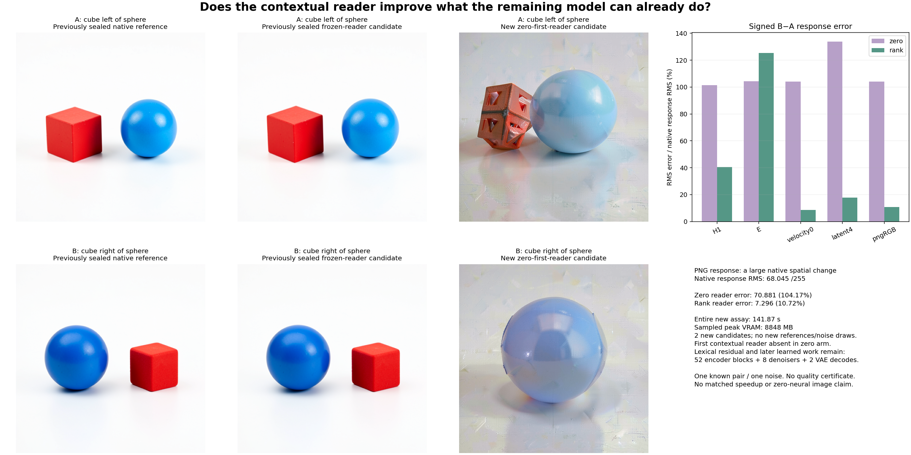

# The contextual reader contributes useful image computation

Cycle30 follow-up: the [uniform causal summary](uniform-reader-image.md) now executes its8,208-byte numerical state law exactly, but merges the objects and reaches122.68%pairedPNGerror. Its mixed endpoint/row improvements over zero remain visible. The original cycle29 contribution account follows.

Deleting the first contextual read degrades the tested images. The [frozen rank-one reader](raw-rank-one-image.md) preserves both objects and their left/right swap; zero A produces a distorted textured red object and zero B largely loses the red cube. Signed PNG response error is **104.17% for zero versus10.72% for rank-one**. This establishes useful rank-one contribution compared with deleting the read on this pair. It does not establish that query scoring, top4 selection or the expensive moment representation is necessary.

## The deletion keeps its own residual and continuation

The [executed plan](plans/zero-reader-image.md) starts from the same raw A/B red-cube/blue-sphere strings, complete151936-ID lexical table, template/tokenizer/positions/512-row mask and seed314159 noise. Both prompts have35attended and477padding rows. Previously observed native and rank-one targets remain sealed; only two new zero-reader candidates are generated. This is retrospective contribution research, not prospective quality certification.

A fresh positive-zero BF16 `[1,512,4096]` head bank enters the original block0 output projection. No approximate or exact first-layer contextual reader, Q/K score, selection, moment, envelope or fallback executes. Negative-zero bits are rejected. The lexical E/QKV lookup remains bundled and paid even though QKV are unused. The zero arm computes

$$
R_0^{(0)}=H_0+W_O0,\qquad
H_1^{(0)}=R_0^{(0)}+\operatorname{MLP}_0(\operatorname{Norm}(R_0^{(0)})).
$$

Every original full512-row block1…26 consumes that branch's actual preceding state. Actual H9/H18/H27 form E. Original four-step FLUX/scheduler/VAE consume its own E and latent, with unchanged profiles, inherited exact clocks and independently cloned noise. No reference state refresh, compact-GEMM change, new reference image, noise draw or parameter fit intervenes. All candidates seal before scoring accesses existing target values.

## Aggregate conditioning error ranks the readers differently from images

For each actual port, signed response error compares candidate B−A with native B−A using widened subtraction and the native response RMS denominator.

| Port | Zero error | Rank-one error |
|---|---:|---:|
| H1 |101.53%|40.59%|
| H2 |102.13%|50.05%|
| H9 |111.95%|90.77%|
| H18 |101.49%|121.46%|
| H27 |105.00%|126.93%|
| E |104.23%|125.43%|
| First context projection |103.66%|125.66%|
| First velocity |104.07%|8.65%|
| Final latent |133.84%|17.82%|
| Raw decoder |104.05%|10.63%|
| PNG RGB |104.17%|10.72%|

The native PNG response RMS is68.045 on0–255. Zero response RMS is35.289, error70.881 and cosine0.1773; rank-one response RMS is68.975, error7.296 and cosine0.99442. Endpoint PNG RMS errors are71.686/71.711 for zero versus6.191/4.058 for rank-one. Rank-one improves every scanline of both endpoint images.

The conditioning countertrend remains real. Rank-one has worse **paired E response** error, while its absolute endpoint E errors are much lower:6.64%/6.79% versus107.81%/107.81% for zero. Zero changes a large common state as well as the edit response; maximum absolute E discrepancy is15646. The image consumer is a function of complete E, not a scalar function of its paired error norm. These results do not isolate a universal downstream repair law or a specifically semantic direction.

Rank-one improves all35active endpoint E rows in each prompt, with507total improved rows in A and502in B. It worsens5/477padding rows in A and10/477in B. At H18,33/32rows worsen despite overall endpoint gains. All61,440dependent row/scanline accounts remain in the [lossless stream](results/zero-reader-image/observations.jsonl.gz); the number of independent prompt/noise specimens is not61,440.

## Expand the signed contribution

Let $\Delta_N,\Delta_Z,\Delta_R$ be native, zero and rank-one B−A responses. Define

$$
e_Z=\Delta_Z-\Delta_N,\quad q=\Delta_R-\Delta_Z,
\qquad e_R=e_Z+q.
$$

Then

$$
\|e_R\|^2=\|e_Z\|^2+\|q\|^2+2\langle e_Z,q\rangle.
$$

At PNG, the complete channel-sum account is

$$
3{,}951{,}127{,}805+3{,}984{,}874{,}335-7{,}894{,}141{,}898
=41{,}860{,}242.
$$

The contribution's cancellation exceeds its added power. At E, added power2,744,623.49 exceeds cancellation1,644,440.94: zero error energy2,454,854.54 becomes rank error3,555,037.10. A negative cross term alone does not imply improvement. These are exact decompositions of measured branch effects, not claims that one local head directly transports a fixed pixel vector through the nonlinear network. The code, retained `rankMinusZero` arrays and asymmetric-vector regression all use the same sign convention.

## Compute, custody and remaining work

Guarded CUDA job **`job-0b613bbe336d`** succeeds once in **141.87scheduler seconds**, with sampled peaks **7388.9MBRSS/8848MBVRAM**. Fresh-process phases are3.670slexical/zero-bank,71.194sencoder and44.855simages, including imports, source hashes/loading and captures. The lexical/zero-bank body has0.298sCPU versus3.580swall after imports. Timing differs from the earlier assay and is not a matched speedup comparison.

The first reader performs zero score products and holds no moment/index/envelope state. Remaining original work is unchanged:52native encoder blocks/52SDPA/372linears (**2.774Tnominal linear MACs**),8denoisers/8context projections/40joint/160single blocks,824transformer linears (**37.791Tnominal linear MACs**) and2VAEdecodes. Forty clock gathers replace clock affines. Original learned maps/VAE and historical lexical/clock compilation remain paid; zeroing one attention bank does not make an image generator zero-neural.

All133mechanics tests and isolated exact-payload imports pass. Source review corrected the contribution sign convention before staging. Declared/sealed/executed payload SHA is `7cc9dac1201ccc926b5ff6ce604a1e1349738caa6d0c259c37bc970d754de53d` (84,190B). [Independent byte verification](results/zero-reader-image/retained-array-verification.json) covers408members/1,146,426,436B, including complete zero/rank/native arrays, used atom shards, clocks/noise, differences and seals. The130new complete arrays/packets total554,741,996B and remain near compute. Primary publication is22files/6,855,375B plus separate figure/evidence receipts. [Saturn run](results/zero-reader-image-evidence/saturn-run.json) and [verify](results/zero-reader-image-evidence/saturn-verify.json) return0 for one61,440-record stream; `target-streams-only` is an instrument scope, not semantic certification.

[Astra's review](results/zero-reader-image-evidence/advisor.json) checks the original six PNGs, identities and consumer joins. The newest computation inventory and C whole-turn post reinforce a useful distinction: an executable state update can help one consumer and hurt another. Neither supplies a general zero-neural image law.

The [next single cut](plans/uniform-causal-reader.md) replaces the expensive first reader with uniform causal value accumulation. It keeps live prompt-derived context while removing query/key scores, anchors, top4, full K/V index and moment/envelope machinery. Numerical sums need8,192bytes plus count/control state; table reads and input/output buffers remain charged. Two candidates will test this smaller update law against existing full/rank/zero evidence. The plan is unexecuted. Arbitrary-prompt zero-neural generation remains active and unsolved.
